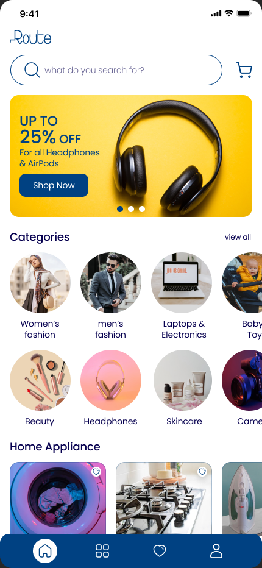
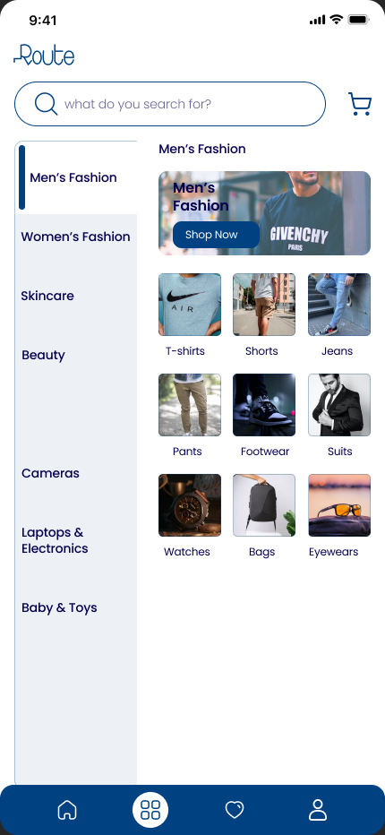
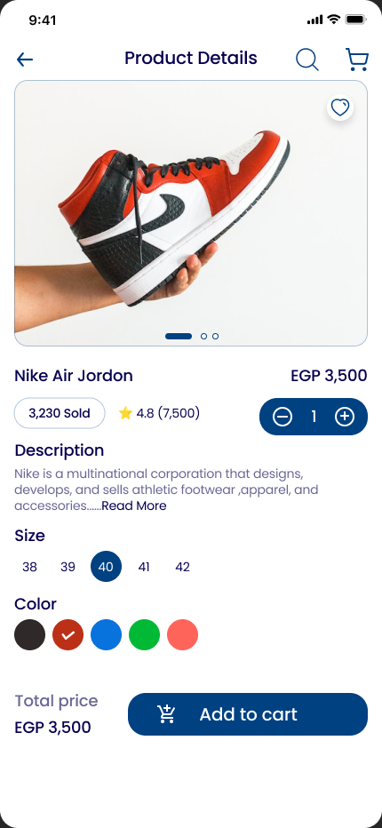
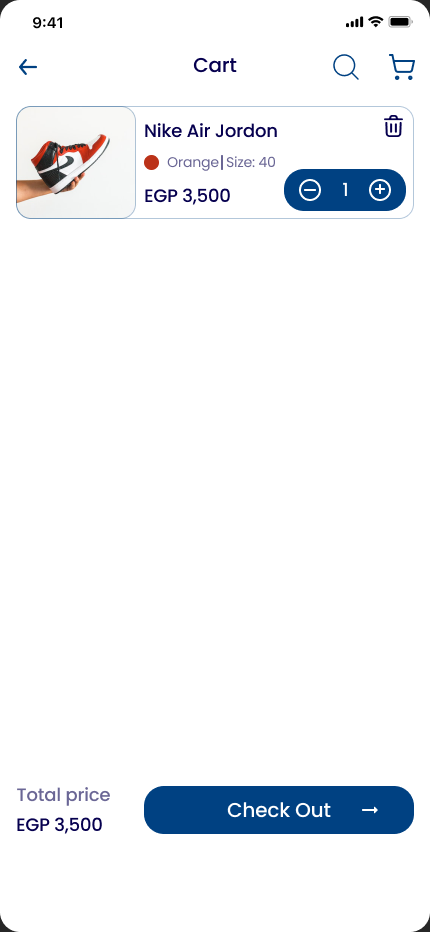
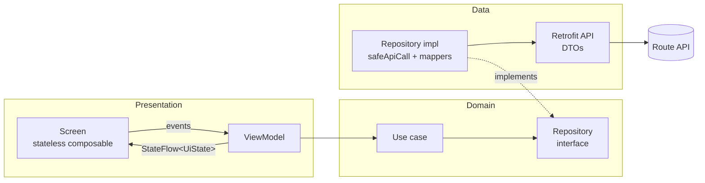

# Ecommerce Native C19

A native Android e-commerce client built with **Jetpack Compose**, **Clean Architecture** and **unidirectional
data flow**. It is a learning-first reference project: every layer has a real job, architecture decisions are
written down, and the codebase is small enough to read end to end.

The UI is implemented from a Figma design (10 screens) and is being connected, one vertical slice at a time, to
the public [Route E-commerce API](https://documenter.getpostman.com/view/5709532/2s93JqTRWN).

<p align="center">
  
  
  
  
</p>
<p align="center"><sub>Figma reference frames. The Compose implementation and its known deviations are documented in
<a href="docs/design-decisions/README.md">docs/design-decisions</a>.</sub></p>

---

## Contents

- [Project status](#project-status)
- [Tech stack](#tech-stack)
- [Architecture](#architecture)
- [Package structure](#package-structure)
- [Networking and error handling](#networking-and-error-handling)
- [Getting started](#getting-started)
- [Testing](#testing)
- [Documentation map](#documentation-map)
- [Contributing](#contributing)

## Project status

| Screen | UI | Data source |
|---|---|---|
| Splash, Sign in, Sign up | Done | Local state (auth not wired yet) |
| **Home** | Done | **Route API** (categories grid + three product rows ranked by sales, recency and rating; promo banners are static artwork) |
| **Categories** | Done | **Route API** (categories + sub-categories) |
| **Product list, Product details** | Done | **Route API** (products by sub-category with load-more paging, product by id) |
| Cart, Wishlist, Account | Done | Sample data |

**Next slices:** authentication (token storage) → cart and
wishlist → account. Each slice is delivered as a small, reviewed PR that takes one feature through
data → domain → presentation, with tests.

## Tech stack

| Concern | Choice | Notes |
|---|---|---|
| Language | Kotlin 2.2.10 | |
| UI | Jetpack Compose (BOM 2026.02.01), Material 3 | No XML layouts, Fragments or ViewBinding. Hand-owned light M3 theme with extended colors / typography / shapes in `ui/theme/` |
| Presentation | `ViewModel` + immutable `UiState` + `StateFlow` | Collected with `collectAsStateWithLifecycle` |
| Async | Kotlin coroutines and Flow | |
| Navigation | Navigation 3 (1.2.0) | App-owned per-tab back stacks in `navigation/AppNavigator.kt`, `NavDisplay` in `navigation/AppNavDisplay.kt`, entry-scoped ViewModels |
| DI | Koin 4.1.1 | Chosen over Hilt for simplicity and a future KMP path. All ViewModels come from per-feature Koin modules, checked by `KoinModulesTest`. 4.1.x because 4.2.x requires Kotlin 2.3 |
| Networking | Retrofit 3, OkHttp 5, kotlinx.serialization 1.9 | Compile-time serialization, no reflection |
| Images | Coil 3.3.0 (`coil-compose`, `coil-network-okhttp`) | Loader built in `EcommerceApp` on the app's OkHttpClient; no screen loads remote images yet. 3.3.x because 3.4+ requires Kotlin 2.3 |
| Testing | JUnit 4, kotlinx-coroutines-test, Robolectric, Roborazzi | Hand-written fakes, no mocking library |
| Build | AGP 9.4.1 (built-in Kotlin), Gradle 9.6, version catalog | `gradle/libs.versions.toml` |
| SDK | `minSdk` 24, `targetSdk` / `compileSdk` 37 | |

Dependencies are added only when a slice needs them. DataStore, for example, arrives with
the authentication slice.

## Architecture

The app follows Clean Architecture with three layers. Dependencies point inward: presentation knows the domain,
data implements the domain, and the domain knows neither.



Rules this codebase holds itself to:

- **Composables render and emit events.** They never touch the network, the database or business rules. Each
  feature has a `XxxRoute` (wires the ViewModel) and a stateless `XxxScreen` (previewable and screenshot-testable).
- **ViewModels own screen state.** The state is one immutable data class with explicit `Loading / Error / Empty /
  Content` status. There are no nullable "maybe loading" flags.
- **Use cases are the gateway** from presentation to data, even when they are thin, so behaviour has an obvious
  home when it grows.
- **Errors stop at the repository boundary.** Exceptions become `AppResult.Failure(AppError)`. ViewModels never
  see an exception.
- **DTOs never leave the data layer.** Mappers convert them into domain models.
- **Single module, modular packages.** `:app` is one Gradle module, but each `feature/<name>` keeps `data/`,
  `domain/` and `di/` sub-packages, so it can be extracted into its own module when that pays off.

For the reasoning behind these choices and the planned refactor roadmap, see
[`docs/architecture.md`](docs/architecture.md).

## Package structure

```
app/src/main/java/com/example/ecommercenativec19/
├── EcommerceApp.kt              # Application: starts Koin, builds the Coil image loader
├── di/                          # appModules: the single production Koin module list
├── MainActivity.kt              # Single activity, hosts the Compose tree
├── core/
│   ├── common/                  # AppResult / AppError (pure Kotlin)
│   ├── network/                 # Retrofit, OkHttp, Json, safeApiCall
│   └── ui/                      # Reusable design-system composables (ProductImage, StatusPane, price formatting)
├── feature/
│   ├── categories/              # First slice wired to the API
│   │   ├── data/                # CategoriesApi, DTOs, mapper, repository impl
│   │   ├── domain/              # Models, repository interface, use cases
│   │   ├── di/                  # Koin module
│   │   └── Categories*.kt       # Route, Screen, ViewModel, UiState
│   ├── products/                # Shared product data + domain (ProductsApi, mapper, repository, use cases)
│   ├── productlist/             # Sub-category product grid with load-more paging
│   ├── productdetails/          # Product by id: carousel, quantity and total
│   └── home/ cart/ wishlist/ account/ signin/ signup/ splash/
├── navigation/                  # NavKeys, AppNavigator (back stacks), NavDisplay, shared bottom bar
└── ui/theme/                    # Hand-owned Material 3 theme: Color, Type, Shape, ExtendedTheme, Theme
```

## Networking and error handling

- **Base URL:** `https://ecommerce.routemisr.com/`, exposed as `BuildConfig.BASE_URL` (set in `app/build.gradle.kts`).
- **Auth:** authenticated endpoints expect a custom `token` request header, not `Authorization: Bearer`.
- **Parsing:** `Json { ignoreUnknownKeys = true }`, and fields that are not guaranteed are nullable, so one
  malformed record cannot take a whole screen down.
- **Errors:** `safeApiCall` maps `IOException → AppError.Network`, `HttpException → AppError.Server(code)`,
  `SerializationException → AppError.Parsing` and anything else to `AppError.Unknown`. It rethrows `CancellationException` to keep structured concurrency intact.
- **Logging:** HTTP bodies are logged in debug builds only. The `token` and `Authorization` headers are redacted
  from the log output.
- **API notes:** the Postman collection ships without example responses, so every endpoint the app uses is
  documented from live calls in [`docs/api/`](docs/api/), including server quirks. For example, the
  documented nested sub-categories endpoint ignores its category id, so the app uses the
  `?category=` filter instead.

## Getting started

### Prerequisites

- A recent Android Studio release that supports **AGP 9.4**.
- JDK: the Gradle daemon toolchain (JDK 25) is provisioned automatically through the Foojay resolver.
- An emulator or device on API 24+ with internet access.

### Build and run

```bash
git clone <repo-url>
cd EcommerceNativec19
./gradlew assembleDebug        # build
./gradlew installDebug         # install on a connected device / emulator
```

No API key or secret is required: the Route API's catalogue endpoints are public. Never commit
`local.properties`, keystores or tokens. The `.gitignore` already excludes `local.properties`, keystores
(`*.jks`, `*.keystore`, `keystore.properties`), `.env*` files and `google-services.json`.

## Testing

```bash
./gradlew testDebugUnitTest          # unit tests (JVM)
./gradlew recordRoborazziDebug       # capture every screen with Robolectric + Roborazzi
```

What is tested, and why:

| Area | Examples |
|---|---|
| ViewModel state transitions | Loading → Content / Error / Empty, retry, selection changes, stale-response races |
| Data layer | DTO → domain mapping, repository success / failure, JSON parsing of real API payloads |
| Error mapping | `safeApiCall` for network, HTTP, unknown and cancellation cases |
| UI | Roborazzi captures of every screen rendered from sample state, compared against the Figma frames (opt-in, skipped in a normal test run) |

Coroutine tests use `StandardTestDispatcher` with explicit `advanceUntilIdle()`. No test sleeps or hits the
network.

## Documentation map

| Path | What it holds |
|---|---|
| [`docs/architecture.md`](docs/architecture.md) | Architecture rationale (layers, state, errors, Koin, navigation) and refactor roadmap |
| [`docs/api/`](docs/api/) | Request and response shapes captured from the live API, plus known quirks |
| [`docs/design-decisions/`](docs/design-decisions/README.md) | Per-screen Figma → Compose decisions, deviations and visual-check results |
| [`design/figma/`](design/figma/) | Figma reference frames, compose config and asset import tools |
| [`CLAUDE.md`](CLAUDE.md) | Engineering conventions this project follows (architecture, testing, PR discipline) |

## Contributing

- One small branch per task: `<type>/short-description` (for example `feat/categories-api`).
- Pull requests stay small, explain what changed, why and how it was verified, and never go straight to `main`.
- Before opening a PR, run `assembleDebug` and `testDebugUnitTest`. Re-capture screens with `recordRoborazziDebug` when UI changes.
- Comments explain *why*, not *what*. No secrets, local paths or personal data in commits.

## License

No license has been chosen yet. Until one is added, all rights are reserved by the author.
