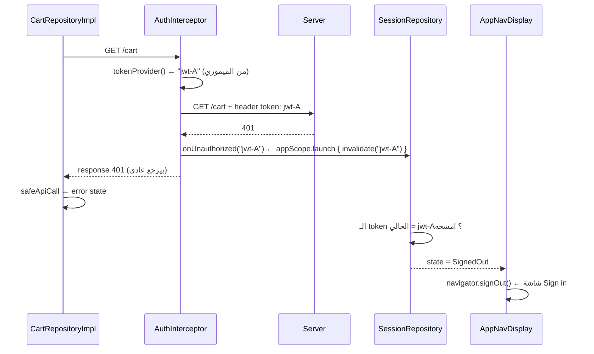

<div dir="rtl" align="right">

# شرح <code dir="ltr">AuthInterceptor</code> سطر بسطر

المسار: <code dir="ltr">app/src/main/java/com/example/ecommercenativec19/core/network/AuthInterceptor.kt</code>

ملفات مرتبطة: <code dir="ltr">NetworkModule.kt</code> (فين بيتعمل)، <code dir="ltr">AuthInterceptorTest.kt</code> (التستات)، و [session-walkthrough.md](session-walkthrough.md) (منين بيجي الـ <code dir="ltr">token</code> ولفين بيروح).

---

## الصورة الكبيرة الأول

الكلاس ده عنده **شغلانتين بس**:

1. **يحط الـ <code dir="ltr">token</code>** في كل request رايح للسيرفر، عشان الشاشات والـ APIs مايفكروش فيه خالص.
2. **يبلّغ** لو السيرفر رفض الـ <code dir="ltr">token</code> (رد بـ <code dir="ltr">401</code>)، عشان الـ session تتمسح واليوزر يرجع لـ Sign in.

### يعني إيه <code dir="ltr">Interceptor</code> أصلًا؟

الـ OkHttp بيبعت أي request عن طريق **سلسلة** (chain) من الـ interceptors. كل واحد بياخد الـ request، ممكن يعدّل فيه، يسلّمه للي بعده بـ <code dir="ltr">chain.proceed()</code>، ولما الرد يرجع ممكن يبص عليه أو يعدّله قبل ما يرجّعه.

</div>

<div dir="ltr" align="left">

```text
Retrofit (suspend fun getCart())
   │
   ▼
┌──────────────────────┐   request + header "token"
│ AuthInterceptor      │ ───────────────────────────┐
└──────────────────────┘                            ▼
                                ┌────────────────────────────────┐
                                │ SensitivePathLoggingInterceptor │ ← بيطبع في Logcat (و بيخفي الـ token)
                                └────────────────────────────────┘
                                                    │
                                                    ▼
                                          OkHttp internals ← الشبكة ← السيرفر
                                                    │
   ◄──────────────── response (200 / 401 / ...) ────┘
   AuthInterceptor يبص على الكود: 401؟ ← onUnauthorized(token)
```

</div>

<div dir="rtl" align="right">

ده نفس فكرة الـ <code dir="ltr">Interceptor</code> في Dio في Flutter (<code dir="ltr">onRequest</code> و <code dir="ltr">onResponse</code>)، بس في OkHttp الاتنين في دالة واحدة: الكود **قبل** <code dir="ltr">proceed()</code> = onRequest، والكود **بعده** = onResponse.

### الرحلة الكاملة لما السيرفر يرفض الـ token

</div>

<div dir="ltr" align="left">



</div>

<div dir="rtl" align="right">

لاحظ إن الـ interceptor **مابيعملش** navigation ولا بيمسح حاجة بنفسه. هو بس "بيبلّغ". وكل طبقة بتعمل شغلتها:

</div>

<div dir="ltr" align="left">

```text
AuthInterceptor  ← بيكتشف الـ 401 ويبلّغ
SessionRepository ← بيقرر يمسح ولا لأ (invalidate الآمن)
AppNavDisplay    ← بيلاحظ SignedOut وينقل الشاشة
```

</div>

<div dir="rtl" align="right">

---

## الـ KDoc

</div>

<div dir="ltr" align="left">

```kotlin
6  /**
7   * Adds the `token` header (the Route API does not use `Authorization: Bearer`) and reports a rejected token.
8   *
9   * [tokenProvider] must be a non-blocking read of an in-memory cache: interceptors run on OkHttp's threads.
10  * [onUnauthorized] fires only when a token was attached and the server answered 401, i.e. the session is expired or
11  * revoked. Sign-in and sign-up are exempt: they send no token, and their 401 means "wrong password".
12  */
```

</div>

<div dir="rtl" align="right">

- السطر 7: المعتاد في الـ APIs هو <code dir="ltr">Authorization: Bearer &lt;jwt&gt;</code>. بس الـ Route API اللي بنكلمه عايز header اسمه <code dir="ltr">token</code> والقيمة الـ jwt على طول من غير <code dir="ltr">Bearer</code>. الكومنت موجود عشان أي حد يقرا الكود ويقول "ده غلط، المفروض Bearer" يعرف إنه مقصود.
- السطر 9: ده **عقد** (contract) على اللي بيبني الـ interceptor. الـ <code dir="ltr">intercept()</code> بيشتغل على thread بتاع OkHttp، ولو <code dir="ltr">tokenProvider</code> قرا من الديسك أو استنى coroutine، كل request هيتأخر وممكن threads OkHttp تخلص. عشان كده الـ token بيتقرا من <code dir="ltr">StateFlow.value</code> (في الميموري). شوف <code dir="ltr">NetworkModule.kt</code> سطر 43 و 44.
- السطر 10: الـ <code dir="ltr">onUnauthorized</code> بيتنادى في حالة واحدة بس: **بعتنا token** و**السيرفر رد 401**. الحالتين مع بعض معناهم إن الـ token منتهي أو اتلغى.
- السطر 11: شاشات Sign in و Sign up مستثناه. هناك الـ <code dir="ltr">401</code> معناه "الباسورد غلط"، مش "الـ session خلصت". لو ماستثنيناهمش، يوزر كتب باسورد غلط وهو عنده session قديمة كان ممكن يتعمله sign out من غير سبب.

---

## الـ constructor

</div>

<div dir="ltr" align="left">

```kotlin
13 class AuthInterceptor(
14     private val tokenProvider: () -> String?,
15     private val onUnauthorized: (rejectedToken: String) -> Unit,
16 ) : Interceptor {
```

</div>

<div dir="rtl" align="right">

- السطر 13: الكلاس مالوش <code dir="ltr">@Inject constructor</code>. بيتعمل بإيدنا في <code dir="ltr">NetworkModule.provideOkHttpClient</code> لأنه محتاج lambdas، والـ lambdas مش حاجة Hilt يعرف يحقنها لوحده.
- السطر 14: **أهم قرار في الملف**: الـ interceptor بياخد **دالة** مش <code dir="ltr">SessionRepository</code>. ليه؟
  - أولًا **التست**: في <code dir="ltr">AuthInterceptorTest</code> بنباصي <code dir="ltr">{ token }</code> (متغير عادي) ونغيره من التست. مفيش fake repository، مفيش coroutines، مفيش DataStore.
  - ثانيًا **الفصل**: الـ interceptor مايعرفش إن فيه <code dir="ltr">SessionState</code> ولا <code dir="ltr">StateFlow</code>. هو بس عايز "هات الـ token لو موجود". لو مصدر الـ token اتغير بكرة، الكلاس ده مش هيتغير.
  - ثالثًا **الـ contract الـ synchronous**: النوع <code dir="ltr">() -&gt; String?</code> (مش <code dir="ltr">suspend</code>) بيجبر اللي بيبنيه إنه يدي قراءة فورية. يعني الكومبايلر بيمنعك تعمل الغلط اللي السطر 9 بيحذر منه.
  - الـ <code dir="ltr">String?</code>: الـ <code dir="ltr">null</code> معناه "مفيش session" ← مانحطش header.
- السطر 15: الـ <code dir="ltr">onUnauthorized</code> بيرجع <code dir="ltr">Unit</code> ومش <code dir="ltr">suspend</code> لنفس السبب: الـ interceptor مايقدرش يستنى. فاللي بيبنيه (<code dir="ltr">NetworkModule</code>) بيعمل <code dir="ltr">appScope.launch { ... }</code> ويرجع فورًا. الاسم <code dir="ltr">rejectedToken</code> في الـ type مجرد توثيق بيظهر في الـ IDE.
- السطر 16: الـ <code dir="ltr">Interceptor</code> هو <code dir="ltr">fun interface</code> من OkHttp فيه دالة واحدة: <code dir="ltr">intercept(chain)</code>.

---

## الدالة <code dir="ltr">intercept</code> (القلب)

</div>

<div dir="ltr" align="left">

```kotlin
18 override fun intercept(chain: Interceptor.Chain): Response {
19     val original = chain.request()
20     val token = tokenProvider()?.takeUnless { original.url.isCredentialEndpoint() }
21     val request = if (token == null) original else original.newBuilder().header(TOKEN_HEADER, token).build()
22     val response = chain.proceed(request)
23     if (token != null && response.code == HTTP_UNAUTHORIZED) onUnauthorized(token)
24     return response
25 }
```

</div>

<div dir="rtl" align="right">

- السطر 18: الدالة بتاخد <code dir="ltr">chain</code> وبترجع <code dir="ltr">Response</code>. لازم ترجع رد، يا إما من <code dir="ltr">chain.proceed()</code> يا إما تعمل واحد بنفسها (زي ما التست بيعمل).
- السطر 19: الـ request الأصلي اللي Retrofit عمله. الـ <code dir="ltr">Request</code> في OkHttp **immutable**، فمش هنعدل عليه، هنعمل نسخة.
- السطر 20: سطر كثيف، نفكه:

</div>

<div dir="ltr" align="left">

```kotlin
tokenProvider()                                    // "jwt-A" أو null
    ?.takeUnless { original.url.isCredentialEndpoint() }
// takeUnless { شرط } = لو الشرط true رجّع null، غير كده رجّع القيمة نفسها
```

</div>

<div dir="rtl" align="right">

النتيجة:

</div>

<div dir="ltr" align="left">

```text
مفيش session                      ← token = null
فيه session + /auth/signin        ← token = null   (مستثنى)
فيه session + /cart               ← token = "jwt-A"
```

</div>

<div dir="rtl" align="right">

ولاحظ إن الـ token **بيتقرا مرة واحدة بس** ويتخزن في متغير. ده مهم جدًا للسطر 23 (هنشرح ليه تحت).

- السطر 21: لو مفيش token نبعت الـ request زي ما هو. غير كده نعمل نسخة بـ <code dir="ltr">newBuilder()</code> ونضيف الـ header.
  - ليه <code dir="ltr">.header()</code> مش <code dir="ltr">.addHeader()</code>؟ الـ <code dir="ltr">header(name, value)</code> بيعمل **replace** لأي header بنفس الاسم، أما <code dir="ltr">addHeader</code> فبيضيف واحد كمان. لو حد بالغلط حط <code dir="ltr">token</code> في الـ Retrofit API، هيبقى فيه header واحد بس مش اتنين.
- السطر 22: هنا الـ request بيتسلّم للـ interceptor اللي بعده (الـ logging) وبعدين الشبكة. السطر ده **blocking**: بيستنى لحد ما الرد يوصل. كل اللي قبله = قبل الإرسال، وكل اللي بعده = بعد الرد.
- السطر 23: الشرط ليه جزئين:
  - أولًا <code dir="ltr">token != null</code>: يعني **إحنا اللي بعتنا token**. لو مابعتناش (مفيش session، أو sign in)، الـ 401 مالوش علاقة بالـ session.
  - ثانيًا <code dir="ltr">response.code == 401</code>: السيرفر رفض.
  - وبنبعت **نفس الـ token اللي اتبعت** (المتغير من السطر 20)، مش <code dir="ltr">tokenProvider()</code> تاني. ليه؟ تخيل:

</div>

<div dir="ltr" align="left">

```text
t0  GET /cart اتبعت بـ jwt-A
t1  اليوزر عمل sign in تاني ← tokenProvider() بقى بيرجع jwt-B
t2  رد /cart وصل: 401
```

</div>

<div dir="rtl" align="right">

لو بعتنا <code dir="ltr">tokenProvider()</code> في t2 كنا هنبلغ إن <code dir="ltr">jwt-B</code> اترفض وده كدب، والـ session الجديدة هتتمسح. لكن بإننا بنبعت <code dir="ltr">jwt-A</code>، الـ <code dir="ltr">SessionRepository.invalidate("jwt-A")</code> هيلاقي إن الحالي <code dir="ltr">jwt-B</code> فمش هيمسح حاجة. ده نص الحل؛ والنص التاني في <code dir="ltr">invalidate</code> (شوف [session-walkthrough.md](session-walkthrough.md)).

- السطر 23 كمان: لاحظ إن الـ interceptor **مابيعملش retry** ومابيغيّرش الرد. هو بيبلغ بس.
- السطر 24: الرد بيرجع زي ما هو، حتى لو 401. الـ repository اللي طلب (مثلًا <code dir="ltr">CartRepositoryImpl</code>) هيشوف 401 عن طريق <code dir="ltr">safeApiCall</code> ويحوّله لـ error state عادي. الـ interceptor مش بيبلع الخطأ.

---

## الـ <code dir="ltr">companion object</code>

</div>

<div dir="ltr" align="left">

```kotlin
27 companion object {
28     const val TOKEN_HEADER = "token"
29     private const val HTTP_UNAUTHORIZED = 401
30 }
```

</div>

<div dir="rtl" align="right">

- السطر 28: الثابت ده **public** (مش <code dir="ltr">private</code>). ليه؟ عشان أي مكان تاني محتاج اسم الـ header (زي الـ logging اللي بيعمل <code dir="ltr">redactHeader</code>) يقدر يستخدمه. بس حاليًا <code dir="ltr">NetworkModule</code> كاتب <code dir="ltr">"token"</code> كـ string مباشرة في السطر 51، فلو حد غير الثابت ده ونسي هناك، الـ token هيظهر في اللوجز. الأنضف يبقى <code dir="ltr">redactHeader(AuthInterceptor.TOKEN_HEADER)</code>.
- السطر 29: الرقم 401 كثابت باسم واضح بدل magic number.

---

## الدالة <code dir="ltr">isCredentialEndpoint</code>

</div>

<div dir="ltr" align="left">

```kotlin
33 private fun okhttp3.HttpUrl.isCredentialEndpoint(): Boolean {
34     val path = encodedPath
35     return path.endsWith("/auth/signin") || path.endsWith("/auth/signup")
36 }
```

</div>

<div dir="rtl" align="right">

- السطر 33: الدالة extension على <code dir="ltr">HttpUrl</code> و <code dir="ltr">private</code> على مستوى الملف (top-level private)، يعني مش ظاهرة برّه الملف ده خالص. كتبنا <code dir="ltr">okhttp3.HttpUrl</code> بالاسم الكامل بدل <code dir="ltr">import</code> لأنها الاستخدام الوحيد.
- السطر 34: الـ <code dir="ltr">encodedPath</code> هو الـ path بس من غير الدومين والـ query. مثلًا <code dir="ltr">https://x.com/api/v1/auth/signin?x=1</code> ← <code dir="ltr">/api/v1/auth/signin</code>. فالـ query مش هتبوظ المقارنة.
- السطر 35: استخدمنا <code dir="ltr">endsWith</code> بدل مقارنة بالـ path كامل لأن الـ base URL فيه prefix (<code dir="ltr">/api/v1/</code>) ممكن يتغير. والمقارنة بتشمل <code dir="ltr">/auth/</code> عشان مايطابقش path تاني بالصدفة.
- إيه اللي **مش** مستثنى عن قصد؟ الـ <code dir="ltr">/auth/verifyToken</code>. ده محتاج الـ token عشان يتأكد منه، فلازم يتبعت. والتست <code dir="ltr">attaches the token to verifyToken</code> بيحمي النقطة دي.

---

## فين بيتعمل: <code dir="ltr">NetworkModule.kt</code>

</div>

<div dir="ltr" align="left">

```kotlin
42 val auth = AuthInterceptor(
43     // Cached StateFlow value: never blocks an OkHttp thread on disk.
44     tokenProvider = { (sessionRepository.state.value as? SessionState.SignedIn)?.token },
45     onUnauthorized = { rejected -> appScope.launch { sessionRepository.invalidate(rejected) } },
46 )
...
63 // Auth first: the logger then sees (and redacts) the token header it adds.
64 .addInterceptor(auth)
65 .addInterceptor(logging)
```

</div>

<div dir="rtl" align="right">

- السطر 44: الـ <code dir="ltr">state.value</code> قراءة فورية من الميموري. والـ <code dir="ltr">as? SignedIn</code> بيرجع <code dir="ltr">null</code> لو الحالة <code dir="ltr">Loading</code> أو <code dir="ltr">SignedOut</code>، والنتيجة <code dir="ltr">?.token</code> تبقى <code dir="ltr">null</code> ← مفيش header.
- السطر 45: الـ <code dir="ltr">invalidate</code> هي <code dir="ltr">suspend</code> (بتكتب في DataStore)، فبنعملها <code dir="ltr">launch</code> في <code dir="ltr">ApplicationScope</code>:
  - ليه مش <code dir="ltr">runBlocking</code>؟ لأنه هيوقف thread بتاع OkHttp لحد ما الكتابة تخلص.
  - ليه <code dir="ltr">ApplicationScope</code> مش <code dir="ltr">viewModelScope</code>؟ لأن الـ interceptor مالوش شاشة، وممكن الشاشة اللي طلبت تكون اتقفلت. الـ scope ده عايش طول عمر البروسيس.
- السطر 64 و 65: **الترتيب مهم**. الـ interceptors بتشتغل بترتيب الإضافة. الـ auth الأول بيضيف الـ header، والـ logging بعده بيشوف الـ request **النهائي** (فيه الـ header) ويطبعه بعد ما يخفيه بـ <code dir="ltr">redactHeader</code>. لو عكسنا الترتيب، اللوج هيورّي request من غير token، وهتتلخبط وانت بتعمل debug ("ليه مفيش token؟").

---

## التستات: <code dir="ltr">AuthInterceptorTest.kt</code>

### الفكرة: OkHttp حقيقي من غير شبكة

</div>

<div dir="ltr" align="left">

```kotlin
23 private val client = OkHttpClient.Builder()
24     .addInterceptor(AuthInterceptor(tokenProvider = { token }, onUnauthorized = { rejected += it }))
25     .addInterceptor { chain ->
26         sentRequest = chain.request()
27         Response.Builder()
28             .request(chain.request())
29             .protocol(Protocol.HTTP_1_1)
30             .code(status)
31             .message("test")
32             .body("{}".toResponseBody())
33             .build()
34     }
35     .build()
```

</div>

<div dir="rtl" align="right">

- السطر 24: الـ <code dir="ltr">tokenProvider</code> بيقرا متغير <code dir="ltr">token</code> في التست، فكل تست يحط القيمة اللي عايزها. والـ <code dir="ltr">onUnauthorized</code> بيضيف في ليستة <code dir="ltr">rejected</code> عشان نتأكد اتنادى بإيه وكام مرة.
- السطر 25 لـ 34: interceptor تاني **مزيف** آخر السلسلة. بدل ما يكمل للشبكة، بيعمل حاجتين:
  - أولًا يمسك الـ request اللي وصله (<code dir="ltr">sentRequest</code>)، عشان نتأكد الـ header اتحط أو لأ.
  - ثانيًا يرجّع رد مزيف بالكود اللي التست عايزه (<code dir="ltr">status</code>).
  - ده بيخلينا نتست الـ interceptor جوه <code dir="ltr">OkHttpClient</code> **حقيقي** (نفس الـ chain الحقيقية) من غير <code dir="ltr">MockWebServer</code> ولا إنترنت.
- السطر 38: الـ <code dir="ltr">.execute()</code> بيبعت synchronous، والـ <code dir="ltr">.close()</code> بيقفل الرد عشان مايبقاش فيه resource leak.

| التست | بيثبت إيه |
|------|-----------|
| الحالة <code dir="ltr">adds the token header when a session exists</code> | فيه session ← الـ header بيتحط |
| الحالة <code dir="ltr">sends no token header when signed out</code> | مفيش session ← مفيش header |
| الحالة <code dir="ltr">never attaches the token to sign in or sign up</code> | الـ signin و signup مستثنيين |
| الحالة <code dir="ltr">attaches the token to verifyToken</code> | الاستثناء مش واسع زيادة عن اللزوم |
| الحالة <code dir="ltr">reports the rejected token on 401 for an authenticated request</code> | الـ 401 مع token ← بلّغ بنفس الـ token |
| الحالة <code dir="ltr">ignores 401 when no token was attached</code> | الـ 401 من غير token ← تجاهل |
| الحالة <code dir="ltr">ignores 401 from sign in because it means wrong password</code> | الباسورد الغلط مش sign out |
| الحالة <code dir="ltr">ignores other error codes</code> | الـ 500 مش مشكلة session |

---

## القرارات والبدائل

| القرار | البديل | ليه اخترنا ده |
|--------|--------|----------------|
| الـ <code dir="ltr">Interceptor</code> يراقب الـ 401 | الـ <code dir="ltr">Authenticator</code> بتاع OkHttp | الـ <code dir="ltr">Authenticator</code> معمول للـ retry بـ credentials جديدة (refresh token). الـ API مفيهوش refresh، فمفيش حاجة نعمل بيها retry |
| الـ lambdas في الـ constructor | يحقن <code dir="ltr">SessionRepository</code> مباشرة | تست من غير coroutines + الـ interceptor مايعرفش الـ session |
| الـ <code dir="ltr">tokenProvider</code> synchronous | قراءة <code dir="ltr">suspend</code> من DataStore | الـ OkHttp threads مينفعش تستنى |
| بلّغ بالـ token اللي اتبعت | بلّغ بـ <code dir="ltr">tokenProvider()</code> تاني | يمنع مسح session جديدة بسبب رد قديم |
| الـ 401 بس | الـ 401 و 403 | الـ 403 معناه "مسموحلكش" مش "الـ session خلصت" |
| الـ header في interceptor واحد | <code dir="ltr">@Header("token")</code> في كل API | مكان واحد، مستحيل حد ينساه في endpoint جديد |

---

## القيود والحاجات اللي تتراجع

- **الـ redirect لدومين تاني**: لو السيرفر رد بـ redirect (<code dir="ltr">3xx</code>) لدومين مختلف، OkHttp بيمشي وراه أوتوماتيك، وعلى حد علمي بيشيل header الـ <code dir="ltr">Authorization</code> بس في الحالة دي. أما الـ <code dir="ltr">token</code> فهو header باسم custom، فغالبًا هيتبعت للدومين التاني. الـ Route API مابيعملش redirects حاليًا، بس لو حصل ده يبقى تسريب. الحل لو احتجنا: <code dir="ltr">followRedirects(false)</code> أو تشيك على الـ host قبل ما تحط الـ header. ده محتاج تأكيد بتست قبل ما نعتبره bug.
- **الاسم مكتوب مرتين**: الـ <code dir="ltr">"token"</code> مكتوب كـ string في <code dir="ltr">redactHeader("token")</code> في <code dir="ltr">NetworkModule</code> بدل <code dir="ltr">AuthInterceptor.TOKEN_HEADER</code>. لو حد غير واحد ونسي التاني، الـ token هيظهر في الـ Logcat.
- **كذا 401 مع بعض**: لو 5 requests رجعوا 401 في نفس الوقت، <code dir="ltr">invalidate</code> هيتنادى 5 مرات. ده آمن لأن الـ <code dir="ltr">invalidate</code> idempotent (أول مرة بتمسح والباقي مالهمش أثر)، بس فيه شغل زيادة بسيط.
- **الاستثناء بالـ path**: لو الـ API ضاف endpoint جديد للـ credentials (مثلًا <code dir="ltr">/auth/forgotPassword</code>)، لازم يتضاف لـ <code dir="ltr">isCredentialEndpoint</code> يدوي. ولو اتنسى، الـ 401 بتاعه هيعمل sign out.

---

## أسئلة اختبر بيها نفسك

1. ليه الـ <code dir="ltr">token</code> بيتقرا مرة واحدة في السطر 20 ويتستخدم في السطر 23، بدل ما ننادي <code dir="ltr">tokenProvider()</code> تاني؟ ارسم الـ timeline.
2. ليه <code dir="ltr">tokenProvider</code> نوعه <code dir="ltr">() -&gt; String?</code> ومش <code dir="ltr">suspend () -&gt; String?</code>؟
3. إيه اللي هيحصل لو شيلنا الاستثناء بتاع <code dir="ltr">/auth/signin</code>، واليوزر عنده session قديمة وكتب باسورد غلط؟
4. ليه الـ auth interceptor بيتضاف **قبل** الـ logging؟
5. إمتى كنت هتستخدم <code dir="ltr">Authenticator</code> بدل <code dir="ltr">Interceptor</code>؟
6. الـ interceptor بيرجّع الـ 401 للـ repository عادي. مين اللي بينقل اليوزر لشاشة Sign in في الآخر، وإزاي الإشارة بتوصله؟

</div>
