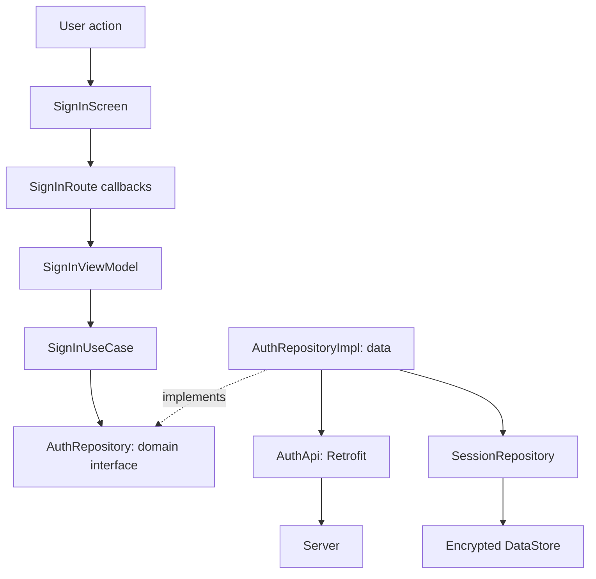
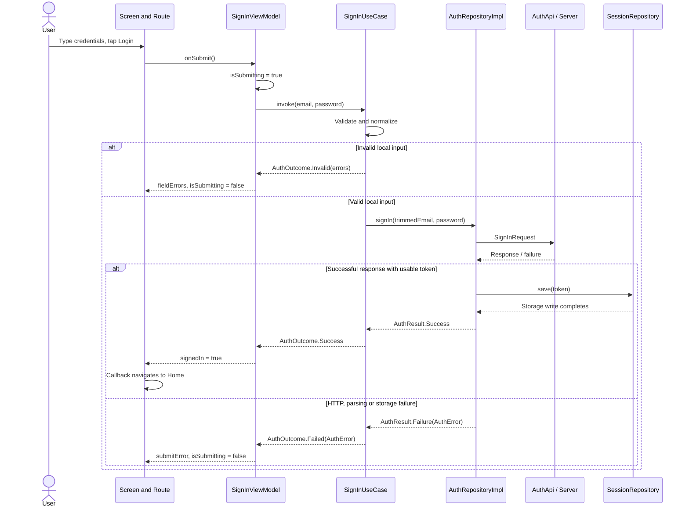

<div dir="rtl" align="right">

# شرح Auth للطلبة: رحلة المستخدم والداتا والـSession خطوة بخطوة

دليل للمحاضر مبني على كود المشروع بتاريخ **28 أكتوبر 2026**. تقدر تفتحه جنب Android Studio وتمشي بنفس ترتيب الفقرات. الأمثلة بيانات تعليمية وهمية. الهدف إن الطالب يتتبع التنفيذ ويعرف مسؤولية كل طبقة، مش يحفظ أسماء الملفات.

للتفاصيل المستقلة: [شرح session](session-walkthrough.md)، [شرح navigation](navigation-walkthrough.md)، [توثيق API داخل المشروع](api/auth.md).

## 1. ابدأ المحاضرة بالمشكلة اللي المستخدم شايفها

قول للطلبة:

> المستخدم عايز يكتب الإيميل والباسورد ويدخل. إحنا محتاجين نتحقق من المدخلات، نبعتها للسيرفر، نحفظ إثبات الدخول، نعرض الخطأ لو حصل، ونخلي باقي الطلبات تعرف إنه دخل. ولما يقفل التطبيق ويفتحه، نقدر نستعيد جلسته.

قسّمها لخمس رحلات:

1. فتح التطبيق وتحديد هل فيه جلسة محفوظة.
2. تسجيل الدخول Sign in.
3. إنشاء حساب Sign up والدخول بعده.
4. استخدام الجلسة في طلبات مثل Cart وWishlist.
5. الخروج يدويًا، أو انتهاء الجلسة بعد رفض السيرفر للـtoken.

ما تبدأش بـHilt أو Retrofit. ابدأ بضغطة Login، وبعد ما يفهموا المسار وضّح مين بنى الأوبجكتات.

### ترتيب مقترح للشرح

| الجزء | زمن تعليمي تقريبي | النتيجة اللي الطالب يطلع بيها |
|---|---|---|
| رحلة المستخدم وخريطة الطبقات | 10 دقائق | يميز UI state عن session state |
| كتابة البيانات والـvalidation | 15 دقيقة | يعرف إمتى مفيش request أصلًا |
| request وresponse ومسار الأخطاء | 20 دقيقة | يتتبع تحويل أنواع النتائج |
| حفظ token واستعادته وcache | 20 دقيقة | يفرق بين كتابة الديسك وتحديث StateFlow |
| interceptor وlogout والتطبيق العملي | 20 دقيقة | يتتبع جلسة كاملة من البداية للنهاية |

دي خطة تدريس مقترحة، مش قياس لزمن تنفيذ التطبيق.

## 2. خريطة الملفات قبل ما نضغط Login

المسار الأساسي للكود: <code dir="ltr">app/src/main/java/com/example/ecommercenativec19/</code>.

</div>

<div dir="ltr" align="left">

```text
feature/signin/          presentation لتسجيل الدخول
  SignInScreen.kt        يرسم الحقول والأخطاء ويرسل events
  SignInRoute.kt         يربط Screen بالـViewModel وبـnavigation callbacks
  SignInViewModel.kt     يدير UiState ويستدعي use case
  SignInUiState.kt       قيم الحقول وحالة الإرسال ونتيجته

feature/signup/          نفس التقسيم لإنشاء حساب

feature/auth/
  domain/               validation، use cases، العقود وأنواع النتائج
  data/                 Retrofit API، DTOs، AuthRepositoryImpl
  di/AuthModule.kt       توصيل العقد بتنفيذه وتهيئة AuthApi
  ui/AuthMessages.kt     تحويل الأخطاء لنصوص العرض

core/session/            امتلاك token وتخزينه وتقديم حالة الجلسة
core/network/            HTTP client، interceptor، تحويل exceptions
feature/splash/          قرار وجهة البداية بعد تحميل الجلسة
navigation/              ربط نجاح الدخول/الخروج بتغيير الشاشات
```

</div>

<div dir="rtl" align="right">

**ملاحظة معمارية:** presentation هنا متوزعة في <code dir="ltr">signin</code> و<code dir="ltr">signup</code> و<code dir="ltr">auth/ui</code>، مش داخل مجلد اسمه <code dir="ltr">auth/presentation</code>. نشرح الموجود بدل ما نفترض structure مختلفة. و<code dir="ltr">core/session</code> يجمع عقد الجلسة وتنفيذ التخزين؛ مش كل ما داخل core يبقى domain.

### اتجاه الاعتماد غير ترتيب تنفيذ الطلب

وقت التشغيل، الاستدعاء يمشي: presentation → domain use case → repository implementation → API. لكن الـuse case في الكود يعتمد على **AuthRepository interface الموجود في domain**. الـdata implementation هو اللي يطبق العقد؛ الدومين لا يستورد <code dir="ltr">AuthRepositoryImpl</code> أو Retrofit.

</div>

<div dir="ltr" align="left">



</div>

<div dir="rtl" align="right">

الخط المتقطع «implements» مش خطوة request إضافية. وقت التنفيذ Hilt يحقن implementation وراء الـinterface.

## 3. رحلة Sign in: المستخدم كتب وضغط Login

### الخطوة 1: المستخدم يكتب الإيميل والباسورد

افتح [SignInScreen.kt](../app/src/main/java/com/example/ecommercenativec19/feature/signin/SignInScreen.kt)، ثم [SignInRoute.kt](../app/src/main/java/com/example/ecommercenativec19/feature/signin/SignInRoute.kt).

</div>

<div dir="ltr" align="left">

```text
AuthTextField.onValueChange
  -> onEmailChange(value)
  -> viewModel.onEmailChange(value)
  -> _uiState.update { it.copy(email = value, ...) }
  -> uiState emits updated state
  -> Route observes it
  -> Screen receives updated state
```

</div>

<div dir="rtl" align="right">

نفس المسار للباسورد. الـScreen لا يخزن النص داخل repository ولا يرسل request عند كل حرف. الـViewModel يمسك قيم الحقول في <code dir="ltr">SignInUiState</code>. الـRoute يجمعها باستخدام <code dir="ltr">collectAsStateWithLifecycle()</code> ويمررها للشاشة.

أثناء تعديل حقل، الـViewModel يشيل خطأ الحقل ده فقط ويشيل <code dir="ltr">submitError</code> القديم. ده **تنسيق state**، مش إعادة validation كاملة عند كل حرف. تغيير إظهار الباسورد يقلب <code dir="ltr">passwordVisible</code> فقط، والـScreen يختار visual transformation.

اسأل الطلبة: «هل إخفاء الباسورد بالنقط معناه إنه اتشفّر؟» الإجابة: لأ؛ ده سلوك عرض، والقيمة نفسها لسه موجودة في الذاكرة.

### الخطوة 2: ضغطة Login تتحول إلى action

في Screen: <code dir="ltr">AppButton(onClick = onSignIn)</code>، وفي Route: <code dir="ltr">onSignIn = viewModel::onSubmit</code>. زر Done في الكيبورد بيوصل لنفس callback.

افتح [SignInViewModel.kt](../app/src/main/java/com/example/ecommercenativec19/feature/signin/SignInViewModel.kt):

</div>

<div dir="ltr" align="left">

```kotlin
val current = _uiState.value
if (current.isSubmitting) return
_uiState.update {
    it.copy(isSubmitting = true, fieldErrors = emptyMap(), submitError = null)
}
```

</div>

<div dir="rtl" align="right">

فسّر بالترتيب:

1. يأخذ snapshot للبيانات وقت الضغطة؛ المحاولة تستخدم <code dir="ltr">current.email</code> و<code dir="ltr">current.password</code>.
2. يمنع محاولة ثانية لو واحدة شغالة. ده مهم حتى لو الزر disabled، لأن الاستدعاء ممكن ييجي من الكيبورد أو test.
3. يعلن إن المحاولة بدأت وينظف أخطاء المحاولة السابقة.
4. يطلق coroutine في <code dir="ltr">viewModelScope</code> ويستدعي <code dir="ltr">signIn(current.email, current.password)</code>.

الـScreen يعطل زر Login عن طريق <code dir="ltr">enabled = !state.isSubmitting</code>. **التنفيذ الحالي لا يرسم spinner للزر**؛ ما توعدش الطلبة بواجهة تحميل مش موجودة. كمان <code dir="ltr">isSubmitting</code> يبدأ قبل validation، لكن validation السريع ممكن ينتهي قبل ما frame تعرض تعطيل الزر.

<code dir="ltr">viewModelScope</code> مش معناه إن كل سطر انتقل تلقائيًا لخلفية. العمليات blocking مثل التشفير محتاجة مراعاة dispatcher؛ مش أي <code dir="ltr">suspend</code> يبقى thread switch.

### الخطوة 3: الدومين يقرر هل نقدر نبعت الطلب

افتح [SignInUseCase.kt](../app/src/main/java/com/example/ecommercenativec19/feature/auth/domain/SignInUseCase.kt) و[AuthValidation.kt](../app/src/main/java/com/example/ecommercenativec19/feature/auth/domain/AuthValidation.kt).

الـuse case يجمع كل أخطاء الحقول في <code dir="ltr">Map&lt;AuthField, FieldError&gt;</code>:

- الإيميل لازم مايبقاش blank ويعدّي regex المحلي بعد <code dir="ltr">trim()</code>.
- باسورد تسجيل الدخول لازم مايبقاش empty؛ **مش بيتطبق عليه شرط الـ6 حروف بتاع إنشاء الحساب**.
- لو فيه أخطاء يرجع <code dir="ltr">AuthOutcome.Invalid(errors)</code> فورًا؛ لا ينادي repository ولا network ولا session.
- لو مفيش، ينادي <code dir="ltr">repository.signIn(email.trim(), password)</code>.

ليه مش بنعمل <code dir="ltr">trim()</code> للباسورد؟ لأن المسافات ممكن تكون جزء من credential الفعلي. تغييرها يغير اللي المستخدم كتبه. والـvalidation المحلي لتقليل المحاولات غير الصالحة وتحسين الرسائل؛ السيرفر يفضل صاحب القرار النهائي لقبول credentials.

**تجربة قصيرة:** إيميل <code dir="ltr">nope</code> وباسورد فاضي يرجع خطأين في نفس المحاولة. الشبكة ممكن تكون مفتوحة أو مقفولة؛ النتيجة المحلية واحدة لأننا لم نصل لها.

### الخطوة 4: الداتا تحول المدخلات إلى request DTO

افتح [AuthRepository.kt](../app/src/main/java/com/example/ecommercenativec19/feature/auth/domain/AuthRepository.kt)، ثم [AuthRepositoryImpl.kt](../app/src/main/java/com/example/ecommercenativec19/feature/auth/data/AuthRepositoryImpl.kt).

العقد يقول:

</div>

<div dir="ltr" align="left">

```kotlin
suspend fun signIn(email: String, password: String): AuthResult
```

</div>

<div dir="rtl" align="right">

التنفيذ يحول القيم إلى <code dir="ltr">SignInRequest(email, password)</code> ثم يستدعي <code dir="ltr">api.signIn(...)</code> داخل helper مشتركة اسمها <code dir="ltr">authenticate</code>.

الـDTO في [AuthDtos.kt](../app/src/main/java/com/example/ecommercenativec19/feature/auth/data/AuthDtos.kt) يمثل صيغة الشبكة. مش بنمرره للـViewModel؛ لو السيرفر غيّر JSON نراجع data layer بدل ربط الشاشة بشكله مباشرةً.

### الخطوة 5: Retrofit وOkHttp يبعثوا الطلب

افتح [AuthApi.kt](../app/src/main/java/com/example/ecommercenativec19/feature/auth/data/AuthApi.kt):

</div>

<div dir="ltr" align="left">

```kotlin
@POST("api/v1/auth/signin")
suspend fun signIn(@Body request: SignInRequest): Response<AuthResponseDto>
```

</div>

<div dir="rtl" align="right">

الجسم التعليمي المتوقع من الـDTO:

</div>

<div dir="ltr" align="left">

```json
{
  "email": "student@example.com",
  "password": "example-password"
}
```

</div>

<div dir="rtl" align="right">

الـbase URL والـclient والـJSON converter مجهزين في [NetworkModule.kt](../app/src/main/java/com/example/ecommercenativec19/core/network/NetworkModule.kt). الـAuthInterceptor ضمن السلسلة، لكنه **يستثني signin/signup من إضافة token**. الـlogin يرسل credentials للحصول على token؛ مش محتاج token سابق علشان يدخل.

الطلب هنا يرجع <code dir="ltr">Response&lt;AuthResponseDto&gt;</code> عشان الريبو يفحص status code وerror body بنفسه. رجوع <code dir="ltr">Response</code> لا يلغي احتمالات network/serialization exceptions.

### الخطوة 6: نمسك response ونحدد هل نجح فعلًا

في <code dir="ltr">authenticate</code>، [safeApiCall](../app/src/main/java/com/example/ecommercenativec19/core/network/SafeApiCall.kt) يحول exceptions إلى <code dir="ltr">AppResult</code>:

| ما حدث | النتيجة العامة |
|---|---|
| <code dir="ltr">IOException</code> من الطلب | <code dir="ltr">AppError.Network</code> |
| <code dir="ltr">SerializationException</code> | <code dir="ltr">AppError.Parsing</code> |
| <code dir="ltr">HttpException</code> إن رُميت | <code dir="ltr">AppError.Server(code)</code> |
| exception أخرى | <code dir="ltr">AppError.Unknown</code> |
| cancellation | تُعاد رميها؛ مش خطأ نعرضه للمستخدم |

**دي نقطة مهمة في التدريس:** <code dir="ltr">AppResult.Success(response)</code> هنا معناها إن block رجعت Response بدون exception. لو Response كودها 401 أو 500، لازم <code dir="ltr">toAuthResult()</code> تفحص <code dir="ltr">isSuccessful</code>؛ مش نجاح business تلقائيًا.

### الخطوة 7: عند HTTP ناجح، نستخرج token ونحفظه

المقتطف التالي من <code dir="ltr">toAuthResult()</code> مختصر للخط الأساسي؛ الكود الكامل فيه catch ومعالجة فشل الحفظ:

</div>

<div dir="ltr" align="left">

```kotlin
val token = body()?.token?.takeIf { it.isNotBlank() }
    ?: return AuthResult.Failure(AuthError.Other(AppError.Parsing))
sessions.save(token)
return AuthResult.Success
```

</div>

<div dir="rtl" align="right">

بالترتيب:

1. Retrofit converter يقرأ JSON ويكوّن <code dir="ltr">AuthResponseDto</code>؛ الـrepository يقرأ <code dir="ltr">body()?.token</code>.
2. <code dir="ltr">ignoreUnknownKeys = true</code> يسمح بتجاهل حقول response الإضافية؛ DTO هنا مهتم بالـtoken فقط.
3. token غائب/غير صالح أثناء parsing أو body فارغة/قيمة blank يمنع إعلان النجاح.
4. <code dir="ltr">AuthRepositoryImpl</code> ينادي <code dir="ltr">SessionRepository.save(token)</code> وينتظر انتهاء الحفظ.
5. لو التشفير أو الكتابة فشلوا، يرجع <code dir="ltr">AuthError.Other(AppError.Unknown)</code> بدل نجاح UI. cancellation تُعاد رميها.
6. <code dir="ltr">AuthResult.Success</code> يعني إن token اتحفظ محليًا بنجاح وفق عقد الجلسة، مش مجرد إن HTTP رجع 200.

الـViewModel **لا يستلم token**. مش محتاجه علشان يقول للمستخدم «دخلت»، والاحتفاظ به في كل screen state هيكرر الملكية ويوسع أماكن تعريضه للتسريب.

### الخطوة 8: النتيجة ترجع للدومين ثم presentation

</div>

<div dir="ltr" align="left">

```text
AuthRepositoryImpl
  -> AuthResult.Success
SignInUseCase
  -> AuthOutcome.Success
SignInViewModel
  -> UiState(isSubmitting=false, signedIn=true)
SignInRoute
  -> observes signedIn=true
  -> onSignedIn()
AppNavDisplay
  -> navigator.completeAuth()
AppNavigator
  -> clears authStack and opens Home tab
```

</div>

<div dir="rtl" align="right">

في الـViewModel، <code dir="ltr">AuthOutcome.Invalid</code> تتحول إلى <code dir="ltr">fieldErrors</code>، و<code dir="ltr">AuthOutcome.Failed</code> إلى <code dir="ltr">submitError</code>، وكل الفروع تنهي <code dir="ltr">isSubmitting</code>.

في Route:

</div>

<div dir="ltr" align="left">

```kotlin
LaunchedEffect(state.signedIn) {
    if (state.signedIn) currentOnSignedIn()
}
```

</div>

<div dir="rtl" align="right">

ليه effect؟ لأن التنقل أثر جانبي ناتج عن state، ومش نداء نعمله في جسم composable كل مرة يترسم. <code dir="ltr">rememberUpdatedState(onSignedIn)</code> يوفر أحدث callback داخل effect. <code dir="ltr">signedIn</code> flag يحتفظ بنجاح العملية عبر recompositions، والانتقال يزيل auth entry؛ ده تصميم المشروع بدل event channel. مش ضمان exactly-once لكل سيناريو restore أو إعادة دخول composition ممكن تتخيله.

## 4. الداتا رايحة وراجعة: ارسم الرحلة دي على السبورة

</div>

<div dir="ltr" align="left">



</div>

<div dir="rtl" align="right">

المسار ده بيرسم نداء الوظيفة ورجوع نتيجتها. تحديث **session cache** مسار reactive إضافي، مش سهم ناقص بين Repo وViewModel؛ هنفصله حالًا.

## 5. ربط Session بالـAuth: مين يقرأ token وفين؟

### جاوب السؤال ده قبل أي تفاصيل Flow

> الـtoken بيتقرأ أولًا من login response في AuthRepositoryImpl. بيتحفظ مشفرًا عن طريق SessionRepository. بعد كده DataStore Flow يقرأ القيمة المخزنة ويفكها ويصدر SignedIn(token)، وstateIn يحتفظ بآخر حالة في الذاكرة. عند إرسال request لاحق، NetworkModule يوفر token من state.value للـAuthInterceptor.

### أماكن القراءة والكتابة بالتحديد

| المرحلة | الملف والدالة | اللي بيحصل |
|---|---|---|
| قراءة نتيجة HTTP | <code dir="ltr">AuthRepositoryImpl.toAuthResult()</code> | استخراج <code dir="ltr">body()?.token</code> |
| طلب الحفظ | نفس الدالة | <code dir="ltr">sessions.save(token)</code> |
| تشفير القيمة | <code dir="ltr">DataStoreSessionRepository.save()</code> | <code dir="ltr">cipher.encrypt(token)</code> |
| كتابة التخزين | نفس الدالة | <code dir="ltr">dataStore.edit { it[TOKEN_KEY] = encrypted }</code> |
| قراءة التخزين | initializer بتاع <code dir="ltr">state</code> في session repository | <code dir="ltr">dataStore.data</code> ثم قراءة <code dir="ltr">preferences[TOKEN_KEY]</code> |
| فك التشفير | <code dir="ltr">String?.toStored()</code> | <code dir="ltr">cipher.decrypt(...)</code> ثم <code dir="ltr">Stored.Token</code> |
| تكوين حالة الجلسة | ثاني <code dir="ltr">map</code> | <code dir="ltr">SessionState.SignedIn(stored.value)</code> |
| الاحتفاظ بكاش الذاكرة | <code dir="ltr">stateIn(...)</code> | آخر SessionState متاحة في <code dir="ltr">state.value</code> |
| قراءة token لطلب HTTP | <code dir="ltr">NetworkModule</code> داخل <code dir="ltr">tokenProvider</code> | <code dir="ltr">(sessionRepository.state.value as? SessionState.SignedIn)?.token</code> |
| إضافته للطلب | <code dir="ltr">AuthInterceptor.intercept()</code> | <code dir="ltr">header("token", token)</code> للطلب غير المستثنى |

### فيه 3 حاجات مختلفة؛ ما نسميهمش كلهم cache

| الشيء | مكانه | المحتوى | العمر |
|---|---|---|---|
| persistent session storage | <code dir="ltr">files/datastore/session.preferences_pb</code> | blob مشفر قابل للاستعادة | يبقى بعد انتهاء process ما لم يُمسح |
| session memory cache | <code dir="ltr">SessionRepository.state: StateFlow</code> | Loading أو SignedOut أو SignedIn وبداخلها plaintext token | عمر process/الـscope في التنفيذ الحالي |
| sign-in UI state | <code dir="ltr">SignInViewModel.uiState</code> | قيم النموذج وأخطاء وflag نجاح | عمر ViewModel؛ ليست مخزن token |

DataStore عنده تفاصيل cache داخلية، لكن لما نقول «الكاش اللي interceptor بيقرأه» في المحاضرة فإحنا بنقصد **StateFlow بتاعة session repository**. مش singleton اسمه TokenCache ومش متغير في MainActivity.

### save مش بتعمل cache assignment مباشرةً

افتح [DataStoreSessionRepository.kt](../app/src/main/java/com/example/ecommercenativec19/core/session/DataStoreSessionRepository.kt). الحفظ الفعلي:

</div>

<div dir="ltr" align="left">

```kotlin
override suspend fun save(token: String) {
    val encrypted = cipher.encrypt(token)
    dataStore.edit { it[TOKEN_KEY] = encrypted }
}
```

</div>

<div dir="rtl" align="right">

مفيش <code dir="ltr">_state.value = SignedIn(token)</code> في الدالة دي. مصدر تحديث الحالة هو pipeline القراءة:

</div>

<div dir="ltr" align="left">

```text
DataStore emits Preferences
  -> TOKEN_KEY encrypted String
  -> toStored(): decrypt
  -> Stored.Token(plainToken)
  -> SessionState.SignedIn(plainToken)
  -> stateIn caches latest session state
```

</div>

<div dir="rtl" align="right">

ليه التنفيذ ده؟ عشان الحالة مشتقة من مصدر تخزين واحد، ومش محتاجين نعمل update يدوي للـcache في كل من save وclear وinvalidate. المقابل هو إن propagation للـStateFlow **غير متزامن مع رجوع save**.

### إمتى بنحطه في الكاش بالضبط؟

</div>

<div dir="ltr" align="left">

```text
t0  السيرفر رجع token-A
t1  AuthRepositoryImpl نادى sessions.save(token-A)
t2  token-A اتشفر واتكتب في DataStore

بعد الكتابة فيه مسارين ممكن جدولتُهم تتداخل:
  A: save ترجع -> AuthResult -> AuthOutcome -> signedIn UI -> Home
  B: DataStore emission -> decrypt -> SignedIn(token-A) في session StateFlow
```

</div>

<div dir="rtl" align="right">

المضمون في مسار النجاح إننا لا نرجع <code dir="ltr">AuthResult.Success</code> قبل نجاح الحفظ. **مش مضمون إن B انتهى قبل كل خطوة في A**. فممكن أول request بعد callback الدخول يقرأ session state أقدم قبل وصول emission. دي نافذة في التنفيذ الحالي؛ ما نشرحش للطلبة إن نجاح حفظ الديسك barrier لكل collectors.

نفس المبدأ عند clear: اكتمال الكتابة وتلقي كل مراقب SignedOut مش نفس اللحظة. أما كيفية معالجة جاهزية الكاش لو احتجنا ضمانًا أقوى فهي تغيير سلوك مستقل يحتاج تصميم واختبار، مش إضافة عشوائية لـtoken cache تانية في ViewModel.

### stateIn وEagerly: البداية بتحصل إمتى؟

آخر السلسلة:

</div>

<div dir="ltr" align="left">

```kotlin
.stateIn(scope, SharingStarted.Eagerly, SessionState.Loading)
```

</div>

<div dir="rtl" align="right">

1. عند إنشاء repository، الحالة الأولية Loading؛ دي «لم نقرأ بعد».
2. <code dir="ltr">Eagerly</code> يبدأ collection من غير انتظار UI subscriber.
3. الـscope محقون بـ<code dir="ltr">@ApplicationScope</code>، من [SessionModule.kt](../app/src/main/java/com/example/ecommercenativec19/core/session/SessionModule.kt)، وعايش على مستوى process.
4. [EcommerceApp.kt](../app/src/main/java/com/example/ecommercenativec19/EcommerceApp.kt) يحقن SessionRepository مبكرًا؛ إنشاء الـsingleton هو اللي يسمح ببداية القراءة. <code dir="ltr">@Singleton</code> وحدها مش أمر eager initialization.
5. لما أول emission يوصل، تتحول الحالة إلى SignedIn أو SignedOut.

<code dir="ltr">.value</code> read مش subscription. عشان كده Eagerly مناسب لاستخدام interceptor الذي يقرأ snapshot فقط؛ لو collection توقفت بدون subscribers، الاعتماد على <code dir="ltr">.value</code> وحدها مش هيعيد تشغيلها.

### التشفير في دقيقة للطلبة

[AndroidKeystoreTokenCipher.kt](../app/src/main/java/com/example/ecommercenativec19/core/session/AndroidKeystoreTokenCipher.kt) يستخدم AES-GCM بمفتاح Android Keystore؛ الشكل المخزن <code dir="ltr">Base64(iv + ciphertext + tag)</code>.

- Keystore يمتلك مفتاح التشفير، مش token نفسه.
- DataStore يحتفظ بالـblob المشفر، مش plaintext token.
- Base64 encoding وليس encryption.
- بعد decrypt، plaintext token موجود في RAM لاستخدامه في requests؛ التشفير لا يجعل كل الذاكرة مشفرة.
- لا نحفظ password في session store؛ password تستخدم لمحاولة auth، وقد تبقى في UI state أثناء وجود الشاشة.

تفاصيل الخوارزمية وحدود الأمان موجودة في [شرح session](session-walkthrough.md)؛ خلي محاضرة auth مركزة على الملكية والتدفق.

## 6. إعادة فتح التطبيق: مفيش login request جديد في السيناريو ده

عند إنشاء جديد **بدون navigation saved state مستعادة**:

1. التطبيق يبدأ، Hilt ينشئ session repository عند طلبها مبكرًا.
2. state تبدأ Loading، وقراءة DataStore تحصل في application scope.
3. SplashRoute تعرض Splash وتنتظر 400ms الخاصة بالعرض.
4. بعدها [SplashViewModel.awaitDestination()](../app/src/main/java/com/example/ecommercenativec19/feature/splash/SplashViewModel.kt) ينادي <code dir="ltr">observeSession().first { it !is SessionState.Loading }</code>.
5. لو لسه Loading، ينتظر؛ الـ400ms مش timeout لقراءة التخزين.
6. token قابل للفك → SignedIn → callback → Home. مفيش token أو قيمة غير قابلة للفك → SignedOut → SignIn.

القراءة هنا مش <code dir="ltr">preferences.getString()</code> داخل Splash. Splash تراقب حالة جاهزة عبر [ObserveSessionUseCase](../app/src/main/java/com/example/ecommercenativec19/feature/auth/domain/ObserveSessionUseCase.kt). نفس repository تعمل read/decrypt وتغذي الذاكرة سواء فيه شاشة بتسأل أو لأ.

وجود token قابل للفك **مش تحقق من صلاحيته على السيرفر**. لا يوجد verify request في مسار Splash الحالي؛ رفضه ممكن يظهر لاحقًا عند request محمي. ولو Android استعاد navigation stack لشاشة داخلية، البداية ممكن تتجاوز Splash؛ راجع حدود الاستعادة في دليل navigation.

## 7. المستخدم فتح Cart: token وصل للطلب إزاي؟

الـCart API caller لا يقرأ DataStore ولا يطلب من SignInViewModel token. الـclient المشترك يضيفه:

</div>

<div dir="ltr" align="left">

```kotlin
tokenProvider = {
    (sessionRepository.state.value as? SessionState.SignedIn)?.token
}
```

</div>

<div dir="rtl" align="right">

عند تنفيذ request، AuthInterceptor ينادي provider؛ لو عنده token والـendpoint مش signin/signup يبني request فيها header:

</div>

<div dir="ltr" align="left">

```text
token: <current-token>
```

</div>

<div dir="rtl" align="right">

ده شكل header الذي يستخدمه العميل الحالي مع API المشروع؛ مش <code dir="ltr">Authorization: Bearer</code> في التنفيذ ده. لو state هي Loading أو SignedOut، provider يرجع null فلا يضيف header.

إحنا ما نقرأش الديسك مع كل request، وما نعملش <code dir="ltr">runBlocking</code> علشان نجيب token. الـsynchronous read هنا من <code dir="ltr">.value</code> في الذاكرة. التطبيق يحقن Cart/Wishlist repositories مبكرًا كمان؛ هما يراقبوا SignedIn فيحملوا caches الخاصة بهم، حتى قبل ما المستخدم يفتح شاشة Cart أو تاب Wishlist. الـCart مش تاب في التطبيق ده.

فرق مهم: **session cache** فيها credential، و**cart cache** فيها محتويات السلة. مسح ViewModel شاشة لا يعني مسح أي singleton repository cache.

## 8. لو الدخول فشل: ارجع مع الخطأ طبقة طبقة

افتح [AuthMessages.kt](../app/src/main/java/com/example/ecommercenativec19/feature/auth/ui/AuthMessages.kt). الدومين يرجع أنواع أخطاء، وpresentation تحولها لنصوص وresources؛ مفيش <code dir="ltr">R.string</code> في use case.

| السيناريو | المسار الراجع | ما يراه المستخدم؟ |
|---|---|---|
| إيميل شكله غلط أو password فارغة | <code dir="ltr">AuthOutcome.Invalid</code> من use case | أخطاء تحت الحقول؛ مفيش request |
| HTTP 401 في signin | <code dir="ltr">AuthError.InvalidCredentials</code> → Failure → Failed | submit error ويبقى في SignIn |
| HTTP 409 | <code dir="ltr">AuthError.EmailAlreadyUsed</code> | رسالة إن الإيميل مستخدم |
| HTTP 400 قابل للقراءة | <code dir="ltr">AuthError.Validation(message)</code> | رسالة السيرفر كما وردت |
| HTTP 400 غير قابل للقراءة أو status آخر | <code dir="ltr">AuthError.Other(AppError.Server(code))</code> | رسالة الخطأ العام المناسبة |
| network exception | <code dir="ltr">AuthError.Other(AppError.Network)</code> | رسالة شبكة وإمكانية إعادة المحاولة |
| response body/token غير صالح | <code dir="ltr">AuthError.Other(AppError.Parsing)</code> | خطأ parsing؛ لا يعلن الدخول |
| فشل حفظ token بعد نجاح السيرفر | <code dir="ltr">AuthError.Other(AppError.Unknown)</code> | يظل في شاشة الدخول مع خطأ |

تمييز أنواع النتائج:

</div>

<div dir="ltr" align="left">

```text
AppResult<T>   = نتيجة helper عامة للتعامل مع exceptions في الداتا
AuthResult     = عقد repository: Success أو Failure(AuthError)
AuthOutcome    = عقد use case: Success أو Invalid(fields) أو Failed(AuthError)
SignInUiState  = ما تحتاجه الشاشة للرسم والتفاعل
SessionState   = الحالة المشتركة للجلسة، مستقلة عن شاشة SignIn
```

</div>

<div dir="rtl" align="right">

ليه AuthResult وAuthOutcome منفصلين؟ use case تقدر توقف الطلب قبل repository بسبب validation؛ فـInvalid لها معنى في مستوى الدومين المنسق للعملية، بينما repository لا تعيد validation UI fields. والـtypes هنا مش DTO wrapping شكلي؛ كل واحدة بتحدد عقدًا مختلفًا.

## 9. Sign up: نفس الرحلة مع اختلافات محددة

المستخدم يضغط Create account من SignIn؛ callback في navigation يعمل <code dir="ltr">push(SignUp)</code> على auth stack. بعد كتابة الاسم والموبايل والإيميل والباسورد، <code dir="ltr">SignUpRoute</code> توصل الحدث إلى <code dir="ltr">SignUpViewModel.onSubmit</code>، ومنها إلى [SignUpUseCase](../app/src/main/java/com/example/ecommercenativec19/feature/auth/domain/SignUpUseCase.kt).

| الجزء | الفرق عن SignIn |
|---|---|
| الحقول | <code dir="ltr">fullName</code>, <code dir="ltr">mobileNumber</code>, <code dir="ltr">email</code>, <code dir="ltr">password</code> |
| validation الاسم | غير blank، وطوله بعد trim لا يقل عن 3 |
| validation الموبايل | قاعدة محلية <code dir="ltr">^01[0125]\d{8}$</code> |
| validation الباسورد | غير empty وطوله لا يقل عن 6؛ دي قاعدة المشروع الحالية وليست توصية عامة لسياسة كلمات المرور |
| تجهيز الدومين | <code dir="ltr">SignUpData</code>، مع trim للاسم والموبايل والإيميل، وترك الباسورد كما هي |
| DTO الشبكة | <code dir="ltr">SignUpRequest</code> تضم <code dir="ltr">rePassword = password</code> لأن UI الحالية لا تحتوي confirm-password |
| endpoint | <code dir="ltr">POST api/v1/auth/signup</code> |
| النجاح | حفظ token ثم <code dir="ltr">signedUp = true</code> ثم Home؛ مفيش خطوة SignIn إضافية |

ليه <code dir="ltr">rePassword</code> في data layer؟ ده حقل مطلوب في عقد API، وUI الحالية لا تجمعه كقيمة مستقلة. لا نضيف حقل وهمي للدومين لمجرد مطابقة JSON.

لينكات التنفيذ: [SignUpRoute](../app/src/main/java/com/example/ecommercenativec19/feature/signup/SignUpRoute.kt)، [SignUpViewModel](../app/src/main/java/com/example/ecommercenativec19/feature/signup/SignUpViewModel.kt)، [SignUpUiState](../app/src/main/java/com/example/ecommercenativec19/feature/signup/SignUpUiState.kt).

Forgot password في SignIn هنا نص غير تفاعلي؛ مفيش reset-password flow منفذ ضمن الشرح ده.

## 10. Sign out و401: مين يحرك الشاشة؟

### المستخدم ضغط Sign out

</div>

<div dir="ltr" align="left">

```text
AccountScreen
  -> AccountViewModel.onSignOut()
  -> SignOutUseCase()
  -> sessions.clear()
  -> remove token from DataStore
  -> DataStore emission -> SessionState.SignedOut
  -> AppNavDisplay effect -> navigator.signOut()
  -> clear tab histories and display SignIn
```

</div>

<div dir="rtl" align="right">

الـuse case لا تعرف navigation؛ [AppNavDisplay](../app/src/main/java/com/example/ecommercenativec19/navigation/AppNavDisplay.kt) تراقب session عن طريق ObserveSessionUseCase. تنفذ reset فقط لما <code dir="ltr">sessionState == SignedOut</code> و<code dir="ltr">navigator.isSignedIn</code>، أي إننا بالفعل بعد auth screens.

Cart/Wishlist يمسحوا حالتهم عند رصد الخروج بشكل مستقل. الخروج هنا **محلي**؛ ليس request لإبطال token على السيرفر ولا حذف حساب.

### request محمي رجع 401

1. AuthInterceptor يحتفظ بالـtoken اللي استخدمه الطلب، وليكن A.
2. السيرفر يرد 401؛ interceptor يبلغ <code dir="ltr">onUnauthorized(A)</code> لو token كانت مرفقة.
3. NetworkModule يطلق <code dir="ltr">sessions.invalidate(A)</code> في application scope، ويرجع HTTP response للـcaller بشكل طبيعي؛ لا ينتظر انتهاء التنقل ولا يعمل retry.
4. session repository تقرأ المخزن الحالي وتفك القيمة وتقارن داخل **نفس <code dir="ltr">dataStore.edit</code>**.
5. لو المخزن لسه A، تمسحه، وتبدأ رحلة SignedOut السابقة.
6. لو المخزن فيه token أحدث B، تحتفظ به. القيم غير القابلة للفك تُزال أيضًا في هذا المسار.

ليه مش <code dir="ltr">clear()</code> على أي 401؟ طلب قديم بـA ممكن يرجع بعد ما المستخدم حصل على B. المسح غير المشروط يضيع الجلسة الجديدة. وليه المقارنة داخل edit بدل <code dir="ltr">state.value</code>؟ لأن cache ممكن تكون لسه A مع إن B اتحفظت، وكمان فصل المقارنة عن الحذف يفتح race مع كتابة أحدث.

401 الخاصة بـsignin لا تدخل المسار ده لأن token لم تُرفق هناك؛ تتحول لـInvalidCredentials في auth repository.

## 11. Hilt: مين بنى سلسلة الاعتماد؟

بعد ما الطلبة فهموا الرحلة، ارجع لتهيئة الأوبجكتات:

</div>

<div dir="ltr" align="left">

```text
SignInRoute -> hiltViewModel()
  SignInViewModel(@Inject SignInUseCase)
    SignInUseCase(@Inject AuthRepository)
      AuthModule @Binds -> AuthRepositoryImpl
        AuthApi <- Retrofit.create(AuthApi::class.java)
        SessionRepository <- SessionRepositoryBindings
          DataStoreSessionRepository(DataStore, TokenCipher, ApplicationScope)
```

</div>

<div dir="rtl" align="right">

[AuthModule.kt](../app/src/main/java/com/example/ecommercenativec19/feature/auth/di/AuthModule.kt) تستخدم <code dir="ltr">@Binds</code> لربط interface بالتنفيذ و<code dir="ltr">@Provides</code> لإنشاء Retrofit service. SessionModule توفر store وcipher وscope، وتربط SessionRepository بالتنفيذ singleton.

ليه session singleton؟ عايزين features والشبكة يقرأوا نفس حالة الجلسة، مش نسخ StateFlow مستقلة. وليه application scope؟ تحميل الجلسة ومعالجة رفض token مش مربوطين بعمر SignInScreen. أما isSubmitting فهي مسؤولية screen ViewModel مش application singleton.

## 12. خطة demo: شغّل التطبيق واعمل تتبع مفهوم

استخدم حساب اختبار؛ لا تعرض كلمة مرور حقيقية أو token في debugger/watch قدام الطلبة أو في تسجيل المحاضرة. استخدم حالات الجلسة ونوع النتيجة بدل طباعة قيمة credential.

| التجربة | فعل المستخدم | مواضع التوقف/الملاحظة | النتيجة المتوقعة من الكود |
|---|---|---|---|
| مدخلات خاطئة | <code dir="ltr">nope</code> وpassword فارغة ثم Login | onSubmit ثم SignInUseCase قبل repository | Invalid، أخطاء حقول، لا request |
| دخول ناجح | credentials لحساب الاختبار | repository، save، map إلى SignedIn، ثم Route effect | حفظ، نجاح UI، Home؛ ترتيب وصول cache وUI قد يتداخل |
| password غلط | إيميل صحيح الشكل وباسورد غير صحيح | toAuthError ثم Failed في ViewModel | submit error والبقاء في SignIn |
| ضغطتين | اضغط Login مجددًا أثناء المحاولة | guard <code dir="ltr">current.isSubmitting</code> | الثانية تتجاهل |
| استعادة الجلسة | أعد تشغيل process مع بقاء بيانات التطبيق | state Loading ثم awaitDestination | استعادة token محليًا؛ قد تُستعاد navigation state أيضًا |
| خروج | Sign out من Account | clear ثم SignedOut ثم navigator.signOut | العودة لـSignIn وتنظيف تاريخ التابات |

الـdebugger يغير scheduling؛ ما تعتبرش ترتيب breakpoints برهانًا إن كل coroutines هتمشي بنفس الترتيب على الجهاز. اختبارات coroutines المتحكم فيها أنسب لإثبات السباقات.

### ترتيب ملفات تفتحها أثناء درس تسجيل الدخول

1. SignInScreen: حدد Button وcallback.
2. SignInRoute: ورّي توصيل onSignIn بالـViewModel وجمع state.
3. SignInViewModel: snapshot، guard، بداية الإرسال.
4. SignInUseCase وAuthValidation: ورّي الفرع الذي لا يرسل شيئًا.
5. AuthRepository interface ثم implementation: افصل العقد عن التنفيذ.
6. AuthApi وDTOs: شكل الطلب والرد.
7. ارجع للـrepository: تحويل HTTP وفحص token وانتظار save.
8. DataStoreSessionRepository: وقف هنا وافصل مسار write عن Flow update.
9. ارجع use case → ViewModel → Route → AppNavigator: النجاح الراجع.
10. افتح NetworkModule وAuthInterceptor: token في الطلب التالي.

لو هتبنيها كتدريب، ابني كل خطوة بحدود واضحة بدل عرض كل الملفات دفعة واحدة: validation أولًا مع fake repo، ثم ViewModel state tests، ثم data mapping مع fake API، ثم session contract/storage tests، وأخيرًا الربط. ده ترتيب تدريس مقترح، مش تغييرات اتعملت في المهمة دي.

## 13. الاختبارات: اربط كل مسؤولية باختبار

المسار الأساسي: <code dir="ltr">app/src/test/java/com/example/ecommercenativec19/</code>.

| الاختبارات | اللي تشرحه منها |
|---|---|
| [AuthValidationTest](../app/src/test/java/com/example/ecommercenativec19/feature/auth/domain/AuthValidationTest.kt) | قواعد كل حقل كدوال مستقلة |
| [SignInUseCaseTest](../app/src/test/java/com/example/ecommercenativec19/feature/auth/domain/SignInUseCaseTest.kt) | لا repo call عند invalid، trim الإيميل وترك الباسورد، تمرير الفشل |
| [SignUpUseCaseTest](../app/src/test/java/com/example/ecommercenativec19/feature/auth/domain/SignUpUseCaseTest.kt) | validation وتجهيز SignUpData |
| [SignInViewModelTest](../app/src/test/java/com/example/ecommercenativec19/feature/signin/SignInViewModelTest.kt) | isSubmitting، تجاهل الضغطة الثانية، النجاح والخطأ وتنظيفه عند الكتابة |
| [SignUpViewModelTest](../app/src/test/java/com/example/ecommercenativec19/feature/signup/SignUpViewModelTest.kt) | تنسيق نموذج إنشاء الحساب وحالاته |
| [AuthRepositoryImplTest](../app/src/test/java/com/example/ecommercenativec19/feature/auth/data/AuthRepositoryImplTest.kt) | حفظ token قبل النجاح، HTTP mapping، فشل التخزين وrePassword |
| [DataStoreSessionRepositoryTest](../app/src/test/java/com/example/ecommercenativec19/core/session/DataStoreSessionRepositoryTest.kt) | تخزين عبر FakeCipher، اشتقاق الحالة، حماية token أحدث من 401 قديم |
| [AuthInterceptorTest](../app/src/test/java/com/example/ecommercenativec19/core/network/AuthInterceptorTest.kt) | إضافة header واستثناء signin/signup وإبلاغ الرفض |
| [SplashViewModelTest](../app/src/test/java/com/example/ecommercenativec19/feature/splash/SplashViewModelTest.kt) | انتظار Loading واختيار الوجهة |

FakeSessionRepository في اختبارات auth تحدث state فورًا؛ دي تبسيطة لا تمثل تأخر cache الحقيقي. بالتالي نجاح اختبار repository لا يثبت إن كل collectors الحقيقية استلمت SignedIn قبل UI callback. اختبارات session وintegration لها نطاق مختلف. وFakeCipher لا يثبت صحة Keystore على أجهزة فعلية.

لتشغيل مجموعة الاختبارات من PowerShell:

</div>

<div dir="ltr" align="left">

```powershell
.\gradlew.bat testDebugUnitTest --tests "*AuthValidationTest" --tests "*SignInUseCaseTest" --tests "*SignUpUseCaseTest" --tests "*SignInViewModelTest" --tests "*SignUpViewModelTest" --tests "*AuthRepositoryImplTest" --tests "*DataStoreSessionRepositoryTest" --tests "*AuthInterceptorTest" --tests "*SplashViewModelTest"
```

</div>

<div dir="rtl" align="right">

الأمر مرجع للتشغيل؛ لم يتم تشغيل Gradle ضمن مهمة كتابة الدليل. تمت مراجعة الشرح مقابل المصدر والاختبارات، وليس إثبات نتيجة تشغيل جديدة.

## 14. حدود التنفيذ اللي ما نخبيهاش أثناء الشرح

- لا يوجد refresh-token flow في العميل؛ token مرفوضة في طلب محمي تؤدي لمحاولة invalidate، مش تجديد تلقائي.
- <code dir="ltr">SignedIn</code> هنا نتيجة توفر token محليًا، وليس إثبات صلاحية السيرفر أو تحقق من JWT claims.
- حفظ token ثم نجاح UI لا يضمن جاهزية كاش session في نفس اللحظة؛ راجع timeline أعلاه.
- <code dir="ltr">clear/invalidate</code> قد ترمي أخطاء تخزين؛ مسارات إطلاقهما الحالية لا تحولها كلها إلى typed UI errors. <code dir="ltr">SupervisorJob</code> لا يعالج uncaught exceptions.
- fallback IOException أثناء قراءة session يصدر حالة SignedOut، لكنه لا يضيف retry أو يصلح الملف تلقائيًا.
- تنظيف blob غير قابل للفك عبر <code dir="ltr">scope.launch { clear() }</code> غير مشروط؛ ممكن يتعارض مع save أحدث. ده مسار مختلف عن invalidate المحمية بالمعاملة.
- الباسورد في UI state لا تُحفظ هنا في SavedStateHandle أو session store. ViewModel retention ليس حفظًا مضمونًا للنموذج بعد process death.
- toString المخفية للـpassword/token وlogging المحجوب وسائل لتقليل التسريب؛ لا تطبع الخصائص مباشرة. AuthInterceptor لا يقيد الإرفاق بنطاق host حاليًا، ومع مشاركة client لمصادر خارجية يلزم مراجعة ذلك قبل التوسع؛ التفصيل في دليل session.

دي ملاحظات على الكود الحالي، لم تتغير المعمارية أو سلوك التطبيق في مهمة التوثيق.

## 15. ورقة مراجعة للمحاضر وأسئلة للطلبة

خلي الطالب يرسم المسارين دول من الذاكرة:

</div>

<div dir="ltr" align="left">

```text
نتيجة العملية:
Click -> VM -> UseCase -> AuthRepository -> API
     <- UI <- Outcome <- AuthResult <- HTTP + successful token storage

حالة الجلسة:
Encrypted DataStore -> decrypt -> SessionState -> stateIn memory cache
                                               -> interceptor reads .value
                                               -> observers react to state
```

</div>

<div dir="rtl" align="right">

اسأله خمس أسئلة تتطلب شرحًا:

1. لو الإيميل غلط، نرجع من أنهي طبقة؟ وليه repository ما اتنادتش؟
2. السيرفر رجع 200 لكن حفظ token فشل: هل نفتح Home؟ تتبع نوع النتيجة لحد UI.
3. ما الفرق بين قراءة token من HTTP وقراءتها من DataStore وقراءتها من StateFlow؟ مين يعمل كل واحدة وإمتى؟
4. ليه <code dir="ltr">save()</code> خلصت مش معناها إن كل request تالية شافت token الجديدة؟ ارسم الـtimeline.
5. request قديم بـA رجع 401 بعد حفظ B: ليه مقارنة المخزن داخل edit تحمي B، وليه <code dir="ltr">state.value</code> وحدها مش كفاية؟

**مؤشر الفهم:** الطالب يقدر يقول مين يملك القرار والبيانات في كل مرحلة، ويعرف أين يضع breakpoint أو اختبار عندما الدخول ينجح على السيرفر لكن الشاشة لا تنتقل، أو الشاشة تنتقل والطلب التالي بلا token.

</div>
