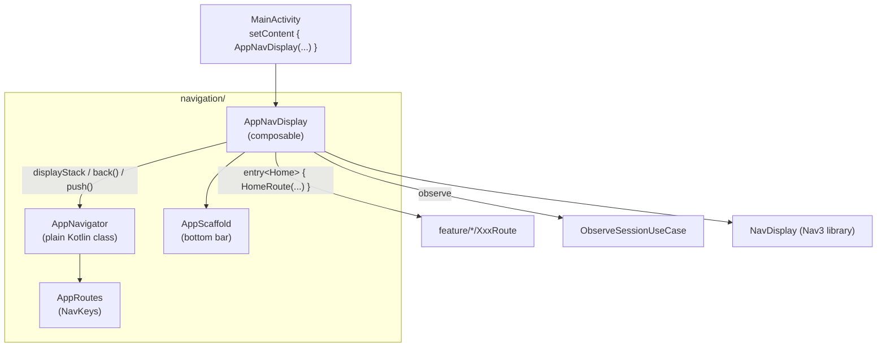
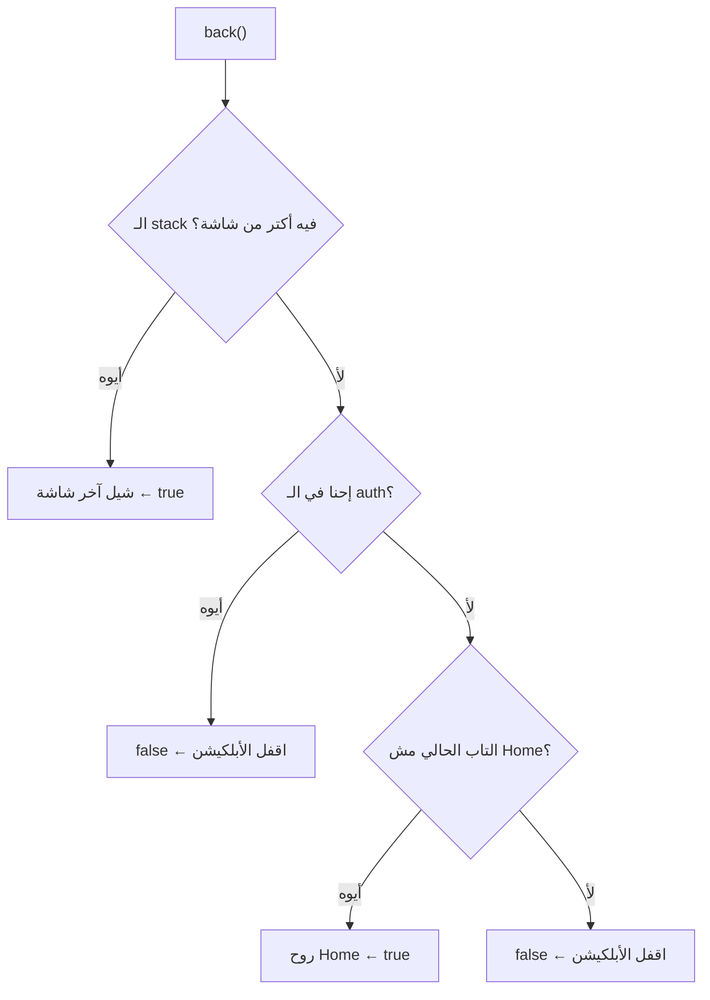

<div dir="rtl" align="right">

# شرح فولدر <code dir="ltr">navigation</code> سطر بسطر

المسار: <code dir="ltr">app/src/main/java/com/example/ecommercenativec19/navigation/</code>

تمت مراجعة الشرح مقابل الكود يوم **28 أكتوبر 2026**. ده شرح للتنفيذ الموجود، مش اقتراح لتغيير المعمارية. أرقام السطور داخل المقتطفات تعليمية من نسخة سابقة؛ ارجع لاسم الدالة في الملف الحالي. المقتطفات المرقّمة مش مخصصة للنسخ والتشغيل مباشرة.

اقرأ معه [شرح session](session-walkthrough.md)، خصوصًا قبل دراسة تسجيل الخروج. وللمراجعة السريعة: [الربط والسيناريوهات العملية](#الربط-والسيناريوهات-العملية) في نهاية الملف.

**ترتيب القراءة:** الصورة الكبيرة ← <code dir="ltr">AppRoutes</code> ← <code dir="ltr">AppNavigator</code> ← <code dir="ltr">AppNavDisplay</code> ← <code dir="ltr">AppScaffold</code> ← الاختبارات والقيود ← السيناريوهات العملية.

---

## الصورة الكبيرة الأول

الفولدر ده مسؤول عن **"اليوزر واقف على أنهي شاشة، ولو داس back يروح فين"**. مفيش ولا شاشة فيه؛ الشاشات كلها في <code dir="ltr">feature/&lt;name&gt;/</code>. هو بس بيربطهم ببعض.

المشروع بيستخدم **Navigation 3** (<code dir="ltr">androidx.navigation3</code> نسخة <code dir="ltr">1.2.0</code>). عشان تفهم الفولدر لازم تفهم الفكرة الأساسية بتاعته الأول.

### الفرق بين Navigation Compose القديم و Navigation 3

</div>

<div dir="ltr" align="left">

```text
Navigation Compose (القديم)                 Navigation 3 (الجديد)
──────────────────────────────            ──────────────────────────────
NavController هو اللي ماسك الـ back stack     إنت اللي ماسك الـ back stack
الـ routes = strings أو @Serializable         الـ keys = أي object (@Serializable NavKey)
navController.navigate("details/7")         backStack.add(ProductDetails("7"))
popBackStack()                              backStack.removeLast()
multiple back stacks: saveState/restoreState  multiple back stacks: إنت تعملها بإيدك
NavHost { composable("home") { } }          NavDisplay(backStack) { entry<Home> { } }
```

</div>

<div dir="rtl" align="right">

الفكرة الجوهرية في Navigation 3: **الـ back stack مجرد <code dir="ltr">List</code> إنت بتملكها**. الـ <code dir="ltr">NavDisplay</code> بيبص على آخر عنصر في الليستة ويعرض الشاشة بتاعته. عايز تفتح شاشة؟ زوّد عنصر. عايز ترجع؟ شيل عنصر. خلاص.

ده بالظبط زي <code dir="ltr">Navigator.pages</code> في Flutter (Navigator 2.0): الـ state هي الليستة، والـ UI بيترسم منها.

المقارنة هنا في **ملكية الحالة**؛ Navigation Compose بيدعم هو كمان type-safe routes باستخدام <code dir="ltr">@Serializable</code>. الـtype safety مش ميزة حصرية لـNav3، ومش محتاج ترجع للـstrings علشان تستخدم Navigation Compose.

### الملفات ودور كل واحد

</div>

<div dir="ltr" align="left">

```text
navigation/
├── AppRoutes.kt      ← "أسماء" الشاشات العشرة (NavKey) + ربطها بتابات الـ bottom bar
├── AppNavigator.kt   ← "المخ": ماسك كل الـ back stacks وبيقرر push / back / tabs / sign out
├── AppNavDisplay.kt  ← "الربط": كل key بيعرض أنهي شاشة، وكل زرار في الشاشة بيعمل إيه
└── AppScaffold.kt    ← "الهيكل": الـ bottom bar المشترك حوالين كل الشاشات

test/.../navigation/
└── AppNavigatorTest.kt ← تستات JVM للمخ من غير أي UI
```

</div>

<div dir="rtl" align="right">

### المعمارية

</div>

<div dir="ltr" align="left">



</div>

<div dir="rtl" align="right">

### شكل الـ back stacks

الأبلكيشن فيه **5 back stacks** مش واحد:

</div>

<div dir="ltr" align="left">

```text
authStack        : [Splash]  أو  [SignIn, SignUp]       ← لما اليوزر مش عامل sign in
Home tab         : [Home, ProductDetails("7"), Cart]
Categories tab   : [Categories, ProductList("s1"), ProductDetails("3")]
Wishlist tab     : []        ← فاضي لحد ما اليوزر يفتح التاب (lazy)
Account tab      : []
currentTab       : Categories
```

</div>

<div dir="rtl" align="right">

القاعدة: لو <code dir="ltr">authStack</code> فيها حاجة ← اليوزر برّه، ونعرضها هي بس. لو فاضية ← اليوزر جوه، ونعرض التاب الحالي.

ليه stack لكل تاب؟ عشان ده السلوك المتوقع في أي أبلكيشن فيه bottom bar: لو فتحت منتج من Categories وبعدين رحت Home ورجعت Categories، المفروض تلاقي نفسك على نفس المنتج.

---

## الملف الأول: <code dir="ltr">AppRoutes.kt</code>

</div>

<div dir="ltr" align="left">

```kotlin
7  // Navigation 3 keys of the ten screens (Figma node ids in the comments, from interactions.json). Keys are plain
8  // serializable data so the back stacks survive configuration change and process death.
10 /** 1:2 */
11 @Serializable data object Splash : NavKey
```

</div>

<div dir="rtl" align="right">

- السطر 7: كل شاشة ليها "key" واحد. الأرقام اللي في الكومنتات (<code dir="ltr">1:2</code>, <code dir="ltr">14:47</code>) هي <code dir="ltr">node id</code> بتاع الشاشة في Figma، عشان تقدر ترجع للتصميم الأصلي لأي شاشة.
- السطر 8: ليه <code dir="ltr">@Serializable</code>؟ لأن <code dir="ltr">rememberNavBackStack</code> بيحفظ الليستة في <code dir="ltr">Bundle</code> لما الأبلكيشن يتقتل في الخلفية (<code dir="ltr">process death</code>) أو الشاشة تلف (<code dir="ltr">configuration change</code>). عشان يحفظها لازم يعرف يحوّل كل key لـ bytes، وده اللي <code dir="ltr">kotlinx.serialization</code> بيعمله.
- السطر 11: الـ <code dir="ltr">NavKey</code> هو <code dir="ltr">marker interface</code> من Nav3. مالوش methods، بس بيقول "ده key ينفع يتحط في back stack". والـ <code dir="ltr">data object</code> لأن الشاشة دي مالهاش باراميترز.

</div>

<div dir="ltr" align="left">

```kotlin
14 @Serializable data object SignIn : NavKey
17 @Serializable data object SignUp : NavKey
20 @Serializable data object Home : NavKey
23 @Serializable data object Categories : NavKey
```

</div>

<div dir="rtl" align="right">

- الأسطر دي: نفس الفكرة، شاشات من غير باراميترز.

</div>

<div dir="ltr" align="left">

```kotlin
25 /** 726:650; opened from a Categories sub-category tile, so it lives on the Categories tab stack. */
26 @Serializable data class ProductList(val subCategoryId: String) : NavKey {
27     init {
28         require(subCategoryId.isNotBlank()) { "subCategoryId must not be blank" }
29     }
30 }
```

</div>

<div dir="rtl" align="right">

- السطر 25: الكومنت بيوضح إن الشاشة دي بتتفتح من Categories، فبتتحط على الـ stack بتاع Categories. ودي اللي بتخلي الـ bottom bar يعلّم على Categories وانت فيها.
- السطر 26: هنا <code dir="ltr">data class</code> لأن الشاشة محتاجة باراميتر. الباراميتر **type-safe**: <code dir="ltr">key.subCategoryId</code> property معروفة للكومبايلر. ده أحسن من النمط القديم بالـstring routes و<code dir="ltr">arguments.getString("id")</code>، مع ملاحظة إن Navigation Compose الحديث بيدعم typed routes أيضًا.
- السطر 27 لـ 29: الـ <code dir="ltr">init</code> بيرفض الـ id الفاضي **وقت إنشاء الـ key**. يعني لو API رجع id فاضي، الكراش هيحصل عند الضغطة نفسها برسالة واضحة، مش جوه الشاشة بعدين في request غريب. ده "fail fast". والتستات <code dir="ltr">product list rejects a blank sub-category id</code> بتحميه.
- الـ <code dir="ltr">data class</code> كمان بيدي <code dir="ltr">equals</code> صح، فـ <code dir="ltr">ProductList("s1") == ProductList("s1")</code>، وده اللي التستات بتعتمد عليه.

</div>

<div dir="ltr" align="left">

```kotlin
33 @Serializable data class ProductDetails(val productId: String) : NavKey { ... }
40 @Serializable data object Cart : NavKey
43 @Serializable data object Wishlist : NavKey
46 @Serializable data object Account : NavKey
```

</div>

<div dir="rtl" align="right">

- الأسطر دي: نفس الأنماط. الـ <code dir="ltr">ProductDetails</code> بياخد <code dir="ltr">productId</code> بنفس الـ validation.

### الربط بين التابات والـ keys

</div>

<div dir="ltr" align="left">

```kotlin
48 /** Root key of a bottom-navigation tab. */
49 val AppTab.rootKey: NavKey
50     get() = when (this) {
51         AppTab.Home -> Home
52         AppTab.Categories -> Categories
53         AppTab.Wishlist -> Wishlist
54         AppTab.Account -> Account
55     }
```

</div>

<div dir="rtl" align="right">

- السطر 49: الـ <code dir="ltr">AppTab</code> هو <code dir="ltr">enum</code> متعرف في <code dir="ltr">core/ui/BottomNavigationBar.kt</code> (فيه الأيقونة والاسم). الـ extension ده بيقول: "لما تفتح التاب ده لأول مرة، أول شاشة فيه هي إيه".
- السطر 49 كمان: ليه extension هنا ومش property جوه الـ <code dir="ltr">enum</code>؟ لأن <code dir="ltr">core/ui</code> مينفعش يعرف حاجة عن <code dir="ltr">navigation</code>؛ الاعتماد لازم يمشي في اتجاه واحد (<code dir="ltr">navigation</code> ← <code dir="ltr">core/ui</code>). لو حطيناه جوه <code dir="ltr">AppTab</code> كنا هنعمل circular dependency بين الباكدجات.
- السطر 50: الـ <code dir="ltr">when</code> على <code dir="ltr">enum</code> من غير <code dir="ltr">else</code> يبقى exhaustive، فلو اتضاف تاب جديد الكومبايلر هيجبرك تحدد الـ root بتاعه.

</div>

<div dir="ltr" align="left">

```kotlin
57 /** Tab highlighted while this key is on top, or null when the screen shows no bottom bar. */
58 val NavKey.bottomBarTab: AppTab?
59     get() = when (this) {
60         Home -> AppTab.Home
61         Categories -> AppTab.Categories
62         is ProductList -> AppTab.Categories
63         Wishlist -> AppTab.Wishlist
64         Account -> AppTab.Account
65         else -> null
66     }
```

</div>

<div dir="rtl" align="right">

- السطر 58: الدالة دي بتجاوب على سؤالين في نفس الوقت: هل الـ bottom bar يظهر؟ (<code dir="ltr">null</code> = لأ) ولو ظهر، أنهي تاب متعلّم عليه؟
- السطر 60: كلمة <code dir="ltr">Home -&gt;</code> من غير <code dir="ltr">is</code> لأن <code dir="ltr">Home</code> هو <code dir="ltr">data object</code>، فبنقارن بالـ <code dir="ltr">equals</code>.
- السطر 62: كلمة <code dir="ltr">is ProductList</code> لأنه <code dir="ltr">data class</code>، فبنشيك على النوع مش على instance معينة.
- السطر 65: أي حاجة تانية (<code dir="ltr">Splash</code>, <code dir="ltr">SignIn</code>, <code dir="ltr">SignUp</code>, <code dir="ltr">ProductDetails</code>, <code dir="ltr">Cart</code>) ← مفيش bottom bar. ده جاي من التصميم: شاشة التفاصيل والكارت full screen.
- ملحوظة: <code dir="ltr">else</code> يغطي باقي الأنواع، فالتعبير مكتمل للكومبايلر لكنه لا يجبرك على branch مستقل لكل key جديد. لو ضفت شاشة محتاجة bottom bar لازم تضيفها هنا. الاختبار الحالي يغطي الأنواع الحالية فقط.

---

## الملف التاني: <code dir="ltr">AppNavigator.kt</code> (المخ)

### ليه كلاس منفصل أصلًا؟

</div>

<div dir="ltr" align="left">

```kotlin
13 /**
14  * App-owned navigation state: one auth stack (Splash, Sign in, Sign up) and one stack per bottom-bar tab.
15  * Plain Kotlin on top of [MutableList]s, so it is unit-testable on the JVM; in the app the lists are
16  * `NavBackStack`s, which are snapshot state and saved across configuration change and process death.
17  *
18  * While [authStack] is non-empty the user is signed out and only that stack is shown. Tab stacks are filled
19  * lazily: a tab that was never opened holds no entries.
20  */
```

</div>

<div dir="rtl" align="right">

- السطر 14: الـ Nav3 بيقول "إنت اللي تملك الـ back stack"، بس مابيدّيكش حاجة جاهزة لـ multiple back stacks (تاب لكل stack). فالكلاس ده هو الحل بتاعنا للنقطة دي.
- السطر 15: أهم قرار في الملف. الكلاس مش <code dir="ltr">ViewModel</code> ولا <code dir="ltr">Composable</code>، وبياخد <code dir="ltr">MutableList</code> بدل اشتراط <code dir="ltr">NavBackStack</code>. لكنه **مش مستقل تمامًا عن Compose**: عنده <code dir="ltr">MutableState&lt;AppTab&gt;</code>، وبيعتمد على <code dir="ltr">NavKey</code> و<code dir="ltr">AppTab</code>. ده تنسيق presentation قابل لاختبار JVM، مش domain model نقي.
- السطر 16: في التطبيق الحقيقي القوائم <code dir="ltr">NavBackStack</code> ومدعومة بـCompose snapshot state؛ التعديل يعيد تركيب الأجزاء التي تقرأها. الحفظ والاستعادة هنا من <code dir="ltr">rememberNavBackStack</code>، مش من مجرد وجود List observable.
- السطر 18: القاعدة اللي شرحناها فوق: <code dir="ltr">authStack</code> مش فاضية = اليوزر برّه.
- السطر 19: التابات بتتملي "lazy": تاب Wishlist مثلًا مابيبقاش فيه <code dir="ltr">Wishlist</code> key غير لما اليوزر يدوس عليه. ده بيمنع إن الـ ViewModel بتاع Wishlist يتعمل ويعمل API call من غير ما اليوزر يفتحه.

### الـ constructor

</div>

<div dir="ltr" align="left">

```kotlin
21 class AppNavigator(
22     private val authStack: MutableList<NavKey>,
23     private val tabStacks: Map<AppTab, MutableList<NavKey>>,
24     private val currentTabState: MutableState<AppTab>,
25 ) {
26     val currentTab: AppTab get() = currentTabState.value
```

</div>

<div dir="rtl" align="right">

- السطر 22: ليستة شاشات الـ auth.
- السطر 23: الخريطة فيها ليستة لكل تاب. هي <code dir="ltr">Map</code> مش 4 properties منفصلة عشان الكود يبقى عام: <code dir="ltr">tabStacks.getValue(tab)</code> بدل <code dir="ltr">when</code> في كل حتة.
- السطر 24: التاب الحالي هو <code dir="ltr">MutableState</code> مش <code dir="ltr">var</code> عادي. ليه؟ لأن Compose لازم يعرف إن القيمة اتغيرت عشان يعمل recomposition. لو كان <code dir="ltr">var</code> عادي، تغيير التاب مكانش هيعيد رسم الشاشة.
- السطر 26: الـ property دي read-only برّه. محدش برّه الكلاس يقدر يغير التاب غير عن طريق الدوال (<code dir="ltr">selectTab</code>, <code dir="ltr">back</code>...). ده encapsulation: كل التحولات في مكان واحد.

### الـ <code dir="ltr">displayStack</code> (أهم property)

</div>

<div dir="ltr" align="left">

```kotlin
28 /** What [androidx.navigation3.ui.NavDisplay] renders; the last element is the visible screen. */
29 val displayStack: List<NavKey>
30     get() {
31         if (authStack.isNotEmpty()) return authStack.toList()
32         // Hidden tabs stay in the list (below the current one) so their entry-scoped ViewModels and
33         // scroll state are not cleared when the user switches tabs.
34         return AppTab.entries.filter { it != currentTab }.flatMap { tabStacks.getValue(it) } +
35             tabStacks.getValue(currentTab)
36     }
```

</div>

<div dir="rtl" align="right">

- السطر 29: الـ <code dir="ltr">NavDisplay</code> بياخد **ليستة واحدة**، بس احنا عندنا 5. فالـ property دي بتحوّل الـ 5 لليستة واحدة. وهي <code dir="ltr">get()</code> يعني بتتحسب كل مرة، مش متخزنة، فمستحيل تبقى "قديمة".
- السطر 31: لو اليوزر برّه، نعرض الـ auth stack بس. الـ <code dir="ltr">toList()</code> بيعمل نسخة عشان محدش برّه يقدر يعدّل الليستة الأصلية.
- السطر 32 لـ 35: هنا الحيلة الذكية. مثال: التاب الحالي Home، والـ Categories فيها <code dir="ltr">[Categories, ProductList("s1")]</code>:

</div>

<div dir="ltr" align="left">

```text
displayStack = [Categories, ProductList("s1"),   Home]
                └──── التابات المخفية ────┘    └─ التاب الحالي (آخر حاجة = الظاهرة)
```

</div>

<div dir="rtl" align="right">

ليه منحطش التاب الحالي بس؟ لأن <code dir="ltr">NavDisplay</code> لما key يخرج من الليستة، بيعتبر الشاشة "اتقفلت" وبيمسح الـ ViewModel بتاعها والـ scroll position. فلو شيلنا Categories من الليستة لما رحنا Home، أول ما نرجع هتبدأ من الأول وتعمل API call تاني. بإننا نسيبها **تحت** التاب الحالي، الـ <code dir="ltr">NavDisplay</code> بيعتبرها لسه في الـ stack (مش ظاهرة بس عايشة).
- السطر 34: الـ <code dir="ltr">AppTab.entries</code> بيرجع كل قيم الـ <code dir="ltr">enum</code> بالترتيب. بنشيل التاب الحالي، ونعمل <code dir="ltr">flatMap</code> عشان ندمج ليستاتهم في ليستة واحدة.
- السطر 35: التاب الحالي في **الآخر**، عشان آخر عنصر هو اللي بيظهر.
- التست اللي بيثبت ده: <code dir="ltr">hidden tab stacks stay in the display list below the current tab</code>.

</div>

<div dir="ltr" align="left">

```kotlin
38 val topKey: NavKey get() = displayStack.last()
40 /** True once the auth stack is gone, i.e. the user is past Splash / Sign in / Sign up. */
41 val isSignedIn: Boolean get() = authStack.isEmpty()
```

</div>

<div dir="rtl" align="right">

- السطر 38: الشاشة الظاهرة دلوقتي. بيستخدمه <code dir="ltr">AppNavDisplay</code> عشان يعرف يظهر الـ bottom bar ولا لأ.
- السطر 41: هل اليوزر عدّى شاشات الـ auth. لاحظ إن ده **مش** نفس "عنده token". ده بيقول "هل الـ UI حاليًا في جزء الـ signed-in". الفرق ده مهم في الـ <code dir="ltr">LaunchedEffect</code> في <code dir="ltr">AppNavDisplay</code>.

### الانتقالات بين الـ auth والتابات

</div>

<div dir="ltr" align="left">

```kotlin
43 /** Splash finished: it removes itself and Sign in becomes the root. */
44 fun finishSplash() {
45     authStack.clear()
46     authStack.add(SignIn)
47 }
```

</div>

<div dir="rtl" align="right">

- السطر 45 و 46: الـ Splash **بيشيل نفسه**. ليه مش <code dir="ltr">push(SignIn)</code> وخلاص؟ لأن ساعتها اليوزر لو داس back من Sign in هيرجع للـ Splash، وده غلط. التست <code dir="ltr">back at sign in root exits instead of returning to splash</code> بيثبت إن back هنا بيقفل الأبلكيشن.

</div>

<div dir="ltr" align="left">

```kotlin
49 /** Sign in / Sign up succeeded: drop the auth stack and land on the Home tab. */
50 fun completeAuth() {
51     authStack.clear()
52     openTab(AppTab.Home)
53 }
```

</div>

<div dir="rtl" align="right">

- السطر 51: تفريغ الـ auth stack هو اللي بيحوّل الأبلكيشن لوضع "signed in" (افتكر القاعدة: فاضية = جوه). وده كمان معناه إن back من Home مستحيل يرجعك لشاشة Sign in.
- السطر 52: افتح تاب Home (ولو فاضي حط فيه <code dir="ltr">Home</code>).
- الدالة دي بتتنادى من 3 أماكن: Splash (لو فيه session محفوظة)، Sign in، Sign up.

</div>

<div dir="ltr" align="left">

```kotlin
55 /** Session ended (sign-out or a rejected token): forget every tab's history and show Sign in. */
56 fun signOut() {
57     tabStacks.values.forEach { it.clear() }
58     currentTabState.value = AppTab.Home
59     authStack.clear()
60     authStack.add(SignIn)
61 }
```

</div>

<div dir="rtl" align="right">

- السطر 57: امسح تاريخ كل التابات عشان الدخول التالي لا يستعيد شاشات الجلسة السابقة. إزالة الـentries تنظف حالتها والـViewModels المرتبطة بهويتها بعد انتهاء الانتقالات. ده مش ضمان لمسح كل بيانات الذاكرة؛ cart/wishlist singleton caches بتنظف نفسها بشكل مستقل عند مراقبة session.
- السطر 58: رجّع التاب لـ Home عشان اللوجين الجاي يبدأ نضيف.
- السطر 59 و 60: اعرض Sign in بس. مفيش Splash تاني لأننا عارفين إن مفيش session.
- التست <code dir="ltr">signing in again after sign out starts on a fresh Home</code> بيغطي السيناريو ده.

### الـ <code dir="ltr">push</code>

</div>

<div dir="ltr" align="left">

```kotlin
63 /** Pushes [key] on the stack currently shown (the tab stack, or the auth stack while signed out). */
64 fun push(key: NavKey) {
65     activeStack().add(key)
66 }
```

</div>

<div dir="rtl" align="right">

- السطر 65: الشاشة الجديدة بتتحط على الـ stack **الظاهر حاليًا**. فلو فتحت <code dir="ltr">ProductDetails</code> من Wishlist، بيتحط على stack الـ Wishlist. ولو داس back يرجع للـ Wishlist، مش Home.

### الـ <code dir="ltr">selectTab</code>

</div>

<div dir="ltr" align="left">

```kotlin
68 /** Bottom bar tap. A different tab keeps its history; the current tab pops back to its root. */
69 fun selectTab(tab: AppTab) {
70     if (tab == currentTab) {
71         val stack = tabStacks.getValue(tab)
72         while (stack.size > 1) stack.removeAt(stack.lastIndex)
73     } else {
74         openTab(tab)
75     }
76 }
```

</div>

<div dir="rtl" align="right">

- السطر 70 لـ 72: لو داس على **نفس** التاب اللي هو فيه، يرجع لأول شاشة في التاب (السلوك المعروف في Instagram و YouTube). بنشيل من الآخر لحد ما يفضل عنصر واحد (الـ root).
- السطر 72: ليه <code dir="ltr">removeAt(lastIndex)</code> في loop ومش <code dir="ltr">subList(1, size).clear()</code>؟ لأن مع <code dir="ltr">SnapshotStateList</code> كل عملية <code dir="ltr">remove</code> واضحة ومضمونة، والقراءة أسهل. الـ stack صغير فالأداء مش مشكلة.
- السطر 74: لو تاب **تاني**، افتحه بالتاريخ بتاعه كما هو. التست <code dir="ltr">switching tabs preserves each tab history</code>.

### الـ <code dir="ltr">back</code> (أعقد دالة)

</div>

<div dir="ltr" align="left">

```kotlin
78 /**
79  * System back. Pops within the current stack; a non-Home tab root goes to the Home tab.
80  * Returns false when nothing is left to pop and the caller should leave the app.
81  */
82 fun back(): Boolean {
83     val stack = activeStack()
84     return when {
85         stack.size > 1 -> {
86             stack.removeAt(stack.lastIndex)
87             true
88         }
89         authStack.isNotEmpty() -> false
90         currentTab != AppTab.Home -> {
91             currentTabState.value = AppTab.Home
92             true
93         }
94         else -> false
95     }
96 }
```

</div>

<div dir="rtl" align="right">

- السطر 80: الدالة بترجع <code dir="ltr">Boolean</code> بدل ما تقفل الأبلكيشن بنفسها. ليه؟ لأن قفل الأبلكيشن محتاج <code dir="ltr">Activity</code>، والكلاس ده مايعرفش Android. فهو بيقول "مفيش حاجة أرجعلها" والـ caller (<code dir="ltr">AppNavDisplay</code>) هو اللي يعمل <code dir="ltr">activity.finish()</code>. ده بيخلي الكلاس testable.
- السطر 83: الـ stack اللي هنشتغل عليه (auth أو التاب الحالي).
- السطر 85 لـ 87: **الحالة الأولى**: فيه أكتر من شاشة ← شيل الأخيرة. ده الـ back العادي.
- السطر 89: **الحالة التانية**: إحنا في الـ auth على أول شاشة (Sign in) ← اقفل الأبلكيشن.
- السطر 90 لـ 92: **الحالة التالتة**: إحنا على root تاب غير Home (مثلًا Account) ← روح لتاب Home. ده نمط Material المعروف: Home هو "البيت" اللي back بيرجعلك ليه قبل الخروج.
- السطر 94: **الحالة الرابعة**: إحنا على Home root ← اقفل الأبلكيشن.

</div>

<div dir="ltr" align="left">



</div>

<div dir="rtl" align="right">

### الدوال الـ private

</div>

<div dir="ltr" align="left">

```kotlin
98  private fun openTab(tab: AppTab) {
99      val stack = tabStacks.getValue(tab)
100     if (stack.isEmpty()) stack.add(tab.rootKey)
101     currentTabState.value = tab
102 }
104 private fun activeStack(): MutableList<NavKey> =
105     if (authStack.isNotEmpty()) authStack else tabStacks.getValue(currentTab)
```

</div>

<div dir="rtl" align="right">

- السطر 99: الدالة <code dir="ltr">getValue</code> بدل <code dir="ltr">[tab]</code> لأن <code dir="ltr">[]</code> بيرجع nullable، و <code dir="ltr">getValue</code> بيرمي لو المفتاح مش موجود. وبما إن كل التابات موجودة دايمًا، ده بيوفر <code dir="ltr">!!</code>.
- السطر 100: هنا الـ "lazy" اللي اتكلمنا عنه: أول مرة تفتح التاب، حط الـ root key بتاعه.
- السطر 105: نفس القاعدة: auth مش فاضية؟ اشتغل عليها. غير كده اشتغل على التاب الحالي.

### الدالة <code dir="ltr">rememberAppNavigator</code>

</div>

<div dir="ltr" align="left">

```kotlin
108 /** Creates the navigator with saveable stacks. Start state: Splash. */
109 @Composable
110 fun rememberAppNavigator(): AppNavigator {
111     val authStack = rememberNavBackStack(Splash)
112     val homeStack = rememberNavBackStack(Home)
113     val categoriesStack = rememberNavBackStack()
114     val wishlistStack = rememberNavBackStack()
115     val accountStack = rememberNavBackStack()
116     val tab = rememberSaveable { mutableStateOf(AppTab.Home) }
117     return remember(authStack, homeStack, categoriesStack, wishlistStack, accountStack, tab) {
118         AppNavigator(
119             authStack = authStack,
120             tabStacks = mapOf(
121                 AppTab.Home to homeStack,
122                 AppTab.Categories to categoriesStack,
123                 AppTab.Wishlist to wishlistStack,
124                 AppTab.Account to accountStack,
125             ),
126             currentTabState = tab,
127         )
128     }
129 }
```

</div>

<div dir="rtl" align="right">

- السطر 110: التسمية <code dir="ltr">rememberXxx</code> هي convention في Compose لأي دالة بتعمل حاجة وتفتكرها عبر الـ recompositions (زي <code dir="ltr">rememberScrollState</code>).
- السطر 111: دالة <code dir="ltr">rememberNavBackStack</code> من Nav3. بتعمل stack observable وقابلة للحفظ في Android saved state. <code dir="ltr">Splash</code> هي بداية **الإنشاء الجديد بدون حالة مستعادة**؛ لو النظام استعاد back stack سابقة، مش لازم نبدأ من Splash. الحفظ ده مش تخزين دائم مضمون بعد force-stop أو مسح بيانات التطبيق.
- السطر 112: تاب Home بيبدأ فيه <code dir="ltr">Home</code> جاهز، لأنه أول تاب هيتعرض بعد اللوجين.
- السطر 113 لـ 115: باقي التابات فاضية (lazy).
- السطر 116: الدالة <code dir="ltr">rememberSaveable</code> (مش <code dir="ltr">remember</code>) عشان التاب الحالي كمان يتحفظ مع process death. الـ <code dir="ltr">enum</code> بيتحفظ في <code dir="ltr">Bundle</code> عادي.
- السطر 117: الدالة <code dir="ltr">remember(keys...)</code> بتعمل الـ <code dir="ltr">AppNavigator</code> **مرة واحدة** وتفضل ترجع نفس الـ instance، إلا لو أي key اتغير. من غير <code dir="ltr">remember</code> كان هيتعمل navigator جديد مع كل recomposition (مش كارثة لأن الـ state في الليستات، بس هدر).
- السطر 118: الـ navigator نفسه **مش** محفوظ؛ الليستات هي اللي محفوظة. الـ navigator مجرد "منطق" فوقها، وده بيخليه يتعمل من جديد بسهولة بعد process death على نفس الداتا.

---

## الملف التالت: <code dir="ltr">AppNavDisplay.kt</code> (الربط)

### عقد الشاشات (اتنقل لـ <code dir="ltr">docs/architecture.md</code> §6)

الـ KDoc الطويل اللي كان فوق <code dir="ltr">AppNavDisplay</code> اتنقل لقسم "Screen callback contract" في <code dir="ltr">docs/architecture.md</code>، وفضل في الكود ملخص من 3 سطور. ملحوظة: أرقام السطور في باقي القسم ده من النسخة القديمة (قبل النقل وقبل تقسيم الـ entries)، فالكود نفسه هو المرجع. الـ contract ده **عقد مكتوب** لكل شاشة: بتنادي أنهي callbacks، وكل callback بيودّي فين. أهم الحاجات اللي فيه:

- الجدول: لكل <code dir="ltr">XxxRoute</code> الـ callbacks بتاعته. القاعدة هنا إن **الشاشة مابتعرفش حاجة عن الـ navigation**. الـ <code dir="ltr">HomeRoute</code> مابيعرفش إن فيه <code dir="ltr">AppNavigator</code>؛ هو بس بينادي <code dir="ltr">onOpenCart()</code>. والـ <code dir="ltr">AppNavDisplay</code> هو اللي يقرر إن ده معناه <code dir="ltr">push(Cart)</code>. ده بيخلي الشاشات قابلة لإعادة الاستخدام والـ preview والتست لوحدها.
- السطر 53: انحراف (deviation) متوثق عن التصميم: في Figma زرار back في الكارت دايمًا بيروح Home، بس هنا بيرجع للشاشة اللي فتحته، لأن ده المنطقي لليوزر.
- السطر 60 لـ 63: الحاجات اللي في Figma "تفاعلات" بس **مش navigation** (القلب، زرار +، الكمية) مش متوصلة هنا. هي بتكلم API مش بتنقل شاشة.
- السطر 65 لـ 68: قسم الـ Session: لو الـ session خلصت وانت جوه ← ارجع لـ Sign in.
- السطر 76 لـ 78: الـ Figma بيستخدم <code dir="ltr">SMART_ANIMATE</code>. المشروع اختار cross-fade بمدد التصميم؛ Compose عنده أدوات تحريك متقدمة، لكن استيراد دلالة Smart Animate من Figma مش بيحصل تلقائيًا.

### الـ signature

</div>

<div dir="ltr" align="left">

```kotlin
80 @Composable
81 fun AppNavDisplay(
82     observeSession: ObserveSessionUseCase,
83     modifier: Modifier = Modifier,
84     navigator: AppNavigator = rememberAppNavigator(),
85 ) {
```

</div>

<div dir="rtl" align="right">

- السطر 82: بياخد الـ use case كباراميتر بدل ما يعمل <code dir="ltr">hiltViewModel()</code>. الـ <code dir="ltr">MainActivity</code> (اللي عليها <code dir="ltr">@AndroidEntryPoint</code>) هي اللي بتعمل <code dir="ltr">@Inject</code> وتباصيه. ده بيخلي الـ composable مايعتمدش على Hilt مباشرة.
- السطر 83: باراميتر <code dir="ltr">modifier</code> بقيمة default، الـ convention المعروف في Compose.
- السطر 84: الـ <code dir="ltr">navigator</code> باراميتر بقيمة default. في الأبلكيشن بياخد الـ default، بس في UI test ممكن تباصي navigator جاهز في حالة معينة. ده اسمه "state hoisting".

### مراقبة الـ session

</div>

<div dir="ltr" align="left">

```kotlin
86 val activity = LocalActivity.current
87 val sessionState by observeSession().collectAsStateWithLifecycle()
88 // Only react once past the auth screens: Splash and Sign in are already the signed-out UI.
89 LaunchedEffect(sessionState) {
90     if (sessionState == SessionState.SignedOut && navigator.isSignedIn) navigator.signOut()
91 }
```

</div>

<div dir="rtl" align="right">

- السطر 86: بنجيب الـ <code dir="ltr">Activity</code> عشان نقفلها لما back يرجع <code dir="ltr">false</code>. والـ <code dir="ltr">LocalActivity</code> (من <code dir="ltr">activity-compose</code>) أنضف من <code dir="ltr">LocalContext.current as Activity</code> اللي ممكن يكراش لو الـ context متغلّف.
- السطر 87: بنراقب الـ <code dir="ltr">StateFlow&lt;SessionState&gt;</code> (من فولدر <code dir="ltr">session</code>). ليه <code dir="ltr">collectAsStateWithLifecycle</code> مش <code dir="ltr">collectAsState</code>؟ لأنها بتوقف الـ collection لما الأبلكيشن يروح الخلفية (<code dir="ltr">STOPPED</code>)، فمفيش شغل على الفاضي.
- السطر 89: الـ <code dir="ltr">LaunchedEffect(sessionState)</code> بيشتغل كل ما <code dir="ltr">sessionState</code> يتغير. ده "side effect": حاجة لازم تحصل **بسبب** تغير state، مش جزء من رسم الـ UI.
- السطر 90: الشرطين مع بعض مهمين:
  - أولًا <code dir="ltr">SignedOut</code>: الـ session خلصت (اليوزر عمل logout، أو السيرفر رجع 401 والـ <code dir="ltr">invalidate</code> مسح الـ token).
  - ثانيًا <code dir="ltr">navigator.isSignedIn</code>: إحنا لسه جوه التابات. لو إحنا أصلًا في Splash أو Sign in، مفيش داعي نعمل حاجة (السطر 88 بيقول كده). من غير الشرط ده، أول ما الأبلكيشن يفتح وهو <code dir="ltr">SignedOut</code> كان هيعمل <code dir="ltr">signOut()</code> ويشيل الـ Splash قبل ما يخلص.
- ده بيخلي الـ logout "reactive": الـ <code dir="ltr">SignOutUseCase</code> بيمسح الـ token بس، ومايعرفش حاجة عن الـ navigation. الـ navigation بتتفاعل لوحدها مع تغير الحالة.

### الـ scaffold والـ <code dir="ltr">NavDisplay</code>

</div>

<div dir="ltr" align="left">

```kotlin
92  AppScaffold(
93      selectedTab = navigator.topKey.bottomBarTab,
94      onTabSelected = navigator::selectTab,
95      modifier = modifier,
96  ) {
97      NavDisplay(
98          backStack = navigator.displayStack,
99          onBack = { if (!navigator.back()) activity?.finish() },
```

</div>

<div dir="rtl" align="right">

- السطر 93: الـ bottom bar يتعلّم على أنهي تاب، أو يختفي لو <code dir="ltr">null</code>. ولأن <code dir="ltr">topKey</code> بيقرا من <code dir="ltr">SnapshotStateList</code> و <code dir="ltr">MutableState</code>، Compose بيعمل recomposition أوتوماتيك لما تتغير.
- السطر 94: الـ <code dir="ltr">navigator::selectTab</code> هو function reference، أقصر من <code dir="ltr">{ navigator.selectTab(it) }</code>.
- السطر 96: الـ <code dir="ltr">NavDisplay</code> **جوه** الـ <code dir="ltr">AppScaffold</code>، يعني الـ bottom bar واحد ثابت والشاشات بتتبدل جواه. لو كل شاشة عملت bottom bar بتاعها، كان هيعمل fade مع الشاشة وده شكله وحش.
- السطر 98: هنا الربط الأساسي: الـ <code dir="ltr">NavDisplay</code> بياخد الليستة المدمجة ويعرض آخر عنصر.
- السطر 99: لما اليوزر يدوس back (أو يعمل swipe)، الـ <code dir="ltr">NavDisplay</code> بينادي <code dir="ltr">onBack</code>. بنسأل الـ navigator، ولو قال <code dir="ltr">false</code> نقفل الـ Activity. لاحظ إننا **مش** بنسيب <code dir="ltr">NavDisplay</code> يشيل من الليستة بنفسه، لأن <code dir="ltr">displayStack</code> ليستة مُحسوبة، والقرار (زي "ارجع لتاب Home") منطق خاص بينا.

### الـ decorators

</div>

<div dir="ltr" align="left">

```kotlin
100 // Per-entry ViewModelStore: hiltViewModel() resolves LocalViewModelStoreOwner to the entry.
101 entryDecorators = listOf(
102     rememberSaveableStateHolderNavEntryDecorator(),
103     rememberViewModelStoreNavEntryDecorator(),
104 ),
```

</div>

<div dir="rtl" align="right">

- السطر 101: الـ "decorator" في Nav3 هو حاجة بتلف كل شاشة وتديها إمكانية إضافية.
- السطر 102: الـ decorator ده بيدي كل شاشة <code dir="ltr">SaveableStateHolder</code> خاص بيها. يعني أي <code dir="ltr">rememberSaveable</code> جوه الشاشة (زي scroll position أو نص في TextField) بيتحفظ لما الشاشة تختفي وترجع.
- السطر 103: ده أهم واحد. بيدي الـentry <code dir="ltr">ViewModelStoreOwner</code> مرتبط بهويتها (<code dir="ltr">contentKey</code>). فلما <code dir="ltr">HomeRoute</code> يعمل <code dir="ltr">hiltViewModel()</code>، بيستخدم الـowner ده بدل ربطه بالـActivity. والنتيجة، مع اختلاف هويات الـentries:
  - أولًا كل شاشة ليها ViewModel مستقل (<code dir="ltr">ProductDetails("3")</code> و <code dir="ltr">ProductDetails("7")</code> كل واحد ليه ViewModel).
  - ثانيًا لما الشاشة تخرج من الـ back stack، الـ ViewModel بيتمسح (<code dir="ltr">onCleared</code>).
  من غير الـ decorator، الـscope بيرجع لأقرب <code dir="ltr">ViewModelStoreOwner</code> متاح؛ غالبًا الـActivity في التركيب ده، وبيتنضف عند انتهاء الـowner، مش بيعيش للأبد. والـViewModel نفسه لا ينجو من process death؛ بيتبني من جديد.
- وده بالظبط السبب إن <code dir="ltr">displayStack</code> بيسيب التابات المخفية في الليستة (السطر 32 في <code dir="ltr">AppNavigator</code>).

### الـ transitions

</div>

<div dir="ltr" align="left">

```kotlin
105 transitionSpec = { fade(ScreenFadeMillis, EaseOut) },
106 popTransitionSpec = { fade(ScreenFadeMillis, EaseOut) },
107 predictivePopTransitionSpec = { fade(ScreenFadeMillis, EaseOut) },
```

</div>

<div dir="rtl" align="right">

- السطر 105: الأنيميشن لما شاشة جديدة تدخل (push).
- السطر 106: الأنيميشن لما ترجع (pop).
- السطر 107: الأنيميشن مع الـ predictive back (Android 14+): لما اليوزر يسحب من الحرف، الشاشة اللي تحت بتبان تدريجيًا قبل ما يسيب.
- التلاتة نفس الـ fade عشان التصميم مفيهوش اتجاه (slide).

### الـ <code dir="ltr">entryProvider</code> (الخريطة: key ← شاشة)

</div>

<div dir="ltr" align="left">

```kotlin
108 entryProvider = entryProvider<NavKey> {
109     entry<Splash> {
110         SplashRoute(onSignedIn = navigator::completeAuth, onSignedOut = navigator::finishSplash)
111     }
```

</div>

<div dir="rtl" align="right">

- الـ DSL ده هو بديل <code dir="ltr">NavHost { composable(...) }</code>. بيقول: "لما تلاقي key من النوع ده، اعرض الشاشة دي".
- التقسيم: الـ <code dir="ltr">entryProvider</code> دلوقتي فيه سطرين بس، <code dir="ltr">authEntries(navigator)</code> و <code dir="ltr">mainEntries(navigator)</code>. كل واحدة extension function على <code dir="ltr">EntryProviderScope&lt;NavKey&gt;</code>، وده نفس أسلوب الـ migration guide الرسمي لـ Nav3 (بديل الـ <code dir="ltr">NavGraphBuilder</code> extensions القديمة). الأولى فيها Splash و Sign in و Sign up، والتانية فيها التابات والشاشات اللي فوقها.
- السطر 109: كلمة <code dir="ltr">entry&lt;Splash&gt;</code> معناها "أي key نوعه <code dir="ltr">Splash</code>".
- السطر 110: الـ Splash بيقرر بنفسه (عن طريق <code dir="ltr">SplashViewModel</code> اللي بيستنى الـ session):
  - لو فيه session ← <code dir="ltr">completeAuth()</code> ← Home على طول (من غير ما يعدي على Sign in).
  - لو مفيش ← <code dir="ltr">finishSplash()</code> ← Sign in.

</div>

<div dir="ltr" align="left">

```kotlin
112 entry<SignIn>(
113     metadata = NavDisplay.transitionSpec { fade(SplashFadeMillis, LinearEasing) },
114 ) {
115     SignInRoute(onSignedIn = navigator::completeAuth, onCreateAccount = { navigator.push(SignUp) })
116 }
117 entry<SignUp> { SignUpRoute(onSignedUp = navigator::completeAuth) }
```

</div>

<div dir="rtl" align="right">

- السطر 113: الـ <code dir="ltr">metadata</code> بيعمل override للأنيميشن **للشاشة دي بس**. التصميم بيقول Splash ← Sign in يبقى 400ms linear، وباقي الشاشات 300ms ease-out.
- السطر 115: الـ <code dir="ltr">onCreateAccount</code> بيعمل <code dir="ltr">push(SignUp)</code> على الـ auth stack. فلو اليوزر داس back من SignUp، بيرجع لـ SignIn.
- السطر 117: الـ SignUp لما ينجح بيعمل <code dir="ltr">completeAuth()</code> على طول، لأن الـ API بيرجع token مع التسجيل (اليوزر بيبقى عامل sign in).

</div>

<div dir="ltr" align="left">

```kotlin
118 entry<Home> {
119     HomeRoute(
120         onOpenCart = { navigator.push(Cart) },
121         onOpenCategories = { navigator.selectTab(AppTab.Categories) },
122         onOpenProduct = { productId -> navigator.push(ProductDetails(productId)) },
123     )
124 }
```

</div>

<div dir="rtl" align="right">

- السطر 120: أيقونة الكارت ← <code dir="ltr">push(Cart)</code> على stack التاب الحالي (Home).
- السطر 121: الضغط على category في Home ← **مش** <code dir="ltr">push</code>، ده تغيير تاب. لأن Categories تاب ليه stack خاص بيه، و <code dir="ltr">push(Categories)</code> على Home stack كان هيعمل نسختين من الشاشة.
- السطر 122: كارت المنتج ← <code dir="ltr">push(ProductDetails(id))</code>. الـ id جاي من الشاشة.

</div>

<div dir="ltr" align="left">

```kotlin
131 entry<ProductList> { key ->
132     ProductListRoute(
133         subCategoryId = key.subCategoryId,
```

</div>

<div dir="rtl" align="right">

- السطر 131: لما الشاشة ليها باراميتر، الـ lambda بتاخد الـ <code dir="ltr">key</code> نفسه، و <code dir="ltr">key</code> هنا نوعه <code dir="ltr">ProductList</code> (مش <code dir="ltr">NavKey</code>)، فتقدر تقرا <code dir="ltr">key.subCategoryId</code> مباشرة. ده الـ type-safety اللي اتكلمنا عنه.
- السطر 133: الباراميتر بيتباصى للشاشة، والشاشة بتباصيه للـ ViewModel عن طريق <code dir="ltr">assisted injection</code>: في <code dir="ltr">ProductListRoute</code> فيه <code dir="ltr">hiltViewModel&lt;ProductListViewModel, ProductListViewModel.Factory&gt;(key = subCategoryId) { it.create(subCategoryId) }</code>، والـ ViewModel عليه <code dir="ltr">@AssistedInject</code> و <code dir="ltr">@Assisted subCategoryId</code>.

</div>

<div dir="ltr" align="left">

```kotlin
138 entry<ProductDetails> { key ->
139     ProductDetailsRoute(
140         productId = key.productId,
141         onBack = { navigator.back() },
142         onOpenCart = { navigator.push(Cart) },
143         onAddToCart = { navigator.push(Cart) },
144     )
145 }
146 entry<Cart> { CartRoute(onBack = { navigator.back() }) }
```

</div>

<div dir="rtl" align="right">

- السطر 141: زرار السهم في الـ UI بينادي نفس <code dir="ltr">back()</code> اللي بيناديه زرار الـ system. ليه مش <code dir="ltr">{ navigator.back() }</code> بيرجع Boolean ونعمل finish؟ لأن الشاشة دي مستحيل تكون root، فـ <code dir="ltr">back()</code> دايمًا هيرجع <code dir="ltr">true</code>. القيمة مش مستخدمة عن قصد.
- السطر 143: في <code dir="ltr">ProductDetailsRoute</code> الزرار بينادي <code dir="ltr">viewModel.onAddToCart()</code> الأول (بيبدأ request الإضافة)، وبعدين <code dir="ltr">onAddToCart()</code> اللي بيفتح الكارت على طول زي التصميم. يعني الـ navigation مابتستناش رد الـ API.
- السطر 146: الكارت back بيرجع للي فتحه (الانحراف اللي في السطر 53).

</div>

<div dir="ltr" align="left">

```kotlin
147 entry<Wishlist> { ... }
153 entry<Account> { AccountRoute() }
```

</div>

<div dir="rtl" align="right">

- السطر 153: الـ Account مالهاش callbacks navigation (الـ logout بيتم عن طريق الـ session وبيتفاعل معاه السطر 89).

### الـ helpers في الآخر

</div>

<div dir="ltr" align="left">

```kotlin
159 private fun fade(millis: Int, easing: Easing): ContentTransform =
160     fadeIn(tween(millis, easing = easing)) togetherWith fadeOut(tween(millis, easing = easing))
162 private const val ScreenFadeMillis = 300
163 private const val SplashFadeMillis = 400
165 /** Figma EASE_OUT. */
166 private val EaseOut: Easing = CubicBezierEasing(0f, 0f, 0.58f, 1f)
```

</div>

<div dir="rtl" align="right">

- السطر 160: الشاشة الجديدة تظهر تدريجيًا (<code dir="ltr">fadeIn</code>) **في نفس الوقت** (<code dir="ltr">togetherWith</code>) اللي القديمة بتختفي (<code dir="ltr">fadeOut</code>). والـ <code dir="ltr">tween</code> معناه أنيميشن بمدة ثابتة.
- السطر 162 و 163: المدد من ملف <code dir="ltr">interactions.json</code> المستخرج من Figma.
- السطر 166: ليه مش <code dir="ltr">FastOutSlowInEasing</code> الجاهز من Compose؟ لأن Figma <code dir="ltr">EASE_OUT</code> هو بالظبط CSS <code dir="ltr">ease-out</code> = <code dir="ltr">cubic-bezier(0, 0, 0.58, 1)</code>، وده مختلف عن منحنى Material. فعملناه بنفس أرقام التصميم.

---

## الملف الرابع: <code dir="ltr">AppScaffold.kt</code>

</div>

<div dir="ltr" align="left">

```kotlin
13 /**
14  * The one shared bottom bar. A null [selectedTab] hides it. Only the bottom inset reaches [content]: every
15  * screen draws its own header under the status bar.
16  */
17 @Composable
18 fun AppScaffold(
19     selectedTab: AppTab?,
20     onTabSelected: (AppTab) -> Unit,
21     modifier: Modifier = Modifier,
22     content: @Composable () -> Unit,
23 ) {
24     Scaffold(
25         modifier = modifier,
26         containerColor = MaterialTheme.colorScheme.background,
27         contentWindowInsets = WindowInsets(0, 0, 0, 0),
28         bottomBar = {
29             if (selectedTab != null) BottomNavigationBar(selectedTab = selectedTab, onTabSelected = onTabSelected)
30         },
31     ) { innerPadding ->
32         Box(Modifier.padding(bottom = innerPadding.calculateBottomPadding())) { content() }
33     }
34 }
```

</div>

<div dir="rtl" align="right">

- السطر 18: الـ composable ده **stateless**: بياخد الحالة (<code dir="ltr">selectedTab</code>) وبيطلّع event (<code dir="ltr">onTabSelected</code>). مابيعرفش حاجة عن <code dir="ltr">AppNavigator</code>. ده نمط "state down, events up".
- السطر 19: النوع nullable والـ <code dir="ltr">null</code> معناه "خبّي الـ bottom bar". ده أبسط من باراميتر <code dir="ltr">showBottomBar: Boolean</code> منفصل.
- السطر 22: الـ <code dir="ltr">content</code> slot: نمط Compose المعروف (زي <code dir="ltr">Scaffold</code> نفسه). الـ <code dir="ltr">AppNavDisplay</code> بيحط الـ <code dir="ltr">NavDisplay</code> هنا.
- السطر 26: لون الخلفية من الثيم مش hardcoded.
- السطر 27: الـ <code dir="ltr">WindowInsets(0, 0, 0, 0)</code>: ده بيقول للـ <code dir="ltr">Scaffold</code> "ماتحسبش padding للـ status bar والـ navigation bar". ليه؟ لأن الأبلكيشن <code dir="ltr">edge-to-edge</code>، وكل شاشة بترسم الـ header بتاعها تحت الـ status bar بنفسها (الـ header الأزرق بيمتد لفوق). لو سبنا الـ default، كان هيبقى فيه شريط فاضي فوق.
- السطر 29: الـ bottom bar بيظهر بس لو فيه تاب. ولما بيختفي، الـ <code dir="ltr">Scaffold</code> بيحسب ارتفاعه صفر.
- السطر 32: بناخد **الـ bottom padding بس** من <code dir="ltr">innerPadding</code> (اللي هو ارتفاع الـ bottom bar)، عشان آخر المحتوى مايستخباش تحت الـ bar. والـ top padding بنتجاهله عن قصد (نفس سبب السطر 27).

---

## ملف التست: <code dir="ltr">AppNavigatorTest.kt</code>

</div>

<div dir="ltr" align="left">

```kotlin
17 private fun navigator(auth: List<NavKey>): AppNavigator {
18     val tabStacks = AppTab.entries.associateWith { mutableStateListOf<NavKey>() }
19     tabStacks.getValue(AppTab.Home).add(Home)
20     return AppNavigator(
21         authStack = mutableStateListOf<NavKey>().apply { addAll(auth) },
22         tabStacks = tabStacks,
23         currentTabState = mutableStateOf(AppTab.Home),
24     )
25 }
```

</div>

<div dir="rtl" align="right">

- السطر 18: بيستخدم <code dir="ltr">mutableStateListOf</code> (نفس نوع الليستة اللي <code dir="ltr">NavBackStack</code> مبني عليه) من غير Compose UI. ده شغال في JVM عادي لأن الـ snapshot system جزء من <code dir="ltr">compose-runtime</code> مش محتاج Android.
- السطر 19: نفس الحالة الابتدائية بتاعة <code dir="ltr">rememberAppNavigator</code> (Home stack فيه <code dir="ltr">Home</code>).
- السطر 13 و 15: helpers للحالتين: <code dir="ltr">signedOut()</code> (في Splash) و <code dir="ltr">signedIn()</code> (في Home).

التستات بتغطي كل قاعدة في الـ navigator:

| التست | القاعدة |
|------|---------|
| الحالة <code dir="ltr">starts on splash</code> | البداية الجديدة في fixture هي Splash؛ مش اختبار saved-state restoration |
| الحالة <code dir="ltr">finishing splash replaces it with sign in</code> | الـ Splash بيشيل نفسه |
| الحالة <code dir="ltr">back at sign in root exits instead of returning to splash</code> | مفيش رجوع للـ Splash |
| الحالة <code dir="ltr">back from sign up returns to sign in</code> | الـ back العادي في الـ auth |
| الحالة <code dir="ltr">auth success clears the auth stack and shows Home</code> | اللوجين بيمسح الـ auth |
| الحالة <code dir="ltr">back at Home root after auth exits and never returns to auth</code> | مفيش رجوع للوجين بعد ما تدخل |
| الحالة <code dir="ltr">switching tabs preserves each tab history</code> | كل تاب فاكر تاريخه |
| الحالة <code dir="ltr">hidden tab stacks stay in the display list below the current tab</code> | التابات المخفية عايشة تحت |
| الحالة <code dir="ltr">reselecting the current tab pops it to its root</code> | الضغط على نفس التاب يرجع لأوله |
| الحالة <code dir="ltr">back at a non-Home tab root goes to the Home tab</code> | الـ back من root تاب ← Home |
| الحالة <code dir="ltr">cart back pops to the screen that opened it</code> | الكارت يرجع للي فتحه |
| الحالة <code dir="ltr">bottom bar shows on tab screens and Product list but not on details or cart</code> | ظهور الـ bottom bar |
| الحالة <code dir="ltr">splash with a stored session goes straight to Home</code> | فيه session ← Home على طول |
| الحالة <code dir="ltr">sign out shows only Sign in and drops every tab history</code> | الـ logout بيمسح كل حاجة |
| الحالة <code dir="ltr">back after sign out exits instead of reaching a previous tab</code> | مفيش رجوع لتابات بعد logout |
| الحالة <code dir="ltr">signing in again after sign out starts on a fresh Home</code> | لوجين جديد = بداية نضيفة |
| الحالة <code dir="ltr">product details rejects a blank id</code> | الـ validation في الـ keys |

---

## رحلة كاملة كمثال

</div>

<div dir="ltr" align="left">

```text
1. فتح الأبلكيشن
   authStack=[Splash]                        displayStack=[Splash]

2. SplashViewModel لقى session ← completeAuth()
   authStack=[]  Home=[Home]                 displayStack=[Home]          (bottom bar: Home)

3. دوس على تاب Categories ← selectTab(Categories)
   Categories=[Categories]  currentTab=Categories
   displayStack=[Home, Categories]                                        (bottom bar: Categories)

4. دوس على sub-category ← push(ProductList("s1"))
   displayStack=[Home, Categories, ProductList("s1")]                     (bottom bar: Categories)

5. دوس على منتج ← push(ProductDetails("7"))
   displayStack=[Home, Categories, ProductList("s1"), ProductDetails("7")] (bottom bar: مخفي)

6. back ← stack.size > 1 ← شيل ProductDetails
   displayStack=[Home, Categories, ProductList("s1")]

7. back ← شيل ProductList
   displayStack=[Home, Categories]

8. back ← Categories root ومش Home ← currentTab=Home
   displayStack=[Categories, Home]          (Categories لسه عايشة تحت!)

9. back ← Home root ← false ← activity.finish()
```

</div>

<div dir="rtl" align="right">

---

## القرارات والبدائل

| القرار | البديل | ليه اخترنا ده |
|--------|--------|----------------|
| المكتبة Navigation 3 | مكتبة Navigation Compose | التوجيه في <code dir="ltr">CLAUDE.md</code>؛ الـ back stack state عادية تتست بسهولة |
| الكلاس <code dir="ltr">AppNavigator</code> منفصل عن composables | المنطق جوه الـ composable | تستات JVM سريعة مع اعتماد محدود على Compose runtime |
| الـ stacks منفصلة لكل تاب | stack واحد | كل تاب يفتكر تاريخه |
| التابات المخفية في <code dir="ltr">displayStack</code> | عرض التاب الحالي بس | الـ ViewModels والـ scroll مايتمسحوش |
| الـ keys <code dir="ltr">@Serializable</code> | مكتبة <code dir="ltr">Parcelable</code> | المطلوب من <code dir="ltr">rememberNavBackStack</code> + أبسط |
| الشاشات بتنادي callbacks | الشاشات تاخد <code dir="ltr">navigator</code> | الشاشة مستقلة وقابلة للـ preview والتست |
| الـ logout reactive من الـ session | الـ <code dir="ltr">SignOutUseCase</code> ينقل الشاشة | الـ 401 من أي مكان بيتعامل بنفس الطريقة |

---

## القيود والحاجات اللي محتاجة تتأكد منها

- الـ predictive back على root تاب: الـ <code dir="ltr">NavDisplay</code> في الـ swipe preview بيعرض العنصر اللي تحت الشاشة الحالية في <code dir="ltr">displayStack</code>. وانت على Account root، العنصر اللي تحت ممكن يكون آخر شاشة في تاب تاني (مثلًا Wishlist)، بينما <code dir="ltr">back()</code> هيوديك Home فعلًا. يعني الـ preview ممكن يبين شاشة غير اللي هتروحلها. محتاجة تتجرب على Android 14+.
- نفس الـ key في تابين: لو <code dir="ltr">Cart</code> اتفتح من Home وبعدين من Categories، الـ <code dir="ltr">displayStack</code> هيبقى فيه <code dir="ltr">Cart</code> مرتين. الـ Nav3 بيميّز الشاشات بـ <code dir="ltr">contentKey</code> (اللي الـ default بتاعه مبني على الـ key نفسه)، فممكن الاتنين يشتركوا في نفس الـ ViewModel أو الـ saved state. محتاج تجربة أو تست يأكد السلوك، ولو طلع مشكلة الحل <code dir="ltr">contentKey</code> يشمل اسم التاب.
- الـ <code dir="ltr">bottomBarTab</code> فيه <code dir="ltr">else</code>، فشاشة جديدة مش هتجبرك تحدد هل ليها bottom bar.
- مفيش deep links. لو اتضافت هتحتاج تحويل URL لـ keys و stack.

---

## الربط والسيناريوهات العملية

### خريطة الملفات اللي برّه الفولدر

كل الروابط التالية relative للمستودع، عشان تقدر تفتح الكود جنب الشرح:

| الملف | المسؤولية وعلاقته بالتنقل |
|---|---|
| [MainActivity.kt](../app/src/main/java/com/example/ecommercenativec19/MainActivity.kt) | Hilt entry point؛ يفعل edge-to-edge ويضع <code dir="ltr">AppNavDisplay</code> داخل الثيم |
| [BottomNavigationBar.kt](../app/src/main/java/com/example/ecommercenativec19/core/ui/BottomNavigationBar.kt) | تعريف <code dir="ltr">AppTab</code> ورسم التابات وإرسال الضغطة؛ لا يملك back stacks |
| [ObserveSessionUseCase.kt](../app/src/main/java/com/example/ecommercenativec19/feature/auth/domain/ObserveSessionUseCase.kt) | يتيح قراءة الحالة؛ لا يتيح للـnavigation كتابة token |
| [SplashViewModel.kt](../app/src/main/java/com/example/ecommercenativec19/feature/splash/SplashViewModel.kt) | ينتظر أول حالة غير Loading ويحدد وجهة البداية |
| [SplashRoute.kt](../app/src/main/java/com/example/ecommercenativec19/feature/splash/SplashRoute.kt) | ينتظر 400ms، ثم ينتظر قرار ViewModel وينادي callback |
| [ProductListRoute.kt](../app/src/main/java/com/example/ecommercenativec19/feature/productlist/ProductListRoute.kt) | يحول <code dir="ltr">subCategoryId</code> إلى باراميتر إنشاء ViewModel باستخدام Hilt assisted injection |
| [ProductDetailsRoute.kt](../app/src/main/java/com/example/ecommercenativec19/feature/productdetails/ProductDetailsRoute.kt) | نفس النمط لـ<code dir="ltr">productId</code>؛ يطلق إضافة المنتج ثم يطلب فتح Cart |
| [AccountRoute.kt](../app/src/main/java/com/example/ecommercenativec19/feature/account/AccountRoute.kt) | يرسل ضغطة sign-out للـViewModel؛ التنقل يتبع session بعدها |

الـ400ms في Splash مش timeout لقراءة الديسك. لو التحميل استغرق أطول، <code dir="ltr">awaitDestination()</code> يفضل منتظرًا. <code dir="ltr">rememberUpdatedState</code> في SplashRoute يوفر أحدث callbacks داخل الـeffect من غير إعادة تشغيله بسبب تغير lambda فقط.

### جدول كل شاشة ومكانها

| الـkey | بياناته | مين بيفتحه في الربط الحالي؟ | الـbottom bar |
|---|---|---|---|
| <code dir="ltr">Splash</code> | لا شيء | إنشاء جديد بدون saved state | مخفي |
| <code dir="ltr">SignIn</code> | لا شيء | انتهاء Splash بدون session أو انتهاء جلسة | مخفي |
| <code dir="ltr">SignUp</code> | لا شيء | Create account من SignIn | مخفي |
| <code dir="ltr">Home</code> | لا شيء | نجاح auth أو اختيار تاب Home | Home |
| <code dir="ltr">Categories</code> | لا شيء | التاب أو اختصار Categories من Home | Categories |
| <code dir="ltr">ProductList</code> | <code dir="ltr">subCategoryId</code> | اختيار sub-category | Categories |
| <code dir="ltr">ProductDetails</code> | <code dir="ltr">productId</code> | Home أو ProductList أو Wishlist | مخفي |
| <code dir="ltr">Cart</code> | لا شيء | أيقونة cart أو زر الإضافة في Details | مخفي |
| <code dir="ltr">Wishlist</code> | لا شيء | اختيار التاب | Wishlist |
| <code dir="ltr">Account</code> | لا شيء | اختيار التاب | Account |

مرّر **هوية المنتج** بدل DTO كامل. الشاشة تعيد تحميل المعلومة عبر use case، والـsaved state يفضل صغيرًا. وجود <code dir="ltr">require(id.isNotBlank())</code> يحمي عقد الإنشاء لكنه مش تحقق كامل من API data؛ تمرير ID غير صالح قد يرمي exception، مش رسالة خطأ ودية تلقائيًا.

### AppScaffold: نفك الملف المفتوح عندك عمليًا

اقرأ [AppScaffold.kt](../app/src/main/java/com/example/ecommercenativec19/navigation/AppScaffold.kt) كغلاف layout، مش محرك تنقل:

1. <code dir="ltr">selectedTab</code> يحدد الاختيار المرئي ووجود البار نفسه. <code dir="ltr">null</code> يغطي حالة الشاشة التي ليس فيها bar بدون Boolean إضافي قابل للتعارض.
2. <code dir="ltr">onTabSelected</code> يرجع الحدث للأعلى. البار لا ينادي <code dir="ltr">push()</code>؛ الـAppNavDisplay هو الذي يمرره إلى <code dir="ltr">navigator::selectTab</code>.
3. <code dir="ltr">content: @Composable () -&gt; Unit</code> هو slot. وقت الاستدعاء محتواه <code dir="ltr">NavDisplay</code>، لكن AppScaffold لا يحتاج معرفة نوعه.
4. <code dir="ltr">modifier</code> يطبق على Scaffold الخارجي. الـBox الداخلي له Modifier مستقل لتطبيق padding المحتوى.
5. <code dir="ltr">contentWindowInsets = WindowInsets(0, 0, 0, 0)</code> يلغي معالجة Scaffold الافتراضية للـsystem insets. **لا يمسح** أحجام system bars الحقيقية، ولا يمنع أي composable داخلي من استخدامها.
6. <code dir="ltr">innerPadding.calculateBottomPadding()</code> يحجز ارتفاع bottom bar المقاس. والبار نفسه يستخدم <code dir="ltr">navigationBarsPadding()</code> في <code dir="ltr">BottomNavigationBar.kt</code>، فارتفاعه يتضمن مساحة الـsystem navigation bar عند وجودها.
7. الـtop والـstart والـend من <code dir="ltr">innerPadding</code> لا يطبّقوا هنا. كل شاشة مسؤولة عن تصميم الحافة العليا؛ ده عقد layout لازم تراجعه عند إضافة شاشة.

مثال حسابي **للتوضيح فقط**: لو جسم البار 56dp والـsystem bottom inset يساوي 24dp، ارتفاعه المقاس يقارب 80dp، والمحتوى يحجز هذه المساحة مرة واحدة. إضافة <code dir="ltr">navigationBarsPadding()</code> مرة ثانية لمحتوى الشاشة قد تعمل فراغًا مزدوجًا. الأبعاد الفعلية تتغير حسب الجهاز وطريقة التنقل.

لما <code dir="ltr">selectedTab == null</code>، مفيش bottom bar ولا bottom system inset افتراضي من Scaffold؛ الشاشة الداخلية هي اللي لازم تحمي أزرارها من system bars. وفتح الكيبورد موضوع مستقل: الملف ده مافيهوش <code dir="ltr">imePadding()</code>، فلا تفترض إنه حل تعارض IME مع الأزرار.

ده مثال UDF في مستوى app shell: **state تنزل، events تطلع**. في Flutter قريب من <code dir="ltr">Scaffold(bottomNavigationBar: ...)</code> مع index وcallback من parent، لكن مش مطابق له في تفاصيل insets أو lifecycle.

### back في الحالة اللي بتلخبط كتير

افترض:

</div>

<div dir="ltr" align="left">

```text
Home       = [Home, ProductDetails("p1")]
Categories = [Categories]
currentTab = Categories
```

</div>

<div dir="rtl" align="right">

<code dir="ltr">back()</code> من Categories root يغير <code dir="ltr">currentTab</code> لـHome فقط. النتيجة المرئية **ProductDetails("p1")**، لأن Home محتفظة بتاريخها. هو لا ينادي <code dir="ltr">selectTab(Home)</code> ولا يمسح تاريخ Home. الفرق بين «الرجوع لتاب Home» و«الرجوع لشاشة Home root» مهم عند قراءة الاختبار أو وصف الـUX.

ولو ضغطت التاب الحالي وهو Categories وفيه ProductList، <code dir="ltr">selectTab(Categories)</code> يشيل كل ما بعد root. ده سلوك reselect اختاره التطبيق؛ مش لازم كل تطبيق يستخدم نفس السياسة.

### إيه بيتحفظ وإيه بيتبني من جديد؟

| الحالة | النتيجة المقصودة وحدودها |
|---|---|
| Recomposition | <code dir="ltr">remember</code> يحتفظ بـAppNavigator؛ الـobservable lists تحرك إعادة الرسم |
| Configuration change | الـsaved stacks والتّاب يستعادوا؛ entry ViewModels تحت الـowner المناسب مصممة للاحتفاظ بالحالة |
| Tab switch | الـentries الموجودة تفضل في displayStack للحفاظ على state؛ ده لا يعني إن كل composable مخفي يفضل مرسومًا |
| Pop أو sign-out | الـentries المحذوفة تتنضف بعد خروجها من composition/انتقالاتها؛ الـViewModels تتلقى <code dir="ltr">onCleared</code> بحسب هويتها |
| Process death مع Android saved state | keys وحالة UI القابلة للحفظ ممكن ترجع؛ نفس ViewModel والـsingleton caches لا يرجعوا كأوبجكتات |
| Fresh launch بعد غياب saved state | تبدأ القيم الابتدائية؛ الجلسة تُقرأ بشكل مستقل من DataStore |

مافيش في AppNavDisplay بوابة تمنع عرض signed-in stack مستعادة أثناء <code dir="ltr">SessionState.Loading</code>. الـeffect يعمل reset لما تظهر <code dir="ltr">SignedOut</code>. لذلك لا تَعِد أن استعادة شاشة داخلية تمر دائمًا على Splash أو تنتظر التحقق من الجلسة. ده حد حالي يستحق integration test؛ الـnavigation guard مش بديل لتفويض السيرفر.

### اختيار مكان المنطق من منظور senior

القرار «الزر يفتح Cart» تنسيق presentation، ومكانه AppNavDisplay. القرار «الكمية مسموحة؟ وكيف نضيفها؟» business/data behavior عبر ViewModel وuse cases وrepository. والقرار «token اترفض، هل هو لسه الحالي؟» في session repository. تجميع القرارات دي في Navigator واحد هيخلطه بالشبكة والدومين ويصعب تعليمه واختباره.

اختيار app-owned stacks هنا واضح وقابل للاختبار، لكنه يحملنا مسؤولية الهوية المكررة وback preview وحفظ تاريخ التابات. ما نضيفش navigation framework إضافي أو domain use case لكل ضغطة لمجرد شكل المعمارية.

### حدود الاختبارات وطريقة التحقق

الاختبارات في [AppNavigatorTest.kt](../app/src/test/java/com/example/ecommercenativec19/navigation/AppNavigatorTest.kt) تثبت تحولات القوائم والقيم. اسم اختبار مثل <code dir="ltr">splash with a stored session goes straight to Home</code> لا يعني إنه قرأ DataStore أو اختبر Splash UI؛ ده اختبار لاستدعاء navigator. اختبارات القرار الفعلي موجودة في [SplashViewModelTest.kt](../app/src/test/java/com/example/ecommercenativec19/feature/splash/SplashViewModelTest.kt).

الأوامر التالية لتشغيلها من PowerShell؛ **ليست نتيجة تشغيل ضمن مهمة التوثيق دي**:

</div>

<div dir="ltr" align="left">

```powershell
.\gradlew.bat testDebugUnitTest --tests "*AppNavigatorTest" --tests "*SplashViewModelTest"
```

</div>

<div dir="rtl" align="right">

تجارب UI المكملة: تنقل بين تابين بعد scroll، تدوير الجهاز، استعادة state بعد process death، تكرار نفس المنتج أو Cart في تابين، predictive back على root تاب، والـinsets مع gesture/three-button navigation والكيبورد. اختبارات القوائم وحدها لا تثبت هذه السلوكيات.

### مراجع رسمية للتوسع

- [Navigation 3 basics](https://developer.android.com/guide/navigation/navigation-3/basics): بناء <code dir="ltr">NavEntry</code> وربط المفاتيح بالمحتوى.
- [Save and manage navigation state](https://developer.android.com/guide/navigation/navigation-3/save-state): حفظ stacks والـentry ViewModel owners.
- [Window insets in Compose](https://developer.android.com/develop/ui/compose/system/insets): توزيع مسؤولية المساحات الآمنة.

المراجع تشرح المكتبة؛ وصف سلوك مشروعنا هنا مستند للملفات والاختبارات المشار إليها. أرقام نسخ المشروع تؤخذ من [version catalog](../gradle/libs.versions.toml)، وليست ادعاء إنها أحدث نسخة منشورة.

## أسئلة اختبر بيها نفسك

1. ليه <code dir="ltr">displayStack</code> بيحط التابات المخفية **تحت** التاب الحالي بدل ما يعرض التاب الحالي بس؟ وإيه علاقة ده بـ <code dir="ltr">rememberViewModelStoreNavEntryDecorator</code>؟
2. ليه <code dir="ltr">back()</code> بترجع <code dir="ltr">Boolean</code> بدل ما تقفل الـ Activity بنفسها؟
3. في <code dir="ltr">LaunchedEffect</code>، ليه الشرط <code dir="ltr">navigator.isSignedIn</code> ضروري؟ إيه اللي هيحصل لو شيلناه؟
4. ليه <code dir="ltr">onOpenCategories</code> في Home بيعمل <code dir="ltr">selectTab</code> مش <code dir="ltr">push(Categories)</code>؟
5. لو الأبلكيشن اتقتل في الخلفية واليوزر كان في <code dir="ltr">ProductDetails("7")</code> في تاب Categories، إيه اللي بيرجع وإيه اللي مش بيرجع؟ (فكر في <code dir="ltr">rememberNavBackStack</code> و <code dir="ltr">rememberSaveable</code> و الـ <code dir="ltr">AppNavigator</code> نفسه)
6. ليه <code dir="ltr">AppScaffold</code> بيستخدم الـ bottom padding بس من <code dir="ltr">innerPadding</code>؟

</div>
