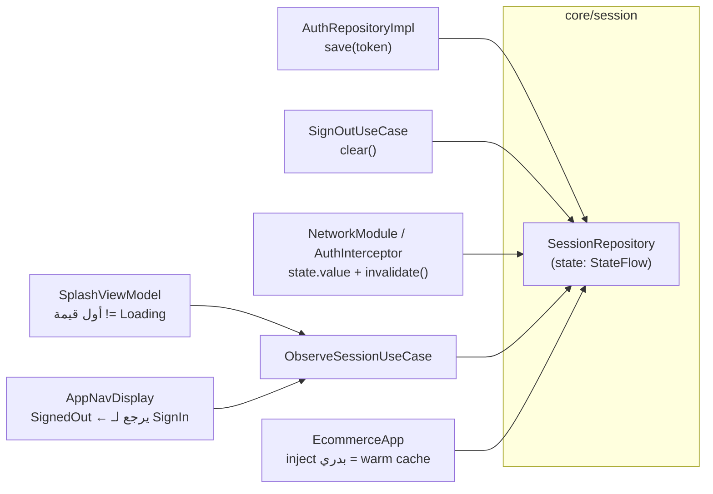
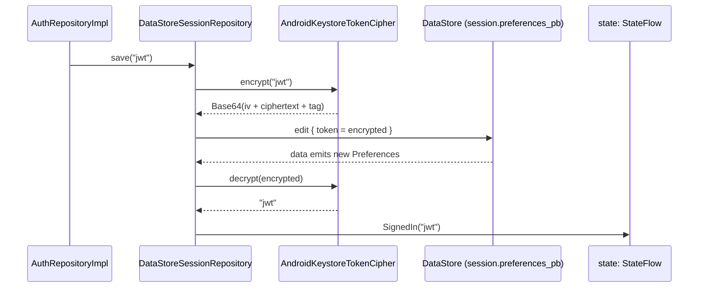
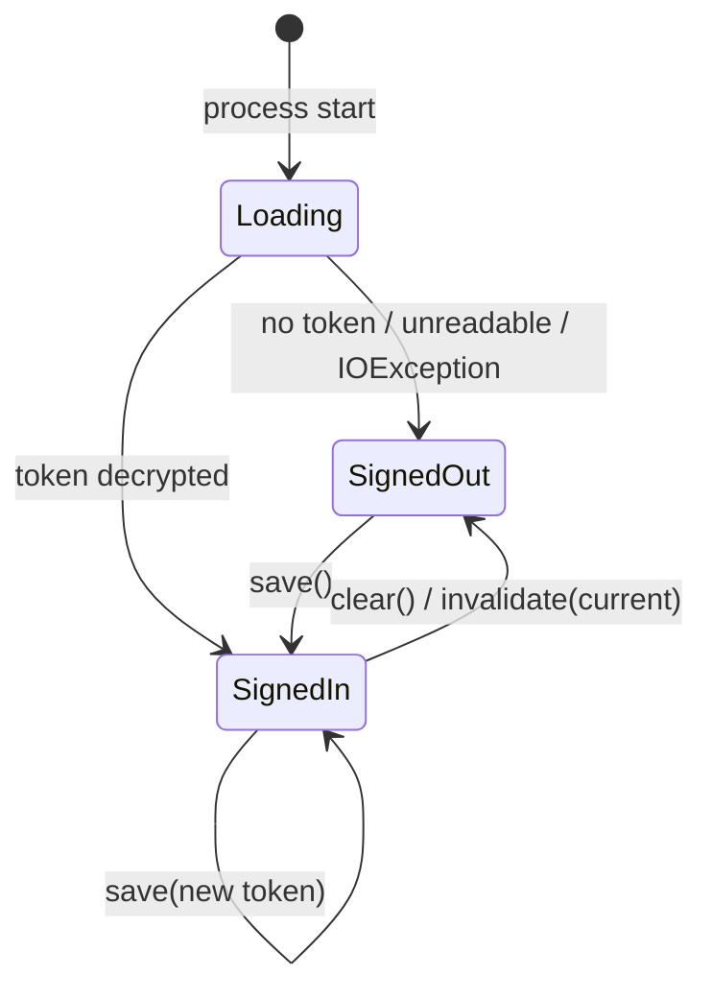
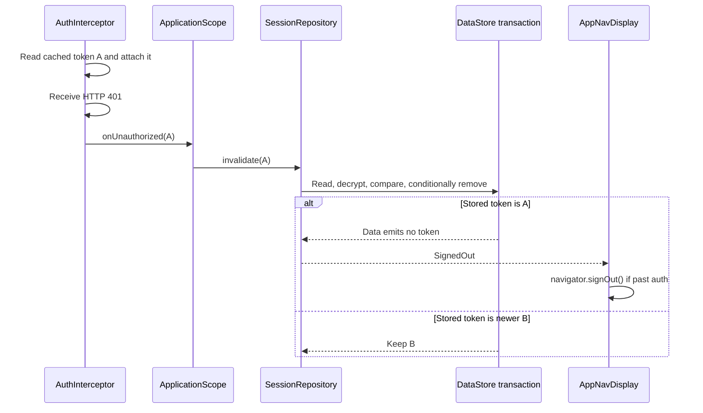

<div dir="rtl" align="right">

# شرح باكدج <code dir="ltr">core/session</code> سطر بسطر

تمت مراجعة الشرح مقابل الكود يوم **28 أكتوبر 2026**. ده شرح للتنفيذ الحالي وحدوده، مش ضمان إن كل مسار فشل متعالج. أرقام السطور في المقتطفات تعليمية؛ المرجع هو اسم الدالة في الملف الحالي. اقرأ معه [شرح navigation](navigation-walkthrough.md).

**ترتيب القراءة:** حالات الجلسة والعقد ← التشفير ← DataStore وFlow ← Hilt ← الاختبارات ← [الربط والسيناريوهات العملية](#الربط-والسيناريوهات-العملية).

المسار: <code dir="ltr">app/src/main/java/com/example/ecommercenativec19/core/session/</code>

الهدف من الملف ده إنك تقدر تشرح لأي حد ليه كل سطر في الباكدج موجود، مش بس "بيعمل إيه".

---

## الصورة الكبيرة الأول

الباكدج دي هي **المالك الوحيد للـ <code dir="ltr">token</code>** في الأبلكيشن. أي حتة محتاجة تعرف "اليوزر عامل <code dir="ltr">sign in</code> ولا لأ" أو محتاجة الـ <code dir="ltr">token</code> نفسه، بتسأل <code dir="ltr">SessionRepository</code> بس.

المسؤوليات الأربعة:

1. حفظ الـ <code dir="ltr">token</code> على الديسك **مشفّر** (مش <code dir="ltr">plain text</code>).
2. قراءته عند فتح الأبلكيشن، وعرضه كـ <code dir="ltr">StateFlow&lt;SessionState&gt;</code> في الميموري.
3. مسحه عند <code dir="ltr">sign out</code>.
4. مسحه **بأمان** لما السيرفر يرجع <code dir="ltr">401</code>، من غير ما يمسح <code dir="ltr">token</code> أحدث اتعمل في النص.

### الملفات ودور كل واحد

</div>

<div dir="ltr" align="left">

```text
core/session/
├── SessionState.kt                 ← الحالة: Loading / SignedOut / SignedIn(token)
├── SessionRepository.kt            ← الـ contract (interface) اللي الكل بيعتمد عليه
├── DataStoreSessionRepository.kt   ← التنفيذ الحقيقي: DataStore + تشفير + StateFlow
├── TokenCipher.kt                  ← interface للتشفير (عشان التستات)
├── AndroidKeystoreTokenCipher.kt   ← التشفير الحقيقي: AES-256/GCM بمفتاح في Android Keystore
└── SessionModule.kt                ← Hilt wiring: scope + DataStore + cipher + binding

test/.../core/session/
├── DataStoreSessionRepositoryTest.kt  ← تستات التنفيذ الحقيقي
└── FakeSessionRepository.kt           ← fake في الميموري لتستات الـ features التانية
```

</div>

<div dir="rtl" align="right">

### مين بيستخدم الباكدج دي

</div>

<div dir="ltr" align="left">



</div>

<div dir="rtl" align="right">

### رحلة الـ <code dir="ltr">token</code> من الشبكة للديسك والعكس

</div>

<div dir="ltr" align="left">



</div>

<div dir="rtl" align="right">

لاحظ إن <code dir="ltr">save()</code> **مش بيكتب في الـ <code dir="ltr">state</code> مباشرة**. الـ <code dir="ltr">state</code> دايمًا مشتق من الديسك. ده معناه إن مصدر الحقيقة واحد (<code dir="ltr">single source of truth</code>) والميموري مجرد <code dir="ltr">cache</code>.

---

## الملف الأول: <code dir="ltr">SessionState.kt</code>

</div>

<div dir="ltr" align="left">

```kotlin
1  package com.example.ecommercenativec19.core.session
3  /**
4   * Whether the user is signed in. [Loading] exists because the token is read from disk asynchronously after process
5   * start; consumers that must not guess (Splash) wait for the first non-[Loading] value.
6   */
7  sealed interface SessionState {
8      data object Loading : SessionState
9      data object SignedOut : SessionState
11     data class SignedIn(val token: String) : SessionState {
12         // The generated toString would print the token into any log or assertion message that shows the state.
13         override fun toString(): String = "SignedIn"
14     }
15 }
```

</div>

<div dir="rtl" align="right">

- السطر 7: استخدمنا <code dir="ltr">sealed interface</code> مش <code dir="ltr">enum</code> لأن حالة واحدة (<code dir="ltr">SignedIn</code>) شايلة داتا (<code dir="ltr">token</code>). ومش <code dir="ltr">sealed class</code> لأن مفيش state مشتركة محتاجة constructor؛ الـ <code dir="ltr">interface</code> أخف ويسمح للأنواع إنها تكون <code dir="ltr">data object</code>.
- السطر 7 كمان: كونه <code dir="ltr">sealed</code> يسمح بـ<code dir="ltr">when</code> exhaustive بدون <code dir="ltr">else</code>. ده مستخدم مع <code dir="ltr">Stored</code> في الريبو. لكن <code dir="ltr">SplashViewModel</code> فيه <code dir="ltr">else</code>، فإضافة حالة لـ<code dir="ltr">SessionState</code> مش هتجبره على معالجة مستقلة؛ هتدخل في مسار SignIn الحالي.
- السطر 8: حالة <code dir="ltr">Loading</code> مش رفاهية. القراءة من الديسك <code dir="ltr">async</code>، فأول ما البروسيس يقوم إحنا **مش عارفين** لسه. من غيرها كنا هنضطر نبدأ بـ <code dir="ltr">SignedOut</code> وده يخلي الـ <code dir="ltr">Splash</code> يودّي اليوزر لـ <code dir="ltr">Sign in</code> غلط لثانية وبعدين يرجعه <code dir="ltr">Home</code>.
- السطر 8 و 9: استخدمنا <code dir="ltr">data object</code> (Kotlin 1.9+) بدل <code dir="ltr">object</code> عادي عشان <code dir="ltr">toString()</code> يطلع <code dir="ltr">Loading</code> بدل <code dir="ltr">SessionState$Loading@1a2b</code>، ويبقى <code dir="ltr">equals</code> واضح في التستات.
- السطر 11: حالة <code dir="ltr">SignedIn</code> هي <code dir="ltr">data class</code> عشان <code dir="ltr">equals</code> يقارن الـ <code dir="ltr">token</code>. ده مهم في التستات: <code dir="ltr">assertEquals(SignedIn("jwt-1"), ...)</code>.
- السطر 13: هنا نقطة أمان. الـ <code dir="ltr">data class</code> بيولّد <code dir="ltr">toString()</code> = <code dir="ltr">SignedIn(token=eyJhbGci...)</code>. أي <code dir="ltr">Log.d("state=$state")</code> أو رسالة فشل تست أو <code dir="ltr">crash report</code> كان هيسرّب الـ <code dir="ltr">token</code>. فعملنا <code dir="ltr">override</code> يرجّع الاسم بس. لاحظ إن <code dir="ltr">equals</code> و <code dir="ltr">hashCode</code> لسه شغالين على الـ <code dir="ltr">token</code> عادي، احنا غيّرنا الطباعة بس.
- التست اللي بيحمي ده: <code dir="ltr">SignedIn toString does not reveal the token</code> في <code dir="ltr">DataStoreSessionRepositoryTest</code>.

---

## الملف التاني: <code dir="ltr">SessionRepository.kt</code>

</div>

<div dir="ltr" align="left">

```kotlin
5  /**
6   * The single owner of the auth token. [state] is an in-memory cache, so OkHttp threads can read the current token
7   * without waiting for disk.
8   */
9  interface SessionRepository {
10     val state: StateFlow<SessionState>
12     suspend fun save(token: String)
14     suspend fun clear()
16     /**
17      * Signs out only if [rejectedToken] is still the current one. A 401 for a request sent with an old token must
18      * not wipe a session the user created in the meantime.
19      */
20     suspend fun invalidate(rejectedToken: String)
21 }
```

</div>

<div dir="rtl" align="right">

- السطر 9: ده <code dir="ltr">interface</code> عشان سببين حقيقيين مش ceremony:
  - أولًا الـ features التانية (<code dir="ltr">Auth</code>, <code dir="ltr">Cart</code>, <code dir="ltr">Wishlist</code>, <code dir="ltr">Account</code>) بتتست بـ <code dir="ltr">FakeSessionRepository</code> من غير <code dir="ltr">DataStore</code> ولا <code dir="ltr">Keystore</code>.
  - ثانيًا التنفيذ الحقيقي محتاج Android (<code dir="ltr">Keystore</code>)، والـ <code dir="ltr">interface</code> يفصل الـ contract عن المنصة.
- السطر 10: النوع <code dir="ltr">StateFlow</code> مش <code dir="ltr">Flow</code> عادي. الفرق الجوهري: <code dir="ltr">StateFlow</code> دايمًا عنده <code dir="ltr">.value</code> متاح **synchronously**. الـ <code dir="ltr">AuthInterceptor</code> بيشتغل على OkHttp thread ومينفعش يعمل <code dir="ltr">suspend</code> ولا يستنى ديسك، فبيقرأ <code dir="ltr">state.value</code> على طول (شوف <code dir="ltr">NetworkModule.kt</code> سطر 44).
- السطر 12: الدالة <code dir="ltr">save</code> هي <code dir="ltr">suspend</code> لأن الكتابة في <code dir="ltr">DataStore</code> عملية I/O. مش بترجع حاجة؛ لو فشلت بترمي <code dir="ltr">exception</code> والـ caller (<code dir="ltr">AuthRepositoryImpl</code>) هو اللي يقرر يحوّلها لـ error state.
- السطر 14: الدالة <code dir="ltr">clear</code> بتمسح بدون شروط، ودي اللي بيستخدمها <code dir="ltr">SignOutUseCase</code> (اليوزر داس <code dir="ltr">Log out</code> بنفسه).
- السطر 20: الدالة <code dir="ltr">invalidate</code> هي أذكى حتة في الباكدج. ليه مش <code dir="ltr">clear()</code> وخلاص لما ييجي <code dir="ltr">401</code>؟ تخيل السيناريو ده:

</div>

<div dir="ltr" align="left">

```text
t0  request A اتبعت بـ token قديم (jwt-A)
t1  اليوزر عمل sign in تاني ← اتحفظ jwt-B
t2  رد request A وصل: 401 (لأن jwt-A انتهى)
t3  لو عملنا clear() ← jwt-B الجديد اتمسح واليوزر اترمى برّه غلط
```

</div>

<div dir="rtl" align="right">

عشان كده <code dir="ltr">invalidate</code> بتاخد الـ <code dir="ltr">token</code> اللي اترفض، وبتمسح **بس لو** هو لسه الحالي.

---

## الملف التالت: <code dir="ltr">TokenCipher.kt</code>

</div>

<div dir="ltr" align="left">

```kotlin
3  /** Reversible encryption of the token for storage. An interface so JVM tests can use a fake instead of the Keystore. */
4  interface TokenCipher {
5      /** Returns a storable string. Throws if the key is unusable. */
6      fun encrypt(plainText: String): String
8      /** Throws if [cipherText] is corrupt or was produced by another key (for example after a backup restore). */
9      fun decrypt(cipherText: String): String
10 }
```

</div>

<div dir="rtl" align="right">

- السطر 3: السبب الوحيد لوجود الـ <code dir="ltr">interface</code> مكتوب في الـ KDoc: الـ <code dir="ltr">Android Keystore</code> مش موجود في JVM unit tests (<code dir="ltr">src/test</code>). من غير الـ <code dir="ltr">interface</code> كنا هنحتاج <code dir="ltr">Robolectric</code> أو instrumented tests عشان نتست منطق الريبو. ده مثال لـ abstraction "مكسوبة" مش speculative.
- السطر 6: الدالة بترجع <code dir="ltr">String</code> مش <code dir="ltr">ByteArray</code> لأن <code dir="ltr">Preferences DataStore</code> بيخزن <code dir="ltr">String</code>. التحويل لـ <code dir="ltr">Base64</code> جوه التنفيذ.
- السطر 6 و 9: الدالتين مش <code dir="ltr">suspend</code>. عمليات الـ <code dir="ltr">Keystore</code> سريعة نسبيًا و blocking، والقرار ده بيحط مسؤولية الـ thread على الـ caller (شوف قسم القيود تحت).
- السطر 8: الـ contract صريح إن <code dir="ltr">decrypt</code> **بترمي** لو الداتا بايظة أو اتشفرت بمفتاح تاني. الريبو بيعتمد على ده عشان يكتشف حالة <code dir="ltr">Unreadable</code>.

---

## الملف الرابع: <code dir="ltr">AndroidKeystoreTokenCipher.kt</code>

</div>

<div dir="ltr" align="left">

```kotlin
12 /**
13  * AES-256/GCM with a non-exportable key in the Android Keystore. Stored format: Base64(iv || ciphertext+tag).
14  *
15  * Used instead of `androidx.security:security-crypto`, which is deprecated; the Keystore API it wrapped is
16  * stable and this is all the app needs. The key is not part of backups, so a restored blob fails to decrypt and
17  * the session is simply cleared.
18  */
19 class AndroidKeystoreTokenCipher : TokenCipher {
```

</div>

<div dir="rtl" align="right">

- السطر 13: الخوارزمية <code dir="ltr">AES-256/GCM</code>، وده <code dir="ltr">authenticated encryption</code>: مش بس بيخفي الداتا، ده كمان بيضيف <code dir="ltr">tag</code> يكشف لو حد عدّل الـ <code dir="ltr">ciphertext</code>. لو اتغير بايت واحد، <code dir="ltr">decrypt</code> بترمي <code dir="ltr">AEADBadTagException</code>.
- السطر 13 كمان: كلمة <code dir="ltr">non-exportable key</code> معناها إن التطبيق بيطلب عمليات بالمفتاح بدل استخراج مادته السرية عبر الـAPI. وجود hardware backing أو StrongBox مش مضمون بالكود ده؛ بيعتمد على الجهاز وإمكاناته. والـtoken بعد فك التشفير موجود نصًا في ذاكرة التطبيق.
- السطر 15: بديل كان ممكن: <code dir="ltr">EncryptedSharedPreferences</code> من <code dir="ltr">security-crypto</code>. المكتبة دي اتعملها <code dir="ltr">deprecate</code>، فبدل ما نعتمد على مكتبة ميتة، استخدمنا الـ API اللي هي أصلًا كانت بتلفّه، وهو stable من API 23.
- السطر 16: المفتاح مش بيدخل في الـ <code dir="ltr">backup</code>. لو اليوزر عمل restore على موبايل جديد، الـ <code dir="ltr">blob</code> المشفر هيبقى من غير مفتاح ← <code dir="ltr">decrypt</code> يفشل ← الريبو يعتبره <code dir="ltr">SignedOut</code>. وعشان كده كمان استثنينا الملف من الـ backup خالص في <code dir="ltr">backup_rules.xml</code> و <code dir="ltr">data_extraction_rules.xml</code>.

### الدالة <code dir="ltr">encrypt</code>

</div>

<div dir="ltr" align="left">

```kotlin
21 override fun encrypt(plainText: String): String {
22     val cipher = Cipher.getInstance(TRANSFORMATION)
23     cipher.init(Cipher.ENCRYPT_MODE, getOrCreateKey())
24     val encrypted = cipher.doFinal(plainText.toByteArray(Charsets.UTF_8))
25     return Base64.encodeToString(cipher.iv + encrypted, Base64.NO_WRAP)
26 }
```

</div>

<div dir="rtl" align="right">

- السطر 22: بنعمل <code dir="ltr">Cipher</code> جديد كل مرة لأن <code dir="ltr">Cipher</code> مش <code dir="ltr">thread-safe</code> وفيه state داخلية. التكلفة بسيطة.
- السطر 23: لاحظ إننا **مش** بنمرر <code dir="ltr">IV</code>. الـ <code dir="ltr">Keystore</code> بيفرض افتراضيًا <code dir="ltr">randomized encryption</code>، فهو اللي بيولد <code dir="ltr">IV</code> عشوائي 12 بايت. ده مهم جدًا: في <code dir="ltr">GCM</code> لو استخدمت نفس الـ <code dir="ltr">IV</code> مرتين بنفس المفتاح، الأمان بينهار.
- السطر 24: الدالة <code dir="ltr">doFinal</code> بترجع <code dir="ltr">ciphertext</code> وفي آخره الـ <code dir="ltr">tag</code> (16 بايت). بنحدد <code dir="ltr">UTF_8</code> صراحة بدل ما نعتمد على الـ default charset.
- السطر 25: بنلزق الـ <code dir="ltr">IV</code> قدام الـ <code dir="ltr">ciphertext</code> لأن الـ <code dir="ltr">decrypt</code> محتاجه. الـ <code dir="ltr">IV</code> مش سر، عادي يتخزن جنب الداتا. استخدمنا <code dir="ltr">NO_WRAP</code> عشان <code dir="ltr">Base64</code> مايضيفش <code dir="ltr">\n</code> كل 76 حرف.

</div>

<div dir="ltr" align="left">

```text
الشكل المتخزن:
Base64( [ IV: 12 bytes ][ ciphertext: N bytes ][ GCM tag: 16 bytes ] )
```

</div>

<div dir="rtl" align="right">

### الدالة <code dir="ltr">decrypt</code>

</div>

<div dir="ltr" align="left">

```kotlin
28 override fun decrypt(cipherText: String): String {
29     val bytes = Base64.decode(cipherText, Base64.NO_WRAP)
30     require(bytes.size > IV_SIZE_BYTES) { "Cipher text too short" }
31     val cipher = Cipher.getInstance(TRANSFORMATION)
32     cipher.init(Cipher.DECRYPT_MODE, getOrCreateKey(), GCMParameterSpec(TAG_SIZE_BITS, bytes, 0, IV_SIZE_BYTES))
33     val plain = cipher.doFinal(bytes, IV_SIZE_BYTES, bytes.size - IV_SIZE_BYTES)
34     return String(plain, Charsets.UTF_8)
35 }
```

</div>

<div dir="rtl" align="right">

- السطر 29: عكس السطر 25. لو الـ string مش <code dir="ltr">Base64</code> سليم هترمي <code dir="ltr">IllegalArgumentException</code>، وده متوقع ومتعامل معاه في الريبو.
- السطر 30: الفحص ده بيدّي رسالة واضحة بدل <code dir="ltr">ArrayIndexOutOfBounds</code> غامضة لو الداتا قصيرة/بايظة. الدالة <code dir="ltr">require</code> بترمي <code dir="ltr">IllegalArgumentException</code>.
- السطر 32: الكلاس <code dir="ltr">GCMParameterSpec</code> بياخد طول الـ <code dir="ltr">tag</code> بالـ **bits** (128) والـ <code dir="ltr">IV</code> من أول 12 بايت. الـ overload ده بيقرأ من نفس الـ array من غير ما نعمل <code dir="ltr">copyOfRange</code>.
- السطر 33: بنفك من البايت 12 لحد الآخر. هنا الـ <code dir="ltr">GCM</code> بيتحقق من الـ <code dir="ltr">tag</code>؛ لو المفتاح غلط أو الداتا اتلعب فيها ← <code dir="ltr">AEADBadTagException</code>.

### الدالة <code dir="ltr">getOrCreateKey</code>

</div>

<div dir="ltr" align="left">

```kotlin
37 private fun getOrCreateKey(): SecretKey {
38     val keyStore = KeyStore.getInstance(ANDROID_KEYSTORE).apply { load(null) }
39     (keyStore.getKey(KEY_ALIAS, null) as? SecretKey)?.let { return it }
40     val generator = KeyGenerator.getInstance(KeyProperties.KEY_ALGORITHM_AES, ANDROID_KEYSTORE)
41     generator.init(
42         KeyGenParameterSpec.Builder(KEY_ALIAS, KeyProperties.PURPOSE_ENCRYPT or KeyProperties.PURPOSE_DECRYPT)
43             .setBlockModes(KeyProperties.BLOCK_MODE_GCM)
44             .setEncryptionPaddings(KeyProperties.ENCRYPTION_PADDING_NONE)
45             .setKeySize(KEY_SIZE_BITS)
46             .build(),
47     )
48     return generator.generateKey()
49 }
```

</div>

<div dir="rtl" align="right">

- السطر 38: الـ provider اسمه <code dir="ltr">AndroidKeyStore</code> وهو مش ملف بكلمة سر زي <code dir="ltr">JKS</code>، فـ <code dir="ltr">load(null)</code> هي الطريقة الرسمية لتهيئته.
- السطر 39: لو المفتاح موجود من قبل نرجعه. استخدمنا <code dir="ltr">as? SecretKey</code> كـ safe cast؛ لو لأي سبب الـ alias شايل نوع تاني، نكمل ونولّد بدل ما نـ crash.
- السطر 40: لاحظ الـ provider في <code dir="ltr">getInstance</code> هو <code dir="ltr">ANDROID_KEYSTORE</code>. ده اللي بيخلي المفتاح يتولد ويعيش جوه الـ <code dir="ltr">Keystore</code> مش في ميموري الأبلكيشن.
- السطر 42: الصلاحيات <code dir="ltr">ENCRYPT or DECRYPT</code> بس. الـ <code dir="ltr">Keystore</code> بيفرض القيود دي؛ المفتاح مينفعش يستخدم لـ <code dir="ltr">sign</code> مثلًا.
- السطر 43 و 44: الـ <code dir="ltr">GCM</code> هو stream mode فمش محتاج <code dir="ltr">padding</code>، عشان كده <code dir="ltr">NONE</code>. لازم يطابقوا الـ <code dir="ltr">TRANSFORMATION</code> في السطر 54 وإلا <code dir="ltr">init</code> يرمي.
- السطر 45: الطول 256 bit.
- الكود مش بيطلب <code dir="ltr">setUserAuthenticationRequired(true)</code>. إضافة اشتراط مصادقة المستخدم هتحتاج تصميمًا لتوقيت المصادقة ومدة صلاحيتها؛ مش معناها دائمًا بصمة لكل عملية. وقد تمنع استعادة الجلسة في الخلفية. الـinterceptor نفسه بيقرأ cache ولا بينادي <code dir="ltr">decrypt</code>.

### الـ <code dir="ltr">companion object</code>

</div>

<div dir="ltr" align="left">

```kotlin
51 private companion object {
52     const val ANDROID_KEYSTORE = "AndroidKeyStore"
53     const val KEY_ALIAS = "session_token_key"
54     const val TRANSFORMATION = "AES/GCM/NoPadding"
55     const val KEY_SIZE_BITS = 256
56     const val IV_SIZE_BYTES = 12
57     const val TAG_SIZE_BITS = 128
58 }
```

</div>

<div dir="rtl" align="right">

- السطر 51: هو <code dir="ltr">private</code> عشان الثوابت دي تفاصيل تنفيذ ومحدش برّه محتاجها.
- السطر 53: الـ alias ده لو اتغير، كل اليوزرز الحاليين هيتعملهم <code dir="ltr">sign out</code> (المفتاح القديم مش هيتلاقى ← <code dir="ltr">decrypt</code> يفشل). يعني ده عمليًا جزء من الـ "schema".
- السطر 56: القيمة 12 بايت هي الحجم الموصى بيه لـ <code dir="ltr">IV</code> في <code dir="ltr">GCM</code> (NIST) والـ default في الـ <code dir="ltr">Keystore</code>.
- السطر 57: الـ 128 bit هو أقوى طول <code dir="ltr">tag</code>.

---

## الملف الخامس: <code dir="ltr">DataStoreSessionRepository.kt</code> (القلب)

### الـ constructor

</div>

<div dir="ltr" align="left">

```kotlin
28 class DataStoreSessionRepository @Inject constructor(
29     private val dataStore: DataStore<Preferences>,
30     private val cipher: TokenCipher,
31     @param:ApplicationScope private val scope: CoroutineScope,
32 ) : SessionRepository {
```

</div>

<div dir="rtl" align="right">

- السطر 28: الـ annotation <code dir="ltr">@Inject constructor</code> بتخلي Hilt يعرف يبني الكلاس من غير <code dir="ltr">@Provides</code>. الربط بالـ <code dir="ltr">interface</code> بيحصل في <code dir="ltr">SessionModule</code> بـ <code dir="ltr">@Binds</code>.
- السطر 29: بيستقبل <code dir="ltr">DataStore</code> جاهز مش <code dir="ltr">Context</code>. ده اللي بيخلي التست يحقن <code dir="ltr">InMemoryPreferencesStore</code>.
- السطر 30: بيستقبل <code dir="ltr">TokenCipher</code> (الـ interface) فالتست يحقن <code dir="ltr">FakeCipher</code>.
- السطر 31: الـ <code dir="ltr">scope</code> اللي <code dir="ltr">stateIn</code> هيعيش فيه. لازم يكون عمره زي عمر البروسيس (مش <code dir="ltr">viewModelScope</code>) لأن الـ session لازم تفضل شغالة مهما الشاشات اتقفلت. كلمة <code dir="ltr">@param:</code> هي الـ use-site target الصح عشان الـ qualifier يتحط على باراميتر الـ constructor اللي Dagger بيقراه، مش على الـ property.

### الـ <code dir="ltr">Stored</code> الداخلي

</div>

<div dir="ltr" align="left">

```kotlin
34 private sealed interface Stored {
35     data object Absent : Stored
36     data object Unreadable : Stored
37     data class Token(val value: String) : Stored {
38         override fun toString(): String = "Token"
39     }
40 }
```

</div>

<div dir="rtl" align="right">

- السطر 34: ليه نوع داخلي تاني غير <code dir="ltr">SessionState</code>؟ لأن طبقة التخزين فيها **3** حالات والـ UI محتاج **2** بس:
  - أولًا <code dir="ltr">Absent</code>: مفيش حاجة متخزنة ← <code dir="ltr">SignedOut</code>.
  - ثانيًا <code dir="ltr">Unreadable</code>: فيه حاجة بس مش عارفين نفكها ← <code dir="ltr">SignedOut</code> **و** لازم نمسحها.
  - ثالثًا <code dir="ltr">Token</code>: تمام ← <code dir="ltr">SignedIn</code>.
  الفرق بين <code dir="ltr">Absent</code> و <code dir="ltr">Unreadable</code> مهم للريبو بس (عشان يقرر يمسح)، فمش من حق الـ UI يشوفه. ده سبب إنه <code dir="ltr">private</code>.
- السطر 38: نفس حماية <code dir="ltr">toString</code> اللي في <code dir="ltr">SessionState</code>.

### الـ <code dir="ltr">state</code> (أهم جزء)

</div>

<div dir="ltr" align="left">

```kotlin
42 override val state: StateFlow<SessionState> = dataStore.data
43     // An unreadable file is recoverable: act as if nothing is stored.
44     .catch { if (it is IOException) emit(emptyPreferences()) else throw it }
45     .map { preferences -> preferences[TOKEN_KEY].toStored() }
46     .onEach { if (it is Stored.Unreadable) scope.launch { clear() } }
47     .map { stored ->
48         when (stored) {
49             is Stored.Token -> SessionState.SignedIn(stored.value)
50             Stored.Absent, Stored.Unreadable -> SessionState.SignedOut
51         }
52     }
53     .stateIn(scope, SharingStarted.Eagerly, SessionState.Loading)
```

</div>

<div dir="rtl" align="right">

- السطر 42: الـ <code dir="ltr">dataStore.data</code> هو <code dir="ltr">Flow&lt;Preferences&gt;</code> بيطلّع قيمة جديدة مع كل كتابة. يعني أي <code dir="ltr">save</code> / <code dir="ltr">clear</code> / <code dir="ltr">invalidate</code> هيوصل هنا لوحده. ده مفهوم الـ **reactive single source of truth**.
- السطر 44: لو upstream رمى <code dir="ltr">IOException</code>، بنصدر <code dir="ltr">emptyPreferences()</code> فتتحول الحالة لـ<code dir="ltr">SignedOut</code>. ده fallback في الذاكرة، مش إصلاح للملف ولا corruption handler. بعد <code dir="ltr">catch</code> الـFlow ممكن يكتمل، ومفيش <code dir="ltr">retry</code> يعيد الاشتراك؛ بالتالي مش مضمون إن الكتابات التالية تحدّث الـStateFlow في نفس نسخة الريبو. غير <code dir="ltr">IOException</code> بيُعاد رميه.
- السطر 44 كمان: مكان <code dir="ltr">catch</code> مهم. الـ <code dir="ltr">catch</code> بيمسك أخطاء الـ **upstream** بس (اللي فوقه)، فهو بيحمي من أخطاء الديسك مش من أخطاء الـ <code dir="ltr">map</code> اللي تحته.
- السطر 45: بنطلع القيمة المشفرة ونحولها لـ <code dir="ltr">Stored</code> (فك التشفير جوه <code dir="ltr">toStored</code>).
- السطر 46: لو الـ <code dir="ltr">blob</code> مش قابل للفك، بنمسحه. ليه <code dir="ltr">scope.launch</code> ومش <code dir="ltr">clear()</code> مباشرة؟
  - أولًا <code dir="ltr">onEach</code> هنا جزء من سلسلة الـ collection، والـ <code dir="ltr">clear()</code> بيكتب في نفس الـ <code dir="ltr">DataStore</code> اللي إحنا بنقرأ منه. فصله في coroutine منفصلة بيخلي الـ pipeline ميستناش على كتابة هو نفسه مصدرها.
  - ثانيًا الكتابة دي هتطلّع emission جديدة (<code dir="ltr">Absent</code>) ← <code dir="ltr">SignedOut</code> تاني، وده عادي لأن <code dir="ltr">StateFlow</code> بيعمل <code dir="ltr">distinctUntilChanged</code> تلقائيًا فمش هيبعت <code dir="ltr">SignedOut</code> مرتين للـ collectors.
  - ليه نمسح أصلًا؟ الـ KDoc فوق الكلاس بيقول: عشان اليوزر يروح لـ <code dir="ltr">Sign in</code> بدل ما يفضل في loop من <code dir="ltr">401</code>. وكمان عشان كل launch جديد مايحاولش يفك نفس الزبالة.
- السطر 47 لـ 51: التحويل من حالة التخزين لحالة الـ domain. الـ <code dir="ltr">when</code> exhaustive بفضل <code dir="ltr">sealed</code>، فمفيش <code dir="ltr">else</code>.
- السطر 53: الدالة <code dir="ltr">stateIn</code> بتحول الـ cold <code dir="ltr">Flow</code> لـ hot <code dir="ltr">StateFlow</code>:
  - أولًا <code dir="ltr">scope</code>: الـ <code dir="ltr">ApplicationScope</code>، يعني الـ collection عايش طول عمر البروسيس.
  - ثانيًا <code dir="ltr">SharingStarted.Eagerly</code>: يبدأ يقرا من الديسك **فورًا** أول ما الأوبجكت يتعمل، مش لما أول حد يعمل <code dir="ltr">collect</code>. ده مع <code dir="ltr">EcommerceApp</code> اللي بيحقن الريبو في <code dir="ltr">onCreate</code> بيخلي القراءة تبدأ مع أول ثانية في الأبلكيشن، فلما <code dir="ltr">Splash</code> يسأل يكون الـ cache غالبًا جاهز. البديل <code dir="ltr">WhileSubscribed</code> كان هيوقف القراءة لما مفيش collectors، وده يكسر الـ <code dir="ltr">interceptor</code> اللي بيقرأ <code dir="ltr">.value</code> من غير ما يعمل <code dir="ltr">collect</code>.
  - ثالثًا <code dir="ltr">SessionState.Loading</code>: القيمة الابتدائية لحد ما الديسك يرد.

</div>

<div dir="ltr" align="left">



</div>

<div dir="rtl" align="right">

### الدالة <code dir="ltr">save</code>

</div>

<div dir="ltr" align="left">

```kotlin
55 override suspend fun save(token: String) {
56     val encrypted = cipher.encrypt(token)
57     dataStore.edit { it[TOKEN_KEY] = encrypted }
58 }
```

</div>

<div dir="rtl" align="right">

- السطر 56: التشفير **قبل** <code dir="ltr">edit</code> مش جواه. الـ <code dir="ltr">edit</code> transaction والمفروض يكون سريع وخالي من شغل تقيل. وكمان لو <code dir="ltr">encrypt</code> فشل (مفتاح بايظ) بيرمي قبل ما نلمس الديسك خالص.
- السطر 57: الدالة <code dir="ltr">edit</code> هي read-modify-write ذرّية (atomic). مش بنحدث <code dir="ltr">state</code> بإيدينا؛ الـ <code dir="ltr">dataStore.data</code> هيطلّع القيمة الجديدة والـ pipeline في السطر 42 يحدث <code dir="ltr">state</code> لوحده.
- ملحوظة: <code dir="ltr">save</code> مابيعملش <code dir="ltr">catch</code>. لو فشل الـ exception بيطلع لـ <code dir="ltr">AuthRepositoryImpl</code> اللي هو الـ boundary بتاع الداتا وبيحوله لـ error result. ده متست بـ <code dir="ltr">FakeSessionRepository.saveError</code>.

### الدالة <code dir="ltr">clear</code>

</div>

<div dir="ltr" align="left">

```kotlin
60 override suspend fun clear() {
61     dataStore.edit { it.remove(TOKEN_KEY) }
62 }
```

</div>

<div dir="rtl" align="right">

- السطر 61: بنمسح المفتاح بس، مش <code dir="ltr">clear()</code> للـ <code dir="ltr">Preferences</code> كلها. لو اتضاف بعدين حاجة تانية في نفس الملف، مش هتتمسح بالغلط.

### الدالة <code dir="ltr">invalidate</code>

</div>

<div dir="ltr" align="left">

```kotlin
64 override suspend fun invalidate(rejectedToken: String) {
65     // Compared against the stored value inside the transaction, not against [state]: that cache lags behind
66     // save(), so a late 401 for the old token could otherwise wipe the token that just replaced it.
67     dataStore.edit { preferences ->
68         val stored = preferences[TOKEN_KEY].toStored()
69         if (stored !is Stored.Token || stored.value == rejectedToken) preferences.remove(TOKEN_KEY)
70     }
71 }
```

</div>

<div dir="rtl" align="right">

- السطر 65 و 66: ده أهم تعليق في الباكدج. الحل "البديهي" كان:

</div>

<div dir="ltr" align="left">

```kotlin
// ❌ غلط
if ((state.value as? SignedIn)?.token == rejectedToken) clear()
```

</div>

<div dir="rtl" align="right">

المشكلة إن <code dir="ltr">state</code> بيتحدث **بعد** ما <code dir="ltr">save()</code> يخلص، عن طريق emission على coroutine تانية. فممكن تبقى <code dir="ltr">save("jwt-B")</code> خلصت على الديسك، و <code dir="ltr">state.value</code> لسه بيقول <code dir="ltr">jwt-A</code>. ساعتها <code dir="ltr">401</code> متأخر لـ <code dir="ltr">jwt-A</code> هيقارن مع <code dir="ltr">jwt-A</code> القديم في الـ cache ← يمسح <code dir="ltr">jwt-B</code> الجديد.

- السطر 67: الحل إننا نقرأ ونقارن ونمسح **جوه نفس الـ transaction**. الـ <code dir="ltr">DataStore</code> بيضمن إن الـ <code dir="ltr">edit</code> blocks بتتنفذ واحدة ورا التانية (serialized)، فالقيمة اللي في <code dir="ltr">preferences</code> هي الحقيقة الحالية على الديسك مش cache.
- السطر 68: بنفك القيمة المخزنة عشان نقارن بالـ plain token.
- السطر 69: بنمسح في حالتين:
  - أولًا <code dir="ltr">stored !is Stored.Token</code>: يعني <code dir="ltr">Absent</code> (المسح مالوش أثر) أو <code dir="ltr">Unreadable</code> (زبالة، امسحها).
  - ثانيًا <code dir="ltr">stored.value == rejectedToken</code>: الـ token المرفوض هو فعلًا الحالي.
  غير كده (فيه token تاني أحدث) ← مانعملش حاجة.
- التست اللي بيثبت السيناريو بالظبط: <code dir="ltr">a late rejection of the old token does not clear the token that replaced it</code>.

### الدالة <code dir="ltr">toStored</code>

</div>

<div dir="ltr" align="left">

```kotlin
73 private fun String?.toStored(): Stored {
74     if (this == null) return Stored.Absent
75     return try {
76         Stored.Token(cipher.decrypt(this))
77     } catch (e: CancellationException) {
78         throw e
79     } catch (e: Exception) {
80         Stored.Unreadable
81     }
82 }
```

</div>

<div dir="rtl" align="right">

- السطر 73: الدالة extension على <code dir="ltr">String?</code> عشان تتقرا طبيعي في الاستخدام: <code dir="ltr">preferences[TOKEN_KEY].toStored()</code>.
- السطر 74: لو مفيش قيمة ← <code dir="ltr">Absent</code>.
- السطر 77 و 78: القاعدة العامة في coroutines: أي <code dir="ltr">catch (e: Exception)</code> لازم يرمي <code dir="ltr">CancellationException</code> تاني، وإلا هتكسر الـ structured concurrency (الـ coroutine تتلغي بس الكود يكمل كأن مفيش حاجة). بصراحة <code dir="ltr">decrypt</code> مش <code dir="ltr">suspend</code> فاحتمال الإلغاء هنا ضعيف، بس ده defensive habit صح لو التنفيذ اتغير بعدين.
- السطر 79 و 80: أي فشل في الفك (<code dir="ltr">Base64</code> غلط، <code dir="ltr">AEADBadTagException</code>، مفتاح ضايع، <code dir="ltr">KeyStoreException</code>) معناه واحد: مش قادرين نقرا ← <code dir="ltr">Unreadable</code>. هنا مش "بنبلع" الخطأ؛ إحنا بنحوله لحالة صريحة ليها سلوك صريح (المسح + <code dir="ltr">SignedOut</code>).

### الثابت

</div>

<div dir="ltr" align="left">

```kotlin
84 private companion object {
85     val TOKEN_KEY = stringPreferencesKey("token")
86 }
```

</div>

<div dir="rtl" align="right">

- السطر 85: اسم المفتاح جوه ملف الـ <code dir="ltr">Preferences</code>. التست بيعرّف <code dir="ltr">rawKey</code> بنفس الاسم عشان يتأكد إن القيمة المتخزنة مشفرة. ومش <code dir="ltr">const</code> لأن <code dir="ltr">Preferences.Key</code> أوبجكت مش primitive.

---

## الملف السادس: <code dir="ltr">SessionModule.kt</code> (الـ Hilt wiring)

</div>

<div dir="ltr" align="left">

```kotlin
20 /** File name under `files/datastore/`; backup_rules.xml and data_extraction_rules.xml exclude it by this name. */
21 private const val SESSION_STORE_NAME = "session"
```

</div>

<div dir="rtl" align="right">

- السطر 20 و 21: الاسم ده هو اللي بيطلع الملف <code dir="ltr">files/datastore/session.preferences_pb</code>. التعليق بيحذرك: لو غيرت الاسم لازم تغيره في ملفات الـ backup rules، وإلا الملف هيدخل الـ backup.

</div>

<div dir="ltr" align="left">

```kotlin
23 @Module
24 @InstallIn(SingletonComponent::class)
25 object SessionModule {
26     // Process-wide scope for work that must outlive any screen (session loading, 401 handling).
27     @Provides
28     @Singleton
29     @ApplicationScope
30     fun provideApplicationScope(): CoroutineScope = CoroutineScope(SupervisorJob() + Dispatchers.Default)
```

</div>

<div dir="rtl" align="right">

- السطر 24: الـ <code dir="ltr">SingletonComponent</code> يعني الحاجات دي عايشة طول عمر الأبلكيشن.
- السطر 25: هو <code dir="ltr">object</code> لأن فيه <code dir="ltr">@Provides</code> بس ومفيش state.
- السطر 29: الـ qualifier <code dir="ltr">@ApplicationScope</code> (متعرف في <code dir="ltr">core/di</code>) ضروري لأن ممكن يبقى فيه أكتر من <code dir="ltr">CoroutineScope</code> في الجراف، وإحنا عايزين نقول "ده الـ scope بتاع البروسيس".
- السطر 30: <code dir="ltr">SupervisorJob</code> بيعزل إلغاء المهام الشقيقة عند فشل مهمة، لكنه **مش exception handler**؛ exception غير معالجة في <code dir="ltr">launch</code> ممكن توصل للـuncaught handler وتوقع التطبيق. الـscope هنا على <code dir="ltr">Dispatchers.Default</code> وبيتبعث صراحةً لـDataStore ولـ<code dir="ltr">stateIn</code>؛ ماينفعش نفترض إنه اتبدّل تلقائيًا لـ<code dir="ltr">IO</code>. ده اختيار التنفيذ الحالي، مش إثبات إن كل عمليات التخزين أو Keystore non-blocking.
- ملحوظة: الـ scope ده عايش في <code dir="ltr">SessionModule</code> مع إنه بيستخدمه <code dir="ltr">NetworkModule</code> كمان. لو بقى ليه مستخدمين أكتر، مكانه الطبيعي يبقى <code dir="ltr">core/di</code>.

</div>

<div dir="ltr" align="left">

```kotlin
32     @Provides
33     @Singleton
34     fun provideSessionDataStore(
35         @ApplicationContext context: Context,
36         @ApplicationScope scope: CoroutineScope,
37     ): DataStore<Preferences> =
38         PreferenceDataStoreFactory.create(scope = scope) { context.preferencesDataStoreFile(SESSION_STORE_NAME) }
```

</div>

<div dir="rtl" align="right">

- السطر 33: هنا <code dir="ltr">@Singleton</code> **إجباري** مش اختياري. الـ <code dir="ltr">DataStore</code> بيرمي <code dir="ltr">IllegalStateException</code> لو اتعمل أكتر من instance على نفس الملف في نفس البروسيس.
- السطر 35: الـ <code dir="ltr">@ApplicationContext</code> بيضمن إننا ماناخدش <code dir="ltr">Activity</code> context ونعمل memory leak.
- السطر 38: استخدمنا <code dir="ltr">PreferenceDataStoreFactory.create</code> بدل الـ property delegate المشهور <code dir="ltr">val Context.dataStore by preferencesDataStore("session")</code>. السبب: الـ factory بيدينا تحكم في الـ <code dir="ltr">scope</code> وبيتعمل جوه DI، فيبقى سهل نبدّله. الـ delegate بيعمل global singleton مخبي على <code dir="ltr">Context</code>.
- تحذير مستقبلي: النوع <code dir="ltr">DataStore&lt;Preferences&gt;</code> من غير qualifier. لو اتضاف <code dir="ltr">DataStore</code> تاني (مثلًا settings)، Hilt هيرمي <code dir="ltr">duplicate binding</code> ولازم نضيف qualifier.

</div>

<div dir="ltr" align="left">

```kotlin
40     @Provides
41     @Singleton
42     fun provideTokenCipher(): TokenCipher = AndroidKeystoreTokenCipher()
43 }
```

</div>

<div dir="rtl" align="right">

- السطر 42: <code dir="ltr">@Provides</code> بيبني التنفيذ ويرجعه كـ<code dir="ltr">TokenCipher</code>. التنفيذ مافيهوش Dagger annotations، لكنه بيعتمد على Android Keystore و<code dir="ltr">android.util.Base64</code>؛ مش Kotlin مستقل عن Android.

</div>

<div dir="ltr" align="left">

```kotlin
45 @Module
46 @InstallIn(SingletonComponent::class)
47 abstract class SessionRepositoryBindings {
48     // Eagerly created (EcommerceApp injects it): begin reading the token at app launch, so the cache is warm by the time Splash asks.
49     @Binds
50     @Singleton
51     abstract fun bindSessionRepository(impl: DataStoreSessionRepository): SessionRepository
52 }
```

</div>

<div dir="rtl" align="right">

- السطر 47: ليه module تاني منفصل؟ لأن <code dir="ltr">@Binds</code> لازم يكون <code dir="ltr">abstract</code>، والـ Kotlin <code dir="ltr">object</code> مينفعش يبقى فيه abstract functions. فالتقسيم: <code dir="ltr">object</code> للـ <code dir="ltr">@Provides</code> و <code dir="ltr">abstract class</code> للـ <code dir="ltr">@Binds</code>.
- السطر 49: <code dir="ltr">@Binds</code> بيعلن ربط <code dir="ltr">SessionRepository</code> بالتنفيذ القابل للإنشاء بـ<code dir="ltr">@Inject</code>. المقصود توضيح الـbinding من غير provider body إضافي؛ تفاصيل الكود المولّد مش أساس القرار المعماري.
- السطر 50: هنا <code dir="ltr">@Singleton</code> ضروري: لازم يبقى فيه **نسخة واحدة** من الريبو، وإلا كل نسخة هيبقى عندها <code dir="ltr">StateFlow</code> منفصل و <code dir="ltr">stateIn</code> منفصل.
- السطر 48: التعليق بيشرح ليه <code dir="ltr">EcommerceApp</code> بيحقن الريبو مع إنه مابيستخدموش: الحقن نفسه هو اللي بيشغّل <code dir="ltr">SharingStarted.Eagerly</code>.

---

## ملفات التست

### <code dir="ltr">FakeSessionRepository.kt</code>

</div>

<div dir="ltr" align="left">

```kotlin
7  class FakeSessionRepository(initial: SessionState = SessionState.SignedOut) : SessionRepository {
8      private val _state = MutableStateFlow(initial)
9      override val state: StateFlow<SessionState> = _state
11     var saveError: Exception? = null
13     override suspend fun save(token: String) {
14         saveError?.let { throw it }
15         _state.value = SessionState.SignedIn(token)
16     }
18     override suspend fun clear() {
19         _state.value = SessionState.SignedOut
20     }
22     override suspend fun invalidate(rejectedToken: String) {
23         if ((_state.value as? SessionState.SignedIn)?.token == rejectedToken) clear()
24     }
26     fun set(state: SessionState) {
27         _state.value = state
28     }
29 }
```

</div>

<div dir="rtl" align="right">

- السطر 7: هو fake مش mock (مفيش <code dir="ltr">MockK</code>). الـ fake بيتصرف زي الحقيقي فعلًا، والتستات بتتأكد من **النتيجة** (الـ state) مش من "الدالة اتنادت كام مرة". التستات دي بتبقى أقل هشاشة.
- السطر 7 كمان: الـ <code dir="ltr">initial</code> باراميتر عشان كل تست يبدأ من الحالة اللي عايزها.
- السطر 8 و 9: النمط المعروف backing property: <code dir="ltr">MutableStateFlow</code> جوه، <code dir="ltr">StateFlow</code> read-only برّه.
- السطر 11 و 14: الـ <code dir="ltr">saveError</code> بيخلي <code dir="ltr">AuthRepositoryImplTest</code> يتست مسار الفشل: "لو الحفظ فشل، هل الريبو بيرجع error؟".
- السطر 23: هنا بنقارن مع <code dir="ltr">state.value</code> عادي، لأن الـ fake مافيهوش lag (التحديث synchronous). يعني الـ race condition اللي اتحلت في الحقيقي مش موجودة أصلًا هنا، وده مقبول لأن الـ fake للتستات اللي محتاجة الـ contract بس.
- السطر 26: الدالة <code dir="ltr">set</code> مش جزء من الـ interface؛ دي "test hook" عشان نحط <code dir="ltr">Loading</code> مثلًا ونتست <code dir="ltr">SplashViewModel</code> وهو مستني.

### <code dir="ltr">DataStoreSessionRepositoryTest.kt</code>

- الـ <code dir="ltr">FakeCipher</code> (سطر 28-35): تشفير قابل للعكس وسهل التوقع (<code dir="ltr">"enc:" + reversed</code>). أي string من غير <code dir="ltr">enc:</code> بيعتبر بايظ، وده بيخلينا نحاكي حالة <code dir="ltr">Unreadable</code> بسهولة.
- الـ <code dir="ltr">InMemoryPreferencesStore</code> (سطر 44-53): الـ <code dir="ltr">DataStore</code> الحقيقي بيستبدل الملف بـ <code dir="ltr">File.renameTo</code>، وده بيفشل على Windows لو الملف موجود. فالتستات اللي فيها أكتر من كتابة بتستخدم نسخة في الميموري. الـ <code dir="ltr">DataStore</code> الحقيقي متغطي بـ smoke test واحد بكتابة واحدة (سطر 58).
- الـ <code dir="ltr">backgroundScope</code> (سطر 70): الـ <code dir="ltr">stateIn(Eagerly)</code> بيعمل collection مابتخلصش أبدًا. لو حطيناه في الـ <code dir="ltr">TestScope</code> العادي، <code dir="ltr">runTest</code> هيفضل مستني ويفشل. الـ <code dir="ltr">backgroundScope</code> بيتلغي أوتوماتيك في آخر التست.
- الـ <code dir="ltr">state.first { ... }</code>: بدل <code dir="ltr">delay</code> أو <code dir="ltr">advanceUntilIdle</code> + <code dir="ltr">.value</code>، بنستنى لحد ما القيمة اللي عايزينها تيجي. ده deterministic ومش معتمد على توقيت.

| الاسم | بيثبت إيه |
|------|-----------|
| السموك <code dir="ltr">smoke test with the real file-backed DataStore</code> | التنفيذ شغال مع الـ <code dir="ltr">DataStore</code> الحقيقي والقيمة على الديسك مش plain |
| الحالة <code dir="ltr">empty store resolves from Loading to SignedOut</code> | مفيش token ← <code dir="ltr">SignedOut</code> بعد <code dir="ltr">Loading</code> |
| الحالة <code dir="ltr">saved token is exposed as SignedIn</code> | الحفظ يوصل للـ <code dir="ltr">state</code> |
| التشفير <code dir="ltr">token is stored encrypted, never as plain text</code> | المخزن هو ناتج <code dir="ltr">encrypt</code> بالظبط |
| الاستعادة <code dir="ltr">a new repository on the same store restores the session</code> | محاكاة restart للبروسيس |
| المسح <code dir="ltr">clear signs out</code> | الـ <code dir="ltr">clear</code> بيرجع <code dir="ltr">SignedOut</code> |
| الإلغاء <code dir="ltr">invalidate clears only the rejected token</code> | الـ token القديم ماينفعش يمسح الجديد |
| السباق <code dir="ltr">a late rejection of the old token does not clear the token that replaced it</code> | الـ race condition بتاعة الـ cache |
| الزبالة <code dir="ltr">invalidate removes an unreadable blob</code> | الـ invalidate بيمسح الداتا البايظة |
| الفك <code dir="ltr">an undecryptable blob means signed out and is removed</code> | الـ Unreadable ← <code dir="ltr">SignedOut</code> + مسح |
| الأمان <code dir="ltr">SignedIn toString does not reveal the token</code> | مفيش تسريب في اللوجز |

---

## الملفات المرتبطة برّه الباكدج

</div>

<div dir="ltr" align="left">

```text
EcommerceApp.kt                 ← inject بدري لـ SessionRepository (warm cache)
core/network/NetworkModule.kt   ← tokenProvider = state.value ، onUnauthorized = invalidate(rejected)
feature/auth/data/AuthRepositoryImpl.kt  ← save(token) بعد sign in / sign up
feature/auth/domain/ObserveSessionUseCase.kt ← بيعرض state للـ presentation
feature/auth/domain/SignOutUseCase.kt   ← clear()
feature/splash/SplashViewModel.kt       ← first { it !is Loading }
navigation/AppNavDisplay.kt             ← SignedOut وانت جوه ← signOut navigation
res/xml/backup_rules.xml + data_extraction_rules.xml ← exclude session.preferences_pb
```

</div>

<div dir="rtl" align="right">

---

## القرارات والبدائل باختصار

| القرار | البديل | ليه اخترنا ده |
|--------|--------|----------------|
| التخزين في <code dir="ltr">Preferences DataStore</code> | الـ <code dir="ltr">SharedPreferences</code> | الـ <code dir="ltr">DataStore</code> بيدي <code dir="ltr">Flow</code> و transactions ذرية ومابيعملش I/O على الـ main thread |
| التشفير بـ <code dir="ltr">Keystore</code> يدوي | مكتبة <code dir="ltr">EncryptedSharedPreferences</code> | المكتبة <code dir="ltr">deprecated</code>؛ الـ API الأصلي stable |
| الاختيار <code dir="ltr">Proto DataStore</code> لأ | مكتبة <code dir="ltr">Proto DataStore</code> | قيمة واحدة <code dir="ltr">String</code>، الـ proto overkill |
| الكاش <code dir="ltr">StateFlow</code> + <code dir="ltr">Eagerly</code> | قراءة من الديسك كل request | الـ <code dir="ltr">interceptor</code> لازم يقرا synchronously |
| الإلغاء <code dir="ltr">invalidate(rejected)</code> | الدالة <code dir="ltr">clear()</code> على أي <code dir="ltr">401</code> | يمنع race الـ token القديم |
| المقارنة جوه <code dir="ltr">edit</code> | مقارنة بـ <code dir="ltr">state.value</code> | الـ cache بيتأخر عن الديسك |
| الإعداد <code dir="ltr">SupervisorJob</code> | الإعداد <code dir="ltr">Job()</code> | يعزل إلغاء المهام الشقيقة؛ لا يعالج exceptions تلقائيًا |

---

## القيود الحالية (بصراحة)

- التشفير على أي thread: <code dir="ltr">save()</code> بيشغل <code dir="ltr">encrypt</code> على الـ dispatcher بتاع اللي نادى (غالبًا <code dir="ltr">viewModelScope</code> = Main). عملية <code dir="ltr">Keystore</code> واحدة سريعة عادة، بس على أجهزة قديمة ممكن تاخد ملي ثواني. الحل لو ظهرت مشكلة: <code dir="ltr">withContext(Dispatchers.Default)</code> جوه <code dir="ltr">save</code>.
- إنشاء المفتاح مش محمي بقفل على مستوى التطبيق. بالتالي مانعتبرش تزامن أول عمليتين ضمانًا مثبتًا؛ تقدير احتماله محتاج اختبار، خصوصًا مع blob مستعاد ومفتاح مفقود.
- القيمة <code dir="ltr">getOrCreateKey()</code> بتتنادى في كل عملية: lookup في الـ <code dir="ltr">Keystore</code> كل مرة. مقبول لأن العمليات قليلة (حفظ عند الدخول + فك عند كل emission).
- مفيش refresh-token flow في التطبيق. الـ<code dir="ltr">401</code> يؤدي لإبطال الجلسة فقط لو الطلب اتبعت بـtoken ومش sign-in/sign-up. ده وصف لتعامل العميل الحالي، مش إثبات عن كل قدرات السيرفر.
- الـ <code dir="ltr">DataStore&lt;Preferences&gt;</code> من غير qualifier: هيحتاج qualifier أول ما يتضاف store تاني.

---

## الربط والسيناريوهات العملية

### الأول نفصل 3 معاني لكلمة session

| المعنى | الممثل في المشروع | ما الذي يثبته؟ |
|---|---|---|
| بيانات محلية قابلة للاستعادة | blob مشفر في DataStore | قدرنا نحفظ credential على الجهاز |
| حالة الجلسة في الذاكرة | <code dir="ltr">SessionState</code> | هل انتهينا من القراءة وهل عندنا token قابل للفك؟ |
| وضع واجهة التنقل | <code dir="ltr">AppNavigator.isSignedIn</code> | هل authStack فاضية؟ |

<code dir="ltr">SignedIn(token)</code> **مش إثبات إن السيرفر لسه بيقبل token**؛ هنا معناه إن token اتفك محليًا. مفيش فحص expiry أو verify request في core/session. السيرفر ممكن يرفضه لاحقًا، فيبدأ مسار <code dir="ltr">401</code>. وفي نفس الوقت <code dir="ltr">navigator.isSignedIn</code> مش مصدر الحقيقة للـcredential.

### خريطة المصدر: افتح الملفات بالترتيب ده

| الملف | إيه اللي تركز عليه؟ |
|---|---|
| [SessionState.kt](../app/src/main/java/com/example/ecommercenativec19/core/session/SessionState.kt) | التمييز بين Loading وSignedOut وحماية طباعة token |
| [SessionRepository.kt](../app/src/main/java/com/example/ecommercenativec19/core/session/SessionRepository.kt) | فرق clear غير المشروط عن invalidate المشروط |
| [TokenCipher.kt](../app/src/main/java/com/example/ecommercenativec19/core/session/TokenCipher.kt) | seam للاختبارات؛ الدوال blocking وقد ترمي |
| [AndroidKeystoreTokenCipher.kt](../app/src/main/java/com/example/ecommercenativec19/core/session/AndroidKeystoreTokenCipher.kt) | المفتاح والـIV والـtag وترتيب الـblob |
| [DataStoreSessionRepository.kt](../app/src/main/java/com/example/ecommercenativec19/core/session/DataStoreSessionRepository.kt) | pipeline القراءة ومكان المعاملة الذرية |
| [SessionModule.kt](../app/src/main/java/com/example/ecommercenativec19/core/session/SessionModule.kt) | Hilt bindings وsingleton scope |
| [ApplicationScope.kt](../app/src/main/java/com/example/ecommercenativec19/core/di/ApplicationScope.kt) | qualifier يميز scope على مستوى التطبيق؛ لا ينشئ scope بنفسه |
| [EcommerceApp.kt](../app/src/main/java/com/example/ecommercenativec19/EcommerceApp.kt) | الحقن المبكر للجلسة وcart وwishlist |
| [NetworkModule.kt](../app/src/main/java/com/example/ecommercenativec19/core/network/NetworkModule.kt) | قراءة <code dir="ltr">.value</code> وإطلاق invalidate خارج screen scope |
| [AuthInterceptor.kt](../app/src/main/java/com/example/ecommercenativec19/core/network/AuthInterceptor.kt) | إرفاق header وإبلاغ رفض token المستخدم في الطلب |
| [AuthRepositoryImpl.kt](../app/src/main/java/com/example/ecommercenativec19/feature/auth/data/AuthRepositoryImpl.kt) | نجاح auth مش بيُعلن قبل محاولة حفظ token |
| [AccountRepositoryImpl.kt](../app/src/main/java/com/example/ecommercenativec19/feature/account/data/AccountRepositoryImpl.kt) | استبدال token بعد تغيير الباسورد |
| [ObserveSessionUseCase.kt](../app/src/main/java/com/example/ecommercenativec19/feature/auth/domain/ObserveSessionUseCase.kt) | واجهة قراءة للـpresentation |
| [SignOutUseCase.kt](../app/src/main/java/com/example/ecommercenativec19/feature/auth/domain/SignOutUseCase.kt) | مسح محلي؛ لا ينقل شاشة ولا ينادي logout API |

<code dir="ltr">core/session</code> هنا يجمع contract صغيرًا مستقلًا عن Android وتنفيذًا يعتمد على Android/DataStore. وجود interface وتنفيذه في نفس package مش معناه إن التنفيذ domain logic. الدومين يعتمد على العقد؛ الـpresentation يستخدم use cases. الـDI هو مكان اختيار التنفيذ.

### السيناريو 1: تسجيل دخول جديد

</div>

<div dir="ltr" align="left">

```text
SignInScreen event
  -> SignInViewModel
  -> SignInUseCase
  -> AuthRepositoryImpl
  -> AuthApi response
  -> sessions.save(token)
  -> encrypted DataStore edit
  -> AuthResult.Success
  -> UI callback -> navigator.completeAuth()
```

</div>

<div dir="rtl" align="right">

بالتوازي، <code dir="ltr">dataStore.data</code> يغذي الـStateFlow، ومنها يقرأ interceptor وتتحرك caches. انتبه: عودة <code dir="ltr">save()</code> تعني نجاح معاملة التخزين، **مش barrier** يضمن إن كل collector استلم <code dir="ltr">SignedIn</code> قبل أول request تالٍ. فيه نافذة بين الكتابة وتحديث cache، والاختبارات بتنتظر emission بدل افتراض التزامن.

<code dir="ltr">AuthRepositoryImpl</code> يتحقق من أن token غير فاضي، ويحول فشل الحفظ لـ<code dir="ltr">AuthResult.Failure</code>. أما <code dir="ltr">SessionRepository.save</code> نفسه فلا يتحقق من blank token؛ سلامة القيمة هنا جزء من مسؤولية caller الحالي، مش invariant محمي داخل core/session.

### السيناريو 2: فتح التطبيق بجلسة محفوظة

الحقن المبكر ينشئ الريبو، و<code dir="ltr">stateIn(Eagerly)</code> يبدأ جمع الـFlow في application scope. <code dir="ltr">Loading</code> يمنع Splash من اعتبار «لم نقرأ بعد» مساوية لـ«لا يوجد token». بعد 400ms الخاصة بالعرض، Splash ينتظر أول حالة محسومة، ثم يرسل callback للتنقل.

لو token موجود واتَفك، يروح Home بدون verify network call في Splash. لو blob غير قابل للفك، الحالة تتحول SignedOut وتُجدول محاولة حذف. لو saved navigation state استُعيدت، ممكن ترجع لشاشة داخلية مباشرة؛ راجع [قسم الحفظ والاستعادة في navigation](navigation-walkthrough.md#الربط-والسيناريوهات-العملية).

### السيناريو 3: السيرفر رجع 401

</div>

<div dir="ltr" align="left">



</div>

<div dir="rtl" align="right">

الـinterceptor يرجّع HTTP response نفسه للـRetrofit؛ مش بيستنى تنقل الواجهة ومش بيعمل retry. فممكن feature تعرض خطأ الطلب قبل وصول reset التنقل. الـ401 في signin/signup مستثنى من إرفاق token أصلًا، وبيتحول لمسار invalid credentials بدل إخراج المستخدم بسبب كلمة سر غلط.

الميزة الدقيقة في <code dir="ltr">invalidate</code> إن **المقارنة والحذف في edit واحدة**. لو قارنت cache ثم ناديت clear في خطوة تانية، فيه نافذتان للسباق: cache متأخر، أو كتابة أحدث بين المقارنة والحذف. المعاملة بتزيل السببين في المسار ده.

### السيناريو 4: المستخدم ضغط Sign out

<code dir="ltr">AccountScreen -&gt; AccountViewModel.onSignOut -&gt; SignOutUseCase -&gt; sessions.clear()</code>.

بعد emission، الـnavigation يمسح تاريخ التابات ويرجع SignIn. وcart/wishlist singleton repositories ينظفوا حالتهم لأنهم بيراقبوا session مستقلًا عن الشاشات. لذلك **مسح ViewModels وحده مش مسؤول عن تنظيف الـsingleton caches**.

ده logout محلي: مش حذف حساب، ومش revoke للـtoken على السيرفر. لو حد كان معاه نسخة token، الكود ده وحده لا يبطلها عن بُعد.

### السيناريو 5: تغيير الباسورد وتدوير token

في [AccountRepositoryImpl.changePassword](../app/src/main/java/com/example/ecommercenativec19/feature/account/data/AccountRepositoryImpl.kt)، التنفيذ يضع الطلب وحفظ token الجديد داخل <code dir="ltr">withContext(NonCancellable)</code>. الغرض ألا تضيع نتيجة التدوير بسبب خروج الشاشة وإلغاء viewModelScope. الكتلة تشمل الشبكة أيضًا؛ ده tradeoff واضح، وليس مبررًا لاستخدام NonCancellable لكل request.

عند النجاح: <code dir="ltr">SignedIn(A) -&gt; SignedIn(B)</code> من غير SignedOut. الـnavigation لا يخرجك، لأن شرطه SignedOut فقط. ومراقبة الجلسة في [CartRepositoryImpl](../app/src/main/java/com/example/ecommercenativec19/feature/cart/data/CartRepositoryImpl.kt) و[WishlistRepositoryImpl](../app/src/main/java/com/example/ecommercenativec19/feature/wishlist/data/WishlistRepositoryImpl.kt) تعمل:

</div>

<div dir="ltr" align="left">

```kotlin
session.state
    .map { it is SessionState.SignedIn }
    .distinctUntilChanged()
    .collectLatest { signedIn -> /* reset/load according to state */ }
```

</div>

<div dir="rtl" align="right">

يعني A وB كلاهما <code dir="ltr">true</code>، فلا reload أو reset لمجرد تدوير credential لنفس المستخدم. ده قائم على افتراض التطبيق الحالي إن تغيير الحساب يمر بـSignedOut. <code dir="ltr">collectLatest</code> يلغي تحميل الجلسة السابقة عند تغير الـBoolean، والـepoch counters تمنع ردودًا قديمة من الكتابة على cache الجلسة الجديدة. تفاصيل optimistic updates أوسع من مسؤولية session.

فتح التابات lazy لا يعني إن cart/wishlist ما يشتغلوش قبل فتحهم؛ <code dir="ltr">EcommerceApp</code> بيحقنهم مبكرًا، فيبدؤوا المراقبة والتحميل بعد الدخول.

### ما الذي لا تضمنه الحماية الحالية؟

- **SupervisorJob مش معالجة أخطاء:** <code dir="ltr">AccountViewModel.onSignOut</code> وcallback الـ401 يطلقوا coroutines بدون catch محلي. فشل <code dir="ltr">clear/invalidate</code> غير ممثل هنا بـtyped result أو رسالة UI. ده اختلاف عن مسار auth الذي يحول فشل save لنتيجة فشل.
- **تنظيف blob غير قابل للفك له سباق مستقل:** <code dir="ltr">onEach</code> يعمل <code dir="ltr">scope.launch { clear() }</code> بدون مقارنة blob. لو save أحدث سبق التنفيذ الفعلي للتنظيف، ممكن clear يمسح القيمة الجديدة. حماية invalidate لا تغطي المسار ده؛ محتاج regression test وإصلاح منفصل لو اتقرر العمل عليه.
- **fallback القراءة مش retry:** التقاط IOException وإصدار emptyPreferences لا يضمن استمرار المراقبة أو إزالة فساد الملف، وقد يترك state قديمة بعد اكتمال upstream.
- **حماية الديسك مش حماية الذاكرة:** AES-GCM يحمي blob، وBase64 مجرد encoding له. الـtoken متاح كنص للطلبات ولـSignedIn، وoverride toString لا يمنع تسجيل <code dir="ltr">.token</code> صراحةً.
- **الـclient المشترك له حدود:** AuthInterceptor لا يفحص host قبل إرفاق token، وCoil يستخدم نفس OkHttpClient. لو استُخدم لتحميل صور من نطاق خارجي، توجد إمكانية إرسال header له. ده استنتاج من الربط الحالي، مش ادعاء إن حصل تسريب فعلي. أي توسع في مصادر الصور يحتاج تقييد إرفاق credentials للنطاق المقصود أو فصل العميل.
- **الاختبارات لا تثبت Keystore الحقيقي:** FakeCipher يتحقق من orchestration وفصل plaintext عن التخزين في عقد الريبو، لكنه مش اختبار أمان للخوارزمية ولا لأجهزة حقيقية.

دي ملاحظات على التنفيذ الموجود، **لم يتم تعديل سلوك التطبيق في مهمة الشرح**.

### الاختبارات: إيه المثبت وإيه لسه محتاج تجربة؟

| الملف | نطاق الإثبات |
|---|---|
| [DataStoreSessionRepositoryTest.kt](../app/src/test/java/com/example/ecommercenativec19/core/session/DataStoreSessionRepositoryTest.kt) | mapping وحفظ ومسح ومقارنة rejected token مع مخزن أحدث؛ smoke واحد بملف حقيقي مع FakeCipher |
| [SessionUseCasesTest.kt](../app/src/test/java/com/example/ecommercenativec19/feature/auth/domain/SessionUseCasesTest.kt) | observe وsign-out باستخدام fake |
| [AuthInterceptorTest.kt](../app/src/test/java/com/example/ecommercenativec19/core/network/AuthInterceptorTest.kt) | headers واستثناء credential endpoints وإبلاغ رفض token |
| [SplashViewModelTest.kt](../app/src/test/java/com/example/ecommercenativec19/feature/splash/SplashViewModelTest.kt) | انتظار Loading واختيار الوجهة |
| [AccountRepositoryImplTest.kt](../app/src/test/java/com/example/ecommercenativec19/feature/account/data/AccountRepositoryImplTest.kt) | تغيير الباسورد وحفظ token والتعامل مع فشل العمليات |

الـin-memory store المستخدم في اختبارات الريبو لا يقلد كل خصائص DataStore تحت تزامن حقيقي؛ هو كفاية للـinterleaving المتحكم فيه في regression test بتاع cache المتأخر. اختبار إنشاء repository جديدة فوق نفس store مش process-death test للنظام كاملًا.

لتشغيل اختبارات النطاق من PowerShell:

</div>

<div dir="ltr" align="left">

```powershell
.\gradlew.bat testDebugUnitTest --tests "*DataStoreSessionRepositoryTest" --tests "*SessionUseCasesTest" --tests "*AuthInterceptorTest" --tests "*SplashViewModelTest" --tests "*AccountRepositoryImplTest"
```

</div>

<div dir="rtl" align="right">

الأمر موثّق للاستخدام؛ **لم يتم تشغيل Gradle ضمن التعديل النصّي ده**. التحقق المكمل على جهاز يشمل backup/restore، فقدان المفتاح، تعذر الكتابة، تدوير token أثناء طلب قديم، ومراقبة Logcat بدون طباعة أي credential.

### backup والأمان والمراجع

[backup_rules.xml](../app/src/main/res/xml/backup_rules.xml) يستثني ملف session من full backup، و[data_extraction_rules.xml](../app/src/main/res/xml/data_extraction_rules.xml) يستثنيه من cloud backup وdevice transfer. الاستثناء مهم لأن نقل blob من غير المفتاح مش نقل session صالحة. ولو وصل blob بطريقة أخرى وفشل فكه، الكود يعامله SignedOut.

[SensitivePathLoggingInterceptor.kt](../app/src/main/java/com/example/ecommercenativec19/core/network/SensitivePathLoggingInterceptor.kt) يقلل logging لمسارات auth/users/addresses إلى headers، وNetworkModule يحجب <code dir="ltr">token</code> و<code dir="ltr">Authorization</code> ويوقف logging في release. ده مستقل عن تشفير DataStore، وكل واحدة بتحمي قناة مختلفة.

- [DataStore](https://developer.android.com/topic/libraries/architecture/datastore): القراءة والكتابة واتساق التخزين؛ حافظ على instance واحدة لكل ملف داخل process.
- [Android Keystore](https://developer.android.com/privacy-and-security/keystore): إدارة المفاتيح وحدود hardware backing.
- [Cryptography and security-crypto deprecation](https://developer.android.com/privacy-and-security/cryptography): حالة المكتبة والـplatform APIs؛ لا تعتبر deprecation مبررًا لكتابة بروتوكول تشفير جديد.

## أسئلة اختبر بيها نفسك

1. ليه <code dir="ltr">SessionState</code> فيه <code dir="ltr">Loading</code>، وإيه اللي كان هيحصل في الـ <code dir="ltr">Splash</code> من غيره؟
2. ليه <code dir="ltr">invalidate</code> بتقارن جوه <code dir="ltr">dataStore.edit</code> ومش بـ <code dir="ltr">state.value</code>؟ ارسم الـ timeline بتاعة الـ bug.
3. لو غيرنا <code dir="ltr">SharingStarted.Eagerly</code> لـ <code dir="ltr">WhileSubscribed(5000)</code>، إيه اللي هيتكسر بالظبط؟ (فكر في <code dir="ltr">AuthInterceptor</code>)
4. اليوزر عمل restore لموبايل جديد من الـ backup. امشي خطوة بخطوة: إيه اللي هيحصل للـ session؟ (افتكر إن الملف مستثنى من الـ backup، وافترض إنه اتنقل بأي طريقة)
5. ليه <code dir="ltr">SupervisorJob</code> ومش <code dir="ltr">Job</code> في الـ <code dir="ltr">ApplicationScope</code>؟
6. ليه <code dir="ltr">toString</code> اتعمله override في <code dir="ltr">SignedIn</code> و <code dir="ltr">Stored.Token</code>، وإيه اللي لسه بيقارن الـ token في <code dir="ltr">equals</code>؟

</div>
